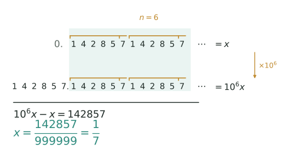

## 讲解

> 上下两行里青绿色底纹盖住的是同一段 $142857$，橙色横线标出循环节、共 $n=6$ 位；第二行就是把第一行的小数点右移 6 位，两式相减时这段无限长的小数部分整段抵消，只剩整数 $142857$，分母于是是 6 个 9。

**一句话**：循环小数写不完，但它的小数部分只是一个"循环节"在无限重复；用"乘 10 的幂、再相减"就能把这条无限长的尾巴整段消掉，剩下的分母一定是一串 9 后面接若干个 0。

### 一、模型与公式

小数部分从某一位起，一段数字依次不断重复，这样的数叫**循环小数**，重复的那组数字叫**循环节**，循环节的位数记作 $n$，写法是在循环节上加一条横线。循环节从十分位就开始的叫**纯循环小数**，如 $0.\overline{36}$；前面先有 $m$ 位不循环的数字、然后才进入循环的叫**混循环小数**，如 $0.25\overline{3}$。

设循环节对应的整数为 $N$（**允许以 0 开头**："07"记作 $N=7$，但它占 2 位），则

$$0.\overline{N}=\frac{N}{\underbrace{99\cdots9}_{n\text{个}}},\qquad 0.\underbrace{x_1\cdots x_m}_{m\text{位}}\overline{N}=\frac{(\text{不循环部分接上循环节})-(\text{不循环部分})}{\underbrace{99\cdots9}_{n\text{个}}\underbrace{00\cdots0}_{m\text{个}}}$$

一句话记法：**分母位数 $=n+m$，9 在前、0 在后；分子是"整体"减"不循环部分"。**

**最短的三条**（一位循环节、两位循环节、一位不循环），可直接套用：

$$0.\overline a=\frac a9,\qquad 0.\overline{ab}=\frac{\overline{ab}}{99},\qquad 0.a\overline{bc}=\frac{\overline{abc}-a}{990}$$

### 二、分母为什么是 9 和 0

设 $x=0.\overline{a_1a_2\cdots a_n}$。两边乘 $10^n$，小数点右移 $n$ 位，正好跳过一整个循环节：

$$10^n x=\underbrace{a_1a_2\cdots a_n}_{N}.\overline{a_1a_2\cdots a_n}=N+x$$

移项得 $(10^n-1)x=N$，即 $x=\dfrac{N}{10^n-1}$，分母恰好是 $n$ 个 9。混循环多一层：先乘 $10^m$ 把不循环部分顶到整数位，再乘 $10^n$，两式相减时小数部分完全抵消，分母自然多出 $m$ 个 0——所以 9 后面还要补 0，补几个由不循环位数决定。

反过来看：**先把分数约成最简分数**，再看分母的质因数。若最简分母只含质因数 2 和 5，得到有限小数；若最简分母还含有其他质因数，小数必定循环。注意不能直接看未约分的分母：例如 $3/6=1/2$，原分母含有质因数 3，但结果是有限小数。做长除法时余数只有有限多种，余数一旦重复，商就开始重复，所以循环节长度一定小于分母。例如 $\frac17$ 的循环节最多 6 位，实际正好 6 位。

还有一条更快的验算路线——**错位拆分**：混循环就是"不循环位 $+$ 纯循环"整体缩小 $10^m$ 倍，即 $0.a\overline{b}=\dfrac{a+0.\overline{b}}{10}$。如 $0.1\overline{36}=\dfrac{1+0.\overline{36}}{10}=\dfrac{1+\frac4{11}}{10}=\dfrac{15}{110}=\dfrac3{22}$。它不仅能秒算，还一眼看出分母为什么是 $10^m(10^n-1)$。

用公式前要守边界：**只对"从某一位起无限重复"的小数使用**；有限小数（如 $0.25$）不能硬套，直接写 $\frac14$；带整数部分的先拆成"整数 $+$ 纯小数"，别把整数部分也算进分子；循环节含 0 时按位补齐，$0.\overline{07}$ 与 $0.\overline{70}$ 是两个不同的数。

### 三、三个高级变形

1. **循环移位**：$0.\overline{ab}$ 与 $0.\overline{ba}$ 的分母都是 99，只是分子互换，比较大小可直接比分子。$\frac17=0.\overline{142857}$ 更妙：$142857\times2=285714$、$\times3=428571$……乘 $k$ 正好把循环节整体左移一位，六个移位对应 $\frac17\sim\frac67$。
2. **循环节叠加**：把 $n$ 位循环节的所有移位相加，每个数位上都恰好出现一次全部数字，和是 $\underbrace{11\cdots1}_{n\text{个}}\times$ 数字和，于是总和 $=\dfrac{\text{数字和}}{9}$（因为 $11\cdots1\times9=99\cdots9$）。三位循环节时就是 $\dfrac{a+b+c}{9}$。
3. **逆推筛数字**：题目给出"分子与分母之和""两个循环小数的差""约分后分母是 11"这类条件时，先把每个数化成分数（同分母的直接合并）、列出方程，再用"数字只能取 0–9、首位不为 0、数字和与 9 的整除关系"把候选筛到唯一。

### 四、竞赛视角

看到"循环节""化成分数""分子分母之和""两个循环小数的和或差"，就该想到**先化分数、再列方程**。纯循环先看循环节是否从十分位开始；混循环先数清 $m$ 和 $n$——循环节里的 0 也占位，$0.\overline{07}$ 是两位而不是一位。

这个专题站在"分数化小数、整除、数字谜"三者的交界处，最容易出竞赛题：分母 $7,11,13,27,37$ 与 $999999$、$999$ 的整除关系，是构造题的常用材料；数字和是不是 9 的倍数，是筛掉不可能答案的利器；"移位""轮换"则提供了不变量——分母不变、分子成比例。

### 易错点

1. **纯循环分母写成 90**：$0.\overline{36}$ 写成 $\frac{36}{90}$。正确：纯循环分母全是 9，$\frac{36}{99}=\frac{4}{11}$。
2. **混循环分子忘减不循环部分**：$0.25\overline{3}$ 写成 $\frac{253}{900}$。正确：分子是 $253-25=228$，$\frac{228}{900}=\frac{19}{75}$。
3. **补 0 的个数错**：$0.1\overline{36}$ 写成 $\frac{135}{900}$。正确：循环节 2 位、不循环 1 位，分母是 99 后接 **1** 个 0 即 990，$\frac{135}{990}=\frac{3}{22}$。
4. **循环节位数数错**：$0.\overline{07}$ 写成 $\frac79$。正确：循环节"07"占两位，$\frac7{99}$——分子写 7，分母仍写 99。
5. **不约分就当答案**：算出 $\frac{36}{99}$ 就停手。正确：约到最简 $\frac4{11}$，否则"分子分母之和"一类条件会整体算错。
6. **把 $0.\overline9$ 当成比 1 小**：套公式得 $\frac99=1$，它不是"差一点点"；方程法同样给出 $10x=9+x$，$x=1$。

## 竞赛真题中的考察

- **2024 秋·走美 第 1 题**：错位相减法（设元）（★）
- **2025 春·走美 第 12 题**：长除法找循环节＋周期定位（★★★）
- **2024 IHC 6 培训 第 5 题**：循环小数化分数（★★★）
- **2024 IHC 6 培训 第 9 题**：循环节周期定位（★★★★）
- **2025 IHC J-6 第 16 题**：2.0̇2̇5=401/198，通分得 11C+3B+2A=802，代 A=x,B=x+2,C=x+4 解方程（★★★★）
- **2024 IHC A-6 第 13 题**：循环小数化为(9p+r)/9后枚举数字（★★★★★）

> 完整题目与解答见仓库 `exam/answers/` 对应试卷文件；跨卷汇总见 `exam/SUMMARY.md`。

<!-- card:auto -->
## 速查卡

> 裁剪即用：本页对应速查卡「计算 09正」。下面是本节最紧的一版摘要，公式与结论与正文完全一致，用于做题前扫一遍。全套卡片见 `tools/cards/build/cards.html`。

**核心公式**

$$0.\overline{N}=\frac{N}{99\cdots9}$$

$$0.a\overline{b}=\frac{\overline{ab}-a}{90}$$

- 纯循环：分母是 $n$ 个 9，分子就是循环节
- 混循环：分母 $n$ 个 9 接 $m$ 个 0，9 在前 0 在后
- 分子 = 不循环部分接上循环节，再减不循环部分
- 循环节里的 0 要占位：$0.\overline{07}$ 是两位

**变形**

- 循环移位：分母相同只换分子，可直接比分子大小
- 逆推：先化分数列方程，再用数字范围与整除筛

> ✅ 识别信号：循环节、化成分数、分子分母之和
> ⚠️ 易错：混循环分子忘减不循环部分；纯循环分母不是 90
<!-- /card:auto -->

## 例题

### 例1：纯循环的循环移位与约分（★★）

**题目**：已知 $\frac17=0.\overline{142857}$。(1) 把 $0.\overline{285714}$ 与 $0.\overline{428571}$ 化成最简分数；(2) 观察 $142857\times2$、$142857\times3$ 的结果，说明为什么这两个最简分数的分母都是 7。

**覆盖点**：纯循环小数化分数与全9分母、循环节的移位与叠加

**解析**：

第一步，数循环节、写分母。两个小数的循环节"285714""428571"都是 6 位，且都从十分位开始，是纯循环，所以分母是 $10^6-1=999999$：

$$0.\overline{285714}=\frac{285714}{999999},\qquad 0.\overline{428571}=\frac{428571}{999999}$$

要对 $999999$ 一个个试除质因数来找公因数，又慢又容易错。**为什么想到借 $\frac17$？**因为题目白送了 $\frac17=0.\overline{142857}$，把它也写成分母 999999 的形式，就等于白送了一个公因数：$\frac17=\frac{142857}{999999}$，即 $999999=7\times142857$。

第二步，看分子与 142857 的关系：

$$142857\times2=285714,\qquad 142857\times3=428571$$

两个分子恰好是 142857 的 2 倍、3 倍。于是

$$0.\overline{285714}=\frac{2\times142857}{7\times142857}=\frac27,\qquad 0.\overline{428571}=\frac{3\times142857}{7\times142857}=\frac37$$

(2) 移位后的循环节正好是 142857 的整数倍，约分时"142857 这一整段"被同时约掉，所以分母只剩下 7。

验算：$2\div7=0.285714285\cdots=0.\overline{285714}$，$3\div7=0.428571428\cdots=0.\overline{428571}$，逐位吻合；又 $285714\times7=1999998=2\times999999$，$428571\times7=2999997=3\times999999$，说明约分正确。

**答案**：$0.\overline{285714}=\frac27$，$0.\overline{428571}=\frac37$

### 例2：混循环为什么补一个零（★★★）

**题目**：把 $2.1\overline{36}$ 化成最简分数，并求所得分数的分子与分母之和。

**覆盖点**：混循环小数化分数与补零分母

**解析**：为什么化混循环不套"循环节几位就写几个 $9$"的口诀，而先想清楚"该乘哪个 $10$ 的幂"？因为分母 $990$ 是两次移位相减的产物：哪几位不循环、循环节有几位，决定的是移位次数，而不是 $9$ 的个数。

第一步，拆开整数部分：$2.1\overline{36}=2+0.1\overline{36}$，只需处理小数部分，设 $x=0.1\overline{36}=0.13636\cdots$。

第二步，用两次"乘 10 的幂"把两条尾巴对齐。不循环部分"1"有 1 位，先乘 10：$10x=1.3636\cdots$；循环节"36"有 2 位，再乘 $10^2$：$1000x=136.3636\cdots$。**为什么乘 1000 而不是 100？**因为要让小数点后面出现**完全相同**的一串"$\cdots3636$"，相减才能把它整段消掉；乘 100 只能得到 $13.636\cdots$，小数点后一位仍是"6"，对不齐。

第三步，相减：

$$1000x-10x=136.3636\cdots-1.3636\cdots=135,\qquad 990x=135$$

$$x=\frac{135}{990}=\frac{3}{22}\quad(\text{分子、分母同除以 }45)$$

分母 990 的结构正好是"2 个 9 接 1 个 0"：循环节 2 位给 99，不循环 1 位再补 1 个 0。

第四步，合并整数部分：$2+\frac{3}{22}=\frac{47}{22}$，分子与分母之和为 $47+22=69$。

验算：$47\div22=2.1363636\cdots=2.1\overline{36}$，逐位吻合；又 $45\times3=135$、$45\times22=990$，约分无误；$3\div22=0.13636\cdots$，与 $x$ 一致。

**答案**：$\frac{47}{22}$，分子与分母之和为 $69$

### 例3：三个循环移位的小数之和（★★★★）

**题目**：设 $\overline{abc}$ 是三位数（$a\neq0$），记 $x=0.\overline{abc}$，$y=0.\overline{bca}$，$z=0.\overline{cab}$（循环节允许以 0 开头，如 $\overline{bca}=081$ 就按 81 计算）。(1) 用 $a+b+c$ 表示 $x+y+z$，并求 $a+b+c=12$ 时它的值；(2) 若 $a,b,c$ 互不相同，且 $x+y+z$ 是整数，要使 $\overline{abc}$ 尽量小，求 $\overline{abc}$。

**覆盖点**：循环节的移位与叠加、循环小数的逆推与条件筛选

**解析**：

(1) **为什么先统一分母？**三个数都是三位循环节，分母同为 999，一个个化成分数再通分会做三次约分，直接同分母相加最省。于是

$$x+y+z=\frac{\overline{abc}+\overline{bca}+\overline{cab}}{999}$$

关键是算分子。把三个三位数按数位拆开：$\overline{abc}=100a+10b+c$，$\overline{bca}=100b+10c+a$，$\overline{cab}=100c+10a+b$。相加时 $a$、$b$、$c$ 各在百位、十位、个位出现一次，所以

$$\overline{abc}+\overline{bca}+\overline{cab}=(100+10+1)(a+b+c)=111(a+b+c)$$

$$\Longrightarrow\quad x+y+z=\frac{111(a+b+c)}{999}=\frac{a+b+c}{9}$$

$a+b+c=12$ 时，$x+y+z=\frac{12}{9}=\frac43$。

(2) 和为整数，即 $\frac{a+b+c}{9}$ 为整数，所以 $a+b+c$ 是 9 的倍数。数字和最小 $1+0+0=1$、最大 $9+9+9=27$，只可能是 $9,18,27$；互不相同则 27 做不到（只能是 $9+9+9$），故 $a+b+c$ 为 9 或 18。

要让 $\overline{abc}$ 最小，先让 $a$ 最小：$a=1$；再让 $b$ 最小：$b=0$。若数字和为 9，则 $c=8$，得 $108$；若数字和为 18，则 $c=17$，不可能。候选只有 $108$，且 $1,0,8$ 互不相同。

还要排除更小的数：$a=1,b=0,c<8$ 时数字和小于 9，不可能是 9 的倍数，更不可能是 18 或 27；$a=0$ 又不是三位数。所以 $108$ 确实最小。

验算：$108+81+810=999$，$\frac{999}{999}=1$ 是整数；而 $0.\overline{107}$ 的和为 $\frac{107+71+710}{999}=\frac{888}{999}=\frac89$，不是整数，说明筛选条件有效。

**答案**：$x+y+z=\dfrac{a+b+c}{9}$，$a+b+c=12$ 时为 $\frac43$；(2) $\overline{abc}=108$

### 例4：差与分母条件锁定循环节（★★★★★）

**题目**：设 $a,b$ 是数字，$a\neq0$。已知

$$0.\overline{ab}-0.a\overline{b}=\frac1{330},$$

且 $0.\overline{ab}$ 化成最简分数后分母是 11。求两位数 $\overline{ab}$。

**覆盖点**：循环小数的逆推与条件筛选

**解析**：

第一步，**为什么想到先化成分数？**题给的是两个循环小数的差，不化成分数根本无法动笔；化完之后"差"就变成一个只含 $a,b$ 的方程，通分一次就能合并。记 $u=10a+b$，则

$$0.\overline{ab}=\frac{u}{99},\qquad 0.a\overline{b}=\frac{(10a+b)-a}{90}=\frac{9a+b}{90}$$

混循环的分子为什么是 $9a+b$？因为"不循环部分接上循环节"拼成的是两位数 $u=10a+b$，再减去不循环部分 $a$；分母是 1 个 9 接 1 个 0。这一步容易写错成减去 $10a$，要盯住"不循环部分只有一位"。

第二步，作差并合并：

$$\frac{u}{99}-\frac{9a+b}{90}=\frac{10u-11(9a+b)}{990}=\frac{10(10a+b)-99a-11b}{990}=\frac{a-b}{990}$$

**这是全题的转折点**：一串含 $a,b$ 的式子，化简后只剩 $a-b$。由 $\frac{a-b}{990}=\frac1{330}=\frac{3}{990}$ 得

$$a-b=3\quad\Longrightarrow\quad a=b+3.$$

第三步，用"分母是 11"继续筛。$0.\overline{ab}=\frac{u}{99}=\frac{u}{9\times11}$，约分后分母为 11，说明 $u$ 与 99 约掉了因子 9，特别地 $9\mid u$。而 $u=10a+b$ 除以 9 的余数与 $a+b$ 相同（$10a+b=9a+(a+b)$），所以 $9\mid(a+b)$。

第四步，分类讨论。由 $a=b+3\le9$ 得 $b\le6$，于是 $a+b=2b+3$ 是 $3$ 到 $15$ 之间的奇数：$3,5,7,9,11,13,15$。其中 9 的倍数只有 9，故 $2b+3=9$，$b=3$，$a=6$。

第五步，检查"分母恰为 11"而不只是"被 9 整除"：$\frac{63}{99}=\frac7{11}$，分母确实是 11（若 $u$ 同时被 11 整除，则 $99\mid u$，只能 $u=99$，约成 $1$，分母是 1 而不是 11；$63$ 不被 11 整除，合格）。

验算：$\frac7{11}=0.636363\cdots$，$0.6\overline3=\frac{63-6}{90}=\frac{57}{90}=\frac{19}{30}=0.6333\cdots$，两数相减

$$\frac7{11}-\frac{19}{30}=\frac{210-209}{330}=\frac1{330},$$

与题设完全一致，且 $u=63$ 使 $0.\overline{63}$ 的分母恰为 11。

**答案**：$\overline{ab}=63$

## 变式与自测

> 四道题按「模仿 → 变式 → 综合 → 自测」排。先盖住答案自己做，做完再对；对不上，多半是分母的 9 的个数数错了，或者忘了约分。

### 变式1：两位纯循环，9 也写两个（★）

**题目**：把 $0.\overline{45}$ 与 $0.\overline{54}$ 化成最简分数，并求这两个分数的和。

**覆盖点**：纯循环小数化分数与全9分母

**解析**：纯循环的分母由 $9$ 组成，循环节有几位就写几个 $9$——两位循环节，分母是 $99$，分子直接抄循环节。化完别忘约分。

$$0.\overline{45}=\frac{45}{99}=\frac{5}{11},\qquad 0.\overline{54}=\frac{54}{99}=\frac{6}{11},$$

两者之和 $=\dfrac{5}{11}+\dfrac{6}{11}=1$。这个"加起来正好是 1"不是巧合：$\overline{45}+\overline{54}=99$，而分母也正好是 $99$。

**答案**：$0.\overline{45}=\dfrac{5}{11}$，$0.\overline{54}=\dfrac{6}{11}$，和为 $1$。

### 变式2：混循环，零的个数看"不循环的那几位"（★★★）

**题目**：把 $1.2\overline{7}$ 化成最简分数。

**覆盖点**：混循环小数化分数与补零分母

**解析**：混循环的分母由"先补零、再补 9"拼成——**补几个零看不循环的数字有几位，补几个 9 看循环节有几位**。若用"整体减小数点前部分"的老办法也可以，两条路结果相同。

$$1.2\overline{7}=\frac{127-12}{90}=\frac{115}{90}=\frac{23}{18}.$$

自检：$\dfrac{23}{18}=1.2\overline{7}$，因为 $\dfrac{5}{18}=0.2\overline{7}$（$18\times0.2777\cdots=5$）成立。

**答案**：$\dfrac{23}{18}$

### 变式3：分母同为 99，化和后借等差数列（★★★★）

**题目**：计算 $0.\overline{12}+0.\overline{24}+0.\overline{36}+\cdots+0.\overline{96}$。（本题把本篇的循环节化分数与「等差数列」篇的求和串起来）

**覆盖点**：循环节的移位与叠加

**解析**：八个加数都是两位循环节，分母统一是 $99$，所以**先统一化成分数再相加**，不要去逐个求小数近似值。化完分母相同，分子恰好成等差数列，一步求和即可。

$$\text{原式}=\frac{12+24+36+\cdots+96}{99}.$$

分子是首项 $12$、公差 $12$、共 $8$ 项的等差数列：

$$12+24+\cdots+96=\frac{(12+96)\times8}{2}=432,$$

$$\text{原式}=\frac{432}{99}=\frac{48}{11}.$$

**答案**：$\dfrac{48}{11}$

### 自测：逆推循环节，再数符合条件的两位数（★★★）

**题目**：设 $\overline{ab}$ 是两位数（$a\neq0$）。(1) 若 $0.\overline{ab}=\dfrac{5}{11}$，求 $\overline{ab}$；(2) 若 $0.\overline{ab}$ 化成最简分数后分母恰好是 $11$，这样的两位数 $\overline{ab}$ 共有多少个？

**覆盖点**：循环小数的逆推与条件筛选

**解析**：两位纯循环的分母固定是 $99$，所以 $0.\overline{ab}=\dfrac{\overline{ab}}{99}$ 是唯一入口，把方程反解出来即可。(2) 问要求"约分后分母是 $11$"，等价于 $99$ 约掉了因子 $9$，也就是分子必须是 $9$ 的倍数；但还要把"约成整数"的那种排除掉。

(1) $\dfrac{\overline{ab}}{99}=\dfrac{5}{11}\Rightarrow\overline{ab}=\dfrac{99\times5}{11}=45$。

(2) 设 $\overline{ab}=9m$，则 $\dfrac{9m}{99}=\dfrac{m}{11}$，只要 $11\nmid m$ 分母就还是 $11$。$m=1,2,\cdots,11$，其中 $m=11$ 时 $\overline{ab}=99$ 化成 $1$、分母为 $1$，要剔掉；$m=1$ 时 $\overline{ab}=09$ 不是两位数（$a\neq0$），也要剔掉。剩下 $m=2,3,\cdots,10$ 共 $9$ 个。

回代验算：$m=2$ 得 $\overline{ab}=18$，$\dfrac{18}{99}=\dfrac{2}{11}$ ✓；$m=10$ 得 $\overline{ab}=90$，$\dfrac{90}{99}=\dfrac{10}{11}$ ✓，两端都对得上。

**答案**：(1) $\overline{ab}=45$；(2) $9$ 个。
