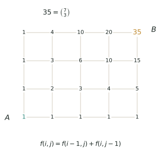

## 讲解

> 起点 $A$ 标 1，其余每点的数都等于"左边一格 $+$ 下面一格"，斜着看正是杨辉三角；向右 4 格、向上 3 格的终点 $B$ 上写着 35，与 $\binom{7}{3}$ 相等。图里每个数都只由它的两个前驱决定，这就是 $f(i,j)=f(i-1,j)+f(i,j-1)$ 的实物版。

### 一、模型：把"数路"换成"数点"

标数法处理这样一类计数：一张网格状（或街道状）的图，从起点 $A$ 走到终点 $B$，基本模型中每一步只向右或向上走一个单位格，绝不后退，问共有多少种走法。若额外允许斜走或跨格跳步，必须把新增的前驱点一并计入，不能直接套用普通矩形公式。

它不一条一条数路，而是给每个路口写一个数：**从 $A$ 走到这个路口共有几条路**。起点写 $1$，其余各点照"前驱之和"逐个填，填到 $B$，$B$ 上的数就是答案。

能用标数法的题，一定满足三条：

1. 基本模型每步向右或向上一个单位格；若允许其他步法，递推前驱随规则改变；
2. 到某点的路，只能由"前驱"接上最后一步得到，前驱之间不重叠、也不遗漏；
3. 终点是一个点，或是能分段、分类处理的几个点。

于是核心只有一句：$f(P)=\sum f(\text{前驱})$。矩形网格上就是 $f(i,j)=f(i-1,j)+f(i,j-1)$。

### 二、为什么是"左加下"

走到 $P$ 的最后一步只有两种：从左边一格向右跨进来，或从下面一格向上跨进来。两者的"最后一步"不同，必是不同的路，这是**互斥**；而任何一条到 $P$ 的路，最后一步必是其中之一，这是**完备**。按加法原理，两类相加就是 $P$ 的数。

最下一行只能一路向右，最左一列只能一路向上，各只有一种走法，所以整行整列都标 $1$。其余点从近到远填，斜着看正是杨辉三角。

若从 $A$ 到 $B$ 要向右 $m$ 格、向上 $n$ 格，每条路都是 $m+n$ 步，其中恰有 $n$ 步向上；选定了哪 $n$ 步向上，路就唯一确定，故

$$N=\binom{m+n}{n}.$$

例如向右 $4$、向上 $3$：标数表末行是 $1,4,10,20,35$，得 $35$；公式 $\binom73=35$，两条路一致。注意公式里的 $m,n$ 是**步数**，不是格点数。

### 三、三个高级变形

**变形 1：前驱不止两个。** 允许"向右上斜走一格"时，最后一步有三种来源，递推改为 $f(i,j)=f(i-1,j)+f(i,j-1)+f(i-1,j-1)$。表照样填，只是每格加三个数；这类题还可以用"按斜走次数分类"独立验算。

**变形 2：挖点与封路。** 某路口不能走，就把它标 $0$——它的数传下去自然是 $0$，经过它的路自动被扣掉，比"总数减经过它的"更省心。用补集法时必须先判断两个障碍点**谁先在谁后**：若 $C$ 在 $D$ 的左下方（从 $C$ 能走到 $D$），一条路可能同时经过两点，相减后要加回重叠；若两点"一左上一右下"，谁也到不了谁，直接相减即可。

**变形 3：禁区、必经与关卡。** "不越过某条线"是整片禁区，把禁区里的点全标 $0$，边界上的点照常参与。"必须经过 $P$"就分段相乘：$A\to P$ 的路数乘 $P\to B$ 的路数。"必须经过两个关卡中的至少一个"是并集，用 $|G_1|+|G_2|-|G_1\cap G_2|$，中间那段同样查表读出。

### 四、竞赛视角

看到"只能向右、向上""最短路线""街道图""不越过""不能经过""至少经过一个"，就该想到标数。它与排列组合最容易混：$\binom{m+n}{n}$ 只认"$m$ 右 $n$ 上"的干净矩形，一有禁区、必经点、斜走，公式立刻失效。与容斥的区别是：标数把"排除"写进表里，容斥把"排除"写成加减，两者可以互相验算，这正是检查答案的好办法。难题的突破口通常是"最后一步"或"第一次碰到某条线"，据此把路分成互斥的几类，再在类内分段相乘。

### 五、易错点

1. **把格数当步数**：$4\times3$ 的方格算成 $12$ 步或 $7$ 个格点。正确：右 $4$ 上 $3$ 共 $7$ 步，$\binom73=35$。
2. **漏加前驱**：内部点只抄左边的数。正确：左、下（有斜走时再加左下）逐个相加，少一个前驱就少一批路。
3. **障碍点空着不标**：后面的点照旧相加，把经过障碍的路又数了回来。正确：障碍点写 $0$。
4. **两个障碍不判先后就减**：若两点可比，直接相减会把"同时经过两点"的路减两次。正确：先比坐标定先后，可比才加回重叠。
5. **越线点忘标 $0$**：只把"明显过界"的点标 $0$，漏掉整片禁区，答案偏大。正确：先把禁区一次标完再填表。
6. **"至少一个"直接相加**：两站都经过的路被数了两次。正确：减去交集。
7. **分段相乘用错段**：把 $P\to B$ 的步数当成 $A\to B$ 的。正确：每段都重新数横向、纵向格数。

## 竞赛真题中的考察

> 本库题库尚无与本节模型完全对应的真题，下列实引均标注卷次，未标卷次的为同类题型描述，不作真题出处引用。

- **同类题型**：矩形网格里从左下到右上，每次只向右或向上，途中若干指定格不通——先把不通格的标数记 $0$，其余照 $f(i,j)=f(i-1,j)+f(i,j-1)$ 逐格累加；问"必过某点"就拆成两段相乘再相加，问"不经过某点"就用总数减去经过它的（★★）
- **2026 春·走美 第 7 题**：中心对称⇒第6步必到网格中心，前6步决定全路，C(6,3)（★★★）
- **2026 IHC S-6 第 19 题**：步长1/2枚举路径和（★★★★★）

> 完整题目与解答见仓库 `exam/answers/` 对应试卷文件；跨卷汇总见 `exam/SUMMARY.md`。

<!-- card:auto -->
## 速查卡

> 裁剪即用：本页对应速查卡「计数 23正」。下面是本节最紧的一版摘要，公式与结论与正文完全一致，用于做题前扫一遍。全套卡片见 `tools/cards/build/cards.html`。

**模型**

- 每步只让坐标增加；起点标 $1$，其余各点填"前驱之和"

$$f(i,j)=f(i-1,j)+f(i,j-1)$$

- 矩形网格：向右 $m$ 格、向上 $n$ 格，最短路条数为

$$\binom{m+n}{n}$$

**变形**

- 允许斜走时多加一个前驱，再补上左下那个数
- 障碍点标 $0$；整片禁区的点全标 $0$，边界上的照常
- 必经 $P$：分段相乘，两段各自重新数横竖格数
- 两个障碍先比坐标定先后，可比才加回重叠的部分
- 至少经过一站是并集：两站相加再减去交集

> ✅ 识别信号：只能向右或向上、最短路线、不越过、必经
> ⚠️ 易错：把格数当步数；障碍点空着不标 $0$
<!-- /card:auto -->

## 例题

### 例1：允许斜走一格的走法（★★）

**题目**：在方格纸上，从 $A$ 到 $B$ 要向右 $3$ 格、向上 $2$ 格。每步只能向右走一格、向上走一格，或向右上斜走一格（不能向左、向下）。从 $A$ 到 $B$ 共有多少种走法？

**覆盖点**：三向标数与分类验算

**解析**：为什么想到标数？先问"最后一步从哪儿来"。斜走一步同时吃掉"右一格 $+$ 上一格"，于是到某点的最后一步有三种来源：左边、下边、左下。前驱由两个变成三个，但"前驱之和"的道理没变，表里每格加三个数即可——这正是标数法比公式强的地方，公式给不出三向的答案，表却能照填。

第一步，建表。最下一行 $j=0$ 与最左一列 $i=0$ 各只有一种走法，标 $1$；内部按 $f(i,j)=f(i-1,j)+f(i,j-1)+f(i-1,j-1)$ 从近到远填：

- 第二行：$f(1,1)=1+1+1=3$，$f(2,1)=3+1+1=5$，$f(3,1)=5+1+1=7$；
- 第三行：$f(1,2)=1+3+1=5$，$f(2,2)=5+5+3=13$，$f(3,2)=13+7+5=25$。

$$\begin{array}{cccc}1&5&13&25\\1&3&5&7\\1&1&1&1\end{array}$$

终点 $B$ 上读得 $25$。

第二步，换一条路验算（按斜走次数分类）。设斜走 $k$ 次，则还要向右 $3-k$ 次、向上 $2-k$ 次，总步数 $5-k$，故 $k$ 只能取 $0,1,2$：

- $k=0$：$5$ 步中选 $2$ 步向上，$\binom52=10$；
- $k=1$：共 $4$ 步，先给斜走选位置 $\binom41=4$，再从余下 $3$ 步中选 $2$ 步向右 $\binom32=3$，$4\times3=12$；
- $k=2$：共 $3$ 步，先给斜走选位置 $\binom32=3$，余下 $1$ 步只能向右，$3\times1=3$。

合计 $10+12+3=25$，与表完全一致。

第三步，对称性检查：把"右 $1$ 上 $2$"与"右 $2$ 上 $1$"对调，走法数应相等。表中 $f(1,2)=f(2,1)=5$，$f(1,1)=3$ 也自对称，说明填表没有串位。

**答案**：$25$ 种

### 例2：两处施工路口的走法（★★★）

**题目**：街道图从 $A(0,0)$ 到 $B(6,4)$，只能向右或向上。路口 $C(1,2)$ 与 $D(4,1)$ 同时施工封闭。从 $A$ 到 $B$ 的最短路径有多少条？

**覆盖点**：障碍点排除与先后判断

**解析**：为什么先想补集？两个封闭点意味着每一条"干净"的路径都要单独研究，正面数太碎；而"经过某点的路径"恰好是两段相乘，很好算。但相减之前必须先回答一个问题：有没有一条路**同时**经过 $C$ 和 $D$？若有，这些路会被减两次，得加回来；若没有，直接相减就对。判断办法就是比坐标——这是本题真正的考点。

第一步，比 $C$、$D$ 的先后。$C(1,2)$ 在 $D(4,1)$ 的左边，却在 $D$ 的上边：从 $C$ 到 $D$ 要"向右 $3$、向下 $1$"，向下被禁止；从 $D$ 到 $C$ 要"向左 $3$、向上 $1$"，向左被禁止。所以谁也到不了谁，**没有一条路同时经过 $C$、$D$**，两批路互不重叠，不必加回。

第二步，总数：右 $6$ 上 $4$ 共 $10$ 步，$\binom{10}{4}=210$。

第三步，经过 $C$ 的：$A\to C$ 右 $1$ 上 $2$，$\binom32=3$ 条；$C\to B$ 右 $5$ 上 $2$，$\binom72=21$ 条；$3\times21=63$ 条。

第四步，经过 $D$ 的：$A\to D$ 右 $4$ 上 $1$，$\binom51=5$ 条；$D\to B$ 右 $2$ 上 $3$，$\binom53=10$ 条；$5\times10=50$ 条。

第五步，$210-63-50=97$。

验算（标零表）：把 $C$、$D$ 写 $0$ 后逐点填，$j=4$ 行得 $1,2,6,17,35,61,97$，终点 $97$，与补集一致。再从表上抽查：$j=2$ 行是 $1,0,3,7,7,8,10$，$C$ 处的 $0$ 确实把它左边的数截断了；$j=1$ 行是 $1,2,3,4,0,1,2$，$D$ 右边只剩 $1,2$ 两条，说明封闭确实生效。

**答案**：$97$ 条

### 例3：不越过对角线的走法（★★★★）

**题目**：从 $A(0,0)$ 到 $B(5,5)$，只能向右或向上，且路径上任何一点都不许越过直线 $y=x$（可以在对角线上走）。共有多少条这样的路径？

**覆盖点**：边界约束与越线标零

**解析**：为什么不能套公式？$\binom{10}{5}$ 默认整个矩形都畅通，而这里多了"不许越线"的边界，公式立刻失效。边界是整片禁区，标数法的处理最干脆：到不了的点标 $0$，能到的点照常相加。

第一步，圈出禁区。点 $(i,j)$ 越线就是 $j>i$（向上比向右多走了）。这些点全部标 $0$；对角线上的 $(k,k)$ 允许经过，不能标 $0$——这是最容易错的一处。

第二步，填表（每行 $j=5\to0$，每列 $i=0\to5$）：

$$\begin{array}{cccccc}0&0&0&0&0&42\\0&0&0&0&14&42\\0&0&0&5&14&28\\0&0&2&5&9&14\\0&1&2&3&4&5\\1&1&1&1&1&1\end{array}$$

终点读得 $42$。

第三步，验算（按"第一次碰到对角线"分类）。把不越线的路按第一次回到对角线的位置 $(k,k)$ 分成五类（$k=1,2,3,4,5$）。

先看 $A$ 到 $(k,k)$ 这一段：它走出 $A$ 的第一步必是向右，最后一步必是向上——否则会先经过 $(0,1)$ 或 $(k-1,k)$ 这类对角线**上方**的点。把这两步去掉，再将中间路径整体向左平移一格，得到从 $A$ 到 $(k-1,k-1)$ 的不越线走法，共 $a_{k-1}$ 条（反过来，任取一条这样的走法，前面接"右"、后面接"上"，就唯一还原）。而 $(k,k)$ 到 $B$ 这一段整体平移后，同样是 $5-k$ 阶的不越线问题，有 $a_{5-k}$ 条。于是

$$a_5=a_0a_4+a_1a_3+a_2a_2+a_3a_1+a_4a_0 .$$

表中读出 $a_0=1$、$a_1=1$、$a_2=2$、$a_3=5$、$a_4=14$，代入得

$$1\times14+1\times5+2\times2+5\times1+14\times1=42,$$

与表一致。

第四步，合理性检查：不设限制有 $\binom{10}{5}=252$ 条，不越线要少得多，$42$ 约为它的六分之一，数量级合理；再顺着表看 $f(1,1)=1$、$f(2,2)=2$、$f(3,3)=5$、$f(4,4)=14$、$f(5,5)=42$，正是一串 $1,1,2,5,14,42$，没有跳档，说明填表无误。

**答案**：$42$ 条

### 例4：两个检查站与一处封闭路口（★★★★★）

**题目**：街道图从 $A(0,0)$ 到 $B(5,5)$，只能向右或向上。快递员必须经过两个检查站 $G_1(2,1)$、$G_2(4,3)$ 中的至少一个，而路口 $X(3,3)$ 封闭。这样的最短路径共有多少条？

**覆盖点**：检查站并集与容斥扣除

**解析**：为什么先做表再算？三个条件套在一起："封闭"是点的限制，最省事的是标 $0$；"至少一个"是并集，要用"两站相加再减交集"。麻烦在于封闭点破坏了矩形，任何一段都不能再用干净矩形的公式——所以先把两张表做出来，让每一段都从表上读，最后才做容斥。

第一步，做两张表。前向表 $f$：从 $A$ 到各点（$X$ 标 $0$）；后向表 $g$：从各点到 $B$（同样避开 $X$）。两表都按 $j=5$ 在最上、$j=0$ 在最下排列：

$$f:\ \begin{array}{cccccc}1&6&21&36&66&132\\1&5&15&15&30&66\\1&4&10&0&15&36\\1&3&6&10&15&21\\1&2&3&4&5&6\\1&1&1&1&1&1\end{array}\qquad g:\ \begin{array}{cccccc}1&1&1&1&1&1\\6&5&4&3&2&1\\15&9&4&0&3&1\\32&17&8&4&4&1\\66&34&17&9&5&1\\132&66&32&15&6&1\end{array}$$

第二步，读单站数据。$G_1$：$f(2,1)=3$，$g(2,1)=17$，得 $3\times17=51$ 条；$G_2$：$f(4,3)=15$，$g(4,3)=3$，得 $15\times3=45$ 条。

第三步，读"两站都经过"。$A\to G_1$ 有 $3$ 条，$G_2\to B$ 有 $3$ 条，中间 $G_1\to G_2$ 共 $\binom42=6$ 条；其中经过 $X$ 的有 $3$ 条（$G_1\to X$ 有 $\binom32=3$ 条，$X\to G_2$ 只能向右一格），合法中间段只有 $6-3=3$ 条。故

$$|G_1\cap G_2|=3\times3\times3=27 .$$

第四步，并集：$51+45-27=69$。

验算（绕开封闭点另算一遍）：先不管 $X$，$|G_1|=3\times35=105$，$|G_2|=35\times3=105$，$|G_1\cap G_2|=3\times6\times3=54$，并集 $105+105-54=156$。再数其中经过 $X$ 的：经过 $X$ 与 $G_1$ 的 $3\times3\times6=54$ 条，经过 $X$ 与 $G_2$ 的 $20\times1\times3=60$ 条，三处都过的 $3\times3\times1\times3=27$ 条，故并集中经过 $X$ 的有 $54+60-27=87$ 条。于是 $156-87=69$，与查表结果一致。再核对：避开 $X$ 的路共 $132$ 条，其中过检查站 $69$ 条，两站都不经过的 $132-69=63$ 条，数目闭合。

**答案**：$69$ 条

## 变式与自测

> 四道题按「模仿 → 变式 → 综合 → 自测」排。先盖住答案自己做，做完再对；对不上，多半是标数式少加了一项——先数清"这个点能由哪几个点一步走来"，再写递推。

### 变式1：允许斜走一格的走法（★★）

**题目**：在 $2\times2$ 的方格中，从 $A$ 走到 $B$，每步可向右一格、向上一格或向右上斜走一格，共有多少种走法？

**覆盖点**：三向标数与分类验算

**解析**：为什么标数式要改？因为斜走让每个点多了一个来源，来源有三类就必须加三项。$f(i,j)=f(i-1,j)+f(i,j-1)+f(i-1,j-1)$，第一行与第一列因斜走也能到，全部填 $1$；逐格填得 $f(1,1)=3$、$f(1,2)=5$、$f(2,1)=5$、$f(2,2)=5+5+3=13$。

**答案**：$13$ 条

### 变式2：中间一格不能通过（★★★）

**题目**：在 $4\times4$ 的方格网中，从 $A$ 走到 $B$（向右 $4$ 格、向上 $4$ 格），途中的点 $P$（向右 $2$、向上 $2$ 处）不能通过，最短路线共有多少条？

**覆盖点**：障碍点排除与先后判断

**解析**：为什么可以直接相减？因为"经过 $P$"这一件事能被拆成互不重叠的两段，数得清楚，减法就比逐个标零省力。全部 $\mathrm{C}_8^4=70$ 条；经过 $P$ 的 $\mathrm{C}_4^2\times\mathrm{C}_4^2=6\times6=36$ 条。$$70-36=34.$$

**答案**：$34$ 条

### 变式3：必经两站之一（★★★★，串「容斥原理」）

**题目**：在 $4\times4$ 的方格网中，从 $A$ 到 $B$，要求经过 $M$（向右 $1$、向上 $1$ 处）或经过 $P$（向右 $2$、向上 $2$ 处），最短路线共有多少条？

**覆盖点**：检查站并集与容斥扣除

**解析**：为什么不能把两个数直接相加？因为存在同时经过 $M$ 和 $P$ 的路线，相加会把它们数两遍。过 $M$：$\mathrm{C}_2^1\times\mathrm{C}_6^3=2\times20=40$；过 $P$：$6\times6=36$；两个都过：$\mathrm{C}_2^1\times\mathrm{C}_2^1\times\mathrm{C}_4^2=2\times2\times6=24$。$$40+36-24=52.$$

**答案**：$52$ 条

### 自测：不许越过对角线（★★★）

**题目**：在 $3\times3$ 的方格网中，从 $A$ 走到 $B$（向右 $3$ 格、向上 $3$ 格），只许向右或向上，且全程"向右的步数不少于向上的步数"，最短路线共有多少条？

**覆盖点**：边界约束与越线标零

**解析**：为什么把越线的点直接标 $0$？因为一旦越过对角线，后面无论怎么走都还是越线，这一整枝都作废——标 $0$ 等于整枝剪掉，比事后扣除更省事。这就是第 $3$ 个卡特兰数：$$\frac{1}{3+1}\mathrm{C}_6^3=\frac{20}{4}=5.$$ 回代：全部 $\mathrm{C}_6^3=20$ 条，越线的 $15$ 条，$20-15=5$ ✓。

**答案**：$5$ 条

