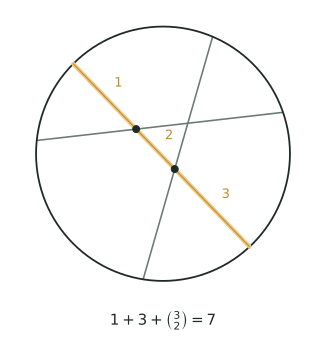

## 讲解

> 两根灰弦先画好，橙色的是最后画上去的第 3 条；它与前两条各交于一个黑点，被切成标着 1、2、3 的三段。每段都从某一块区域内部穿过、把它一分为二，所以新增的块数等于段数 3，而不是交点数 2——"新增量 $=$ 圆内交点数 $+1$"这句话，图上一目了然。

**模型与定义**

圆内画 $n$ 条直线，每条直线与圆交于两点，落在圆内的部分是一条弦。称这 $n$ 条直线处于**一般位置**：任意两条都在圆内相交，任意三条不共点。此时圆被分成的块数最多，记为 $R(n)$，并约定 $R(0)=1$（一条线也没画时，整个圆算 $1$ 块）。

这里的"直线"指横穿圆面的整条直线，圆内部分才是参与分割的弦。若两条直线的交点落在圆外，这个交点对圆内分割毫无作用，所以本专题公式里的"交点"一律指**圆内交点**。另外，"最多"不是自动成立的：一般位置可以用"先画一条、再逐条微调"的办法摆出来，公式给出的上界确实能取到。

要害不在"一共画了几条"，而在**每画一条，它被已有的直线切成几段**。一条新直线若在圆内被切成 $t$ 段，每一段都从某一块区域内部穿过，把那一块一分为二，于是恰好多出 $t$ 块。抓住这个"新增量"，分区问题就变成一道加法题。

**推导**

第 $n$ 条直线与前 $n-1$ 条各交于一点。一般位置保证这 $n-1$ 个交点互不重合、且都在圆内，于是它被切成 $n$ 段，多出 $n$ 块：

$$R(n)-R(n-1)=n,\qquad R(0)=1 .$$

从 $1$ 累加到 $n$：

$$R(n)=1+(1+2+\cdots+n)=1+\frac{n(n+1)}2 .$$

为什么可以逐条累加而不重不漏？每加一条线，只改动它穿过的那几块，其余块原封不动；它被切成 $t$ 段，就恰好穿过 $t$ 块，每块一分为二，净增 $t$ 块。换一种添加顺序仍得同一个总数，说明 $R(n)$ 只由位置关系决定，与画线次序无关。

再换一个"算贡献"的角度，这个角度在平行、共点时更管用。设某个圆内交点 $p$ 上有 $k_p$ 条直线通过。逐条添加直线时，$p$ 只在第 $2,3,\dots,k_p$ 条经过它的直线画上去时，各被算作一个"新交点"，共贡献 $k_p-1$ 段。于是

$$R(n)=1+n+\sum_p (k_p-1).$$

一般位置下每个交点只有两条线，$k_p=2$，$\sum(k_p-1)$ 就是交点数 $\binom n2$，得到第二张面孔：

$$R(n)=1+n+\binom n2 .$$

两张面孔其实是一回事：$1+n+\frac{n(n-1)}2=1+\frac{n(n+1)}2$。

把"新增量"的思路原样搬到圆上：若各圆两两交于两个不同点且没有三圆共点，第 $k$ 个圆与前 $k-1$ 个圆交于 $2(k-1)$ 个不同点，被切成 $2(k-1)$ 段，也就新增 $2(k-1)$ 块；从 $1$ 个圆的 $2$ 块（圆内、圆外）起累加，得 $n$ 个圆最多把平面分成

$$2+n(n-1)$$

个部分。可见分圆与分线的差别只在"每加一个图形能产生几个新交点"上：直线是 $1$ 个，圆是 $2(k-1)$ 个。

**三个高级变形**

其一，恰有 $k$ 条直线互相平行，且其余交点均在圆内并为简单交点。它们之间没有交点，比一般位置少 $\binom k2$ 个"简单交点"，每个简单交点贡献 $1$ 块，所以

$$R=1+n+\binom n2-\binom k2 .$$

其二，恰有 $k$ 条直线交于同一点，且除此之外其余交点均在圆内并为简单交点。原本 $\binom k2$ 个简单交点贡献 $\binom k2$，如今合并成一个点，贡献只有 $k-1$，损失

$$\binom k2-(k-1)=\frac{(k-1)(k-2)}2 .$$

所以"少了几个交点"绝不等于"少了几块"：$4$ 条线共点少 $5$ 个交点，却只少 $3$ 块。其三，圆周上取 $m$ 个点两两连弦。弦有 $\binom m2$ 条；圆内每个交点由 $4$ 个端点唯一确定（凸四边形的两条对角线），故交点数为 $\binom m4$；在没有三条弦共点时

$$R=1+\binom m2+\binom m4 .$$

以 $10$ 个点为例，$1+45+210=256$，比同样多的直线分出的块数大得多。

**竞赛视角**

信号很固定：看到"最多分成几块""任意两条都相交""没有三条共点"，先认一般位置，直接写 $1+\frac{n(n+1)}2$；看到"其中几条平行""几条共点""交点在圆外"，先按最大算，再按贡献往下扣。反求条数时，把目标块数夹在两个相邻三角数之间，再因式分解 $n(n+1)=2(\text{块数}-1)$。规范步骤是：判位置、数圆内交点（按重数）、写贡献和、用小情形回代。还要分清"圆内"与"整个平面"：同样 $n$ 条一般位置直线，在平面上分 $1+\frac{n(n+1)}2$ 块；但圆内只承认落在圆内的交点，落在圆外的不参与分割，所以同一组直线在圆内往往分得更少。题目一旦把范围圈定在圆内，圆外的交点必须果断丢弃。压轴题常把平行与共点叠在一起，还追问"只动一条线能改变多少"——这时不必重画，只数这条线补上了几个交点、经过的点重数变没变。它与"标数法""递推与归纳"容易混：标数法数的是路径，这里数的是"段"；递推是工具，真正的主角是"新增量 = 圆内交点数 + 1"。

### 易错点

1. 忘记起始的 $1$ 块。错：$R(8)=1+2+\cdots+8=36$。对：从 $R(0)=1$ 起加，$R(8)=1+36=37$。
2. 以为第 $n$ 条只多 $n-1$ 块。错：它只与 $n-1$ 条线相交，就只多 $n-1$ 块。对：$n-1$ 个交点把它切成 $n$ 段，多 $n$ 块。
3. 把"少几个交点"当成"少几块"。错：$4$ 线共点少 $5$ 个交点就扣 $5$ 块。对：按贡献扣，只少 $\frac{3\times2}2=3$ 块。
4. 看到平行仍套最大公式。错：$20$ 条中 $4$ 条平行，仍答 $211$。对：扣 $\binom42=6$，得 $205$。
5. 把圆外的交点也算进去。错：两条线在圆外交点，仍认为圆内多了一个交点。对：圆内没有被切，不能计数；它和平行在"圆内分区"上效果相同。
6. 共点时继续用"$1+$ 线数 $+$ 交点数"。错：$20$ 条、$4$ 线共点，得 $1+20+185=206$。对：用贡献和，$1+20+187=208$。
7. 反求条数只朝一个方向试。错：$n(n+1)=420$ 试成 $19\times20=380$ 就放弃。对：$420=20\times21$，$n=20$。

## 竞赛真题中的考察

> 本库题库尚无与本节模型完全对应的真题，下列实引均标注卷次，未标卷次的为同类题型描述，不作真题出处引用。

- **同类题型**：$n$ 条直线最多把平面分成几部分——第 $k$ 条线与已有直线至多交 $k-1$ 点，故新增 $k$ 块，累计得 $\dfrac{n(n+1)}2+1$；反求条数时要把块数代回并验算（★★）
- **同类题型**：圆周上 $n$ 个点两两连弦且任意三条不共点，求圆被分成多少块——先数圆内交点 $\mathrm{C}_n^4$，再用新增量逐条累加（★★★）
- **第 32 届 WMO 第 12 题**：圆周上每相邻两数之间插入两数之和，每步"新增数之和 $=2\times$ 原总和"，用"数新增量"建立递推 $S_{\text{新}}=3S_{\text{旧}}$——与本节"每添一条线，新增块数 $=$ 新增交点 $+1$"是同一条新增量思路（★★★★）
- **同类题型**：出现平行线或三条线共点时新增交点数变少，块数须相应扣减；已知块数反求条数时，必须把构造摆出来才算完整（★★★★）

> 完整题目与解答见仓库 `exam/answers/` 对应试卷文件；跨卷汇总见 `exam/SUMMARY.md`。

<!-- card:auto -->
## 速查卡

> 裁剪即用：本页对应速查卡「计数 16背」。下面是本节最紧的一版摘要，公式与结论与正文完全一致，用于做题前扫一遍。全套卡片见 `tools/cards/build/cards.html`。

**一般位置**

- 新直线被切成 $n$ 段，就新增 $n$ 块

$$R(n)=1+\frac{n(n+1)}2=1+n+\binom n2$$

- 起点 $R(0)=1$；圆最多分 $2+n(n-1)$ 块；只数圆内交点

**特殊位置**

- 块数 $=1+n+$ 各交点的贡献之和
- $k$ 条共点比一般位置少

$$\frac{(k-1)(k-2)}2$$

- 圆周 $m$ 点两两连弦，块数为

$$1+\binom m2+\binom m4$$

> ✅ 识别信号：最多分成几块、任意两条相交、无三线共点
> ⚠️ 易错：忘加起始的 $1$；$k$ 重点只贡献 $k-1$
<!-- /card:auto -->

## 例题

### 例1：从递推到首次破百（★★）

**题目**：圆内画直线，任意两条都在圆内相交，任意三条不共点。(1) 画到第 $8$ 条时，圆被分成多少块？(2) 至少画到第几条，块数才首次超过 $100$？

**覆盖点**：建立分区递推与新增量、反求条数与构造检验

**解析**：

为什么从"新增量"入手？题目只给条数，没有给图，唯一稳定的事实是：第 $n$ 条线被前面 $n-1$ 条线切成 $n$ 段，每段多分一块。先用小情形锚定：$R(1)=2$，$R(2)=4$，$R(3)=7$，$R(4)=11$，增量依次是 $1,2,3,4$，与"切成几段"完全对上。

第 (1) 问，第 $8$ 条线被前 $7$ 条切成 $8$ 段，多 $8$ 块，所以

$$R(8)=1+(1+2+\cdots+8)=1+36=37 .$$

验算：交点数 $\binom82=28$，$1+8+28=37$，两条路一致；再抽 $R(3)=1+3+3=7$，与手画的 $7$ 块相符。

第 (2) 问，要 $1+\frac{n(n+1)}2>100$，即 $n(n+1)>198$。用相邻三角数夹：$13\times14=182\le198$，而 $14\times15=210>198$，故 $n=14$。验算：$R(13)=1+91=92\le100$，$R(14)=1+105=106>100$，确实到第 $14$ 条才首次破百。

**答案**：(1) $37$ 块；(2) 第 $14$ 条，此时 $106$ 块。

### 例2：4 条平行与 4 条共点，损失一样吗（★★★）

**题目**：圆内画 $20$ 条直线。若任意两条都在圆内相交且无三线共点，可分成 $211$ 块。
(1) 若其中恰有 $4$ 条互相平行，其余位置为一般位置，最多分成多少块？
(2) 若其中恰有 $4$ 条都经过圆内同一点 $P$，其余位置为一般位置且除 $P$ 外无三线共点，最多分成多少块？
(3) 两问分别比 $211$ 少多少？为什么同样是"$4$ 条特殊"，损失却不同？

**覆盖点**：平行与共点的分类修正

**解析**：

为什么先认一般位置？因为 $211$ 是 $20$ 条线的上限，任何特殊位置只能从上限往下扣；扣多少由"贡献"决定，而不是由"少了几个交点"决定。

第一步，把一般位置的账写清：$1+20+\binom{20}2=1+20+190=211$。

第二步，第 (1) 问，平行组。$4$ 条平行线两两不相交，少了 $\binom42=6$ 个交点；这 $6$ 个点原本都是"两条线交于一点"的简单点，每个贡献 $1$ 块，所以正好少 $6$ 块：

$$211-6=205 .$$

第三步，第 (2) 问，共点组。$4$ 条线原本有 $\binom42=6$ 个简单交点，总贡献 $6$；现在合并成 $P$ 一个点，$P$ 上有 $4$ 条线，贡献只有 $4-1=3$。损失 $6-3=3$，故

$$211-3=208 .$$

注意：交点数从 $190$ 变成 $190-6+1=185$，少了 $5$ 个，但块数只少 $3$，这正是"贡献"与"点数"的分野。

第四步，第 (3) 问。$205$ 与 $208$ 相差 $3$ 块。平行丢掉的是 $6$ 个各自独立的"$1$ 块"；共点丢掉的是 $6$ 个点合并后的差，其中 $3$ 个交点的贡献仍被 $P$"用上了"（$P$ 贡献 $3$），所以只丢 $3$ 块。

验算：用 $R=1+n+\sum(k_p-1)$。第 (1) 问 $\sum=190-6=184$，$1+20+184=205$；第 (2) 问 $\sum=190-6+3=187$，$1+20+187=208$，两问都对上。

**答案**：(1) $205$ 块；(2) $208$ 块；(3) 分别少 $6$ 块和 $3$ 块；平行的 $6$ 个交点全部作废，共点的 $6$ 个交点合并后仍保留 $3$ 的贡献。

### 例3：圆周十点连弦（★★★★）

**题目**：圆周上取 $10$ 个点，两两连成弦，任意三条弦在圆内不共点。
(1) 圆内共有多少个交点？
(2) 这些弦把圆分成多少块？
(3) 若其中 $6$ 个点恰好是一个正六边形的 $6$ 个顶点，其余 $4$ 点位置一般且不产生新的三弦共点，块数比 (2) 少多少？

**覆盖点**：交点分段与块数换算

**解析**：

为什么想到"每 $4$ 个点定一个交点"？两条弦在圆内相交，当且仅当它们的两组端点交错。把 $4$ 个端点按圆周顺序记为 $A,B,C,D$，相交的两条弦正是 $AC$ 与 $BD$，也就是这个凸四边形的两条对角线；反过来，任取 $4$ 个点，也只有这一对弦在内部相交。于是"圆内交点"与"$4$ 点组"一一对应。

第一步，弦数：$\binom{10}2=45$。

第二步，交点数：$\binom{10}4=210$。题设"无三弦共点"保证不同的 $4$ 点组给出不同的交点，不会重复计数。

第三步，块数。新加一条弦时，它被已有的圆内交点切成 $t$ 段，就多 $t$ 块。把 $45$ 条弦逐条加上，每条自身贡献 $1$ 段，每个圆内交点贡献 $1$ 次分割，所以

$$R=1+45+210=256 .$$

验算小情形：$4$ 点得 $1+6+1=8$ 块，$5$ 点得 $1+10+5=16$ 块，与手画一致；$6$ 点一般位置得 $1+15+15=31$ 块，也是熟知的结果。

第四步，第 (3) 问。正六边形的 $3$ 条长对角线都是直径，交于圆心：原本 $\binom32=3$ 个简单交点（贡献 $3$）合并成 $1$ 个三重点（贡献 $2$），只少 $1$ 块，得

$$256-1=255 .$$

此时交点数从 $210$ 变成 $210-3+1=208$，少了 $2$ 个，块数却只少 $1$，再次说明"点数不等于块数"。这也解释了 $6$ 点成正六边形时只得 $30$ 块、比一般位置的 $31$ 块少 $1$ 块的经典现象。

**答案**：(1) $210$ 个；(2) $256$ 块；(3) 少 $1$ 块，为 $255$ 块。

### 例4：179 块的反求与"只动一条线"（★★★★★）

**题目**：圆内画了若干条直线，其中恰有 $4$ 条互相平行，恰有 $5$ 条都经过圆内同一点 $P$（$P$ 不在这 $4$ 条平行线上）；除这 $4$ 条平行线外，其余任意两条都在圆内相交，且除 $P$ 外没有三条直线共点。已知这些直线把圆分成 $179$ 块。
(1) 一共有多少条直线？
(2) 只允许移动其中一条直线（其余直线不动），能否使块数变为 $183$？若能，说明移法；若不能，求出只移动一条直线能达到的最大块数，并给出移法。

**覆盖点**：反求条数与构造检验

**解析**：

为什么先算"损失"再反求？$179$ 不是"三角数加一"的样子，说明有特殊位置在扣分；直接套一般位置公式一定错。先把损失从上限里扣掉，剩下的才是一个干净的三角数方程。

第一步，记总条数为 $n$。一般位置的上限是 $1+\frac{n(n+1)}2$。
$4$ 条平行：少 $\binom42=6$ 个简单交点，每个值 $1$ 块，损失 $6$。
$5$ 条共点：原本 $\binom52=10$ 个简单交点（贡献 $10$），合并成 $P$ 一个点，$P$ 的贡献是 $5-1=4$，损失 $10-4=6$。
两类特殊位置互不干扰（$P$ 不在平行线上，平行线也不经过 $P$），总损失 $12$。于是

$$1+\frac{n(n+1)}2-12=179\ \Longrightarrow\ \frac{n(n+1)}2=190\ \Longrightarrow\ n(n+1)=380=19\times20,$$

故 $n=19$。验算：$\sum(k_p-1)=\binom{19}2-6-10+4=171-12=159$，$R=1+19+159=179$，吻合。

第二步，第 (2) 问的目标是 $183-179=+4$。移动一条线时，条数不变，块数变化完全由"这条线与其余线的交点怎样分布"决定。按重数记账：一个 $k$ 重点贡献 $k-1$。分两种情形。

- **这条线补上缺口，并经过一个原有的 $k$ 重点。** 设它原来与 $r$ 条线不相交。补上 $r$ 个新交点得 $+r$；而它原来与那个 $k$ 重点上的 $k$ 条线各有 $1$ 个交点，共 $k$ 个简单点（贡献 $k$），加上该点自身贡献 $k-1$，合计 $2k-1$；移动后合并成一个 $k+1$ 重点，贡献 $k$。这部分变化是 $k-(2k-1)=1-k$。故总变化为 $r+1-k$。若它不经过任何已有交点（看作 $k=1$），则只补 $r$ 个点，变化为 $r$，公式仍适用。
- **这条线原本在一个 $k$ 重点上，现在移开。** 该点降为 $k-1$ 重点，贡献 $k-2$；这条线与原来共点的 $k-1$ 条线产生 $k-1$ 个新交点，贡献 $k-1$；原来合计 $k-1$。变化为 $(k-2)+(k-1)-(k-1)=k-2$。

第三步，逐类比较。
1. 移动平行线（$r=3$）：不过任何已有交点时得 $+3$；过 $P$（$k=5$）时得 $3+1-5=-1$，反而少 $1$ 块（变成 $178$）；若过的是简单交点（$k=2$），只得 $3+1-2=2$。最多 $+3$。
2. 移动共点线（$k=5$）：移离 $P$ 得 $5-2=+3$；不动则 $0$。最多 $+3$。
3. 移动一般位置的线（$r=0$）：经过 $P$ 得 $0+1-5=-4$，否则 $0$。最多 $0$。

合起来看：不涉及现成多重点时，变化不超过 $r\le3$；经过一个现成的 $k$ 重点（$k\ge2$）时，变化为 $r+1-k\le3+1-2=2$；脱离 $k$ 重点时，变化为 $k-2\le5-2=3$。所以无论怎么移，最多增加 $3$ 块。

所以单次移动最多增加 $3$ 块，$183$ 达不到；最大是 $179+3=182$。这里有一个反直觉之处：把平行线转到 $P$ 上，看似"多经过了 $5$ 条线"，其实那 $5$ 条线原本与它各有交点，挤成一个点后损失 $4$，净效果是少 $1$ 块。

第四步，构造 $182$：把一条平行线绕圆内一点微微转动，使它与另外 $3$ 条平行线都在圆内相交，且不经过 $P$、不经过任何已有交点。它补上 $3$ 个新交点，块数变为 $182$。验算：移走这条线后，其余 $18$ 条分成 $1+\frac{18\times19}2-3-6=163$ 块；放回新位置，它与其余 $18$ 条交于 $18$ 个不同点，新增 $19$ 块，$163+19=182$，与 $179+3$ 一致。

**答案**：(1) $19$ 条；(2) 不能到 $183$；单次移动最多到 $182$ 块，移法是把一条平行线转到与另外 $3$ 条平行线都相交（不经过 $P$），或把一条共点线移离 $P$。

## 变式与自测

> 四道题按「模仿 → 变式 → 综合 → 自测」排。先盖住答案自己做，做完再对；对不上，多半是新增量算错——第 k 条线只和前面 k−1 条相交，别把它自己也算进去。

### 变式1：$6$ 条直线最多分平面（★）

**题目**：$6$ 条直线最多能把平面分成多少部分？

**覆盖点**：建立分区递推与新增量

**解析**：为什么看新增量？第 $k$ 条线与前面 $k-1$ 条各交一点，被切成 $k$ 段，每段多分出 $1$ 块。把新增量 $0,1,2,\dots$ 累加：$$1+(1+2+3+4+5+6)=1+21=22.$$ 也可直接用公式 $\dfrac{n(n+1)}{2}+1$，$n=6$ 时得 $22$ ✓。

**答案**：$22$ 部分

### 变式2：有两条平行线（★★★）

**题目**：$5$ 条直线中恰有 $2$ 条互相平行，其余任意两条都不平行，且任意三条不共点。它们把平面分成多少部分？

**覆盖点**：平行与共点的分类修正

**解析**：为什么块数会变少？因为平行的两条不相交，交点数从 $\mathrm{C}_5^2=10$ 掉到 $9$，而块数等于 $1+$ 线数 $+$ 交点数，交点数一变，块数就跟着变。$$1+5+9=15.$$

**答案**：$15$ 部分

### 变式3：圆上 6 点连弦（★★★★，串「递推与归纳」）

**题目**：圆周上有 $6$ 个点，两两连弦，且任意三条弦在圆内不共点。这些弦把圆分成多少个区域？

**覆盖点**：交点分段与块数换算

**解析**：为什么不能直接用直线公式？因为圆是封闭的，起点那块要先算进去。圆内交点 $\mathrm{C}_6^4=15$ 个，区域数 $=1+$ 弦数 $+$ 交点数：$$1+\mathrm{C}_6^2+\mathrm{C}_6^4=1+15+15=31.$$

**答案**：$31$ 个区域

### 自测：反求直线的条数（★★★）

**题目**：若干条直线最多把平面分成 $56$ 个部分，这些直线最多有多少条？

**覆盖点**：反求条数与构造检验

**解析**：为什么反求要解二次方程？因为块数是 $n$ 的二次式，两个相邻的 $n$ 之间会跳好几十块，所以解出来必须验是不是整数。$$\frac{n(n+1)}{2}+1=56\ \Longrightarrow\ n(n+1)=110.$$ 验：$10\times11=110$，故 $n=10$ ✓。

**答案**：$10$ 条

