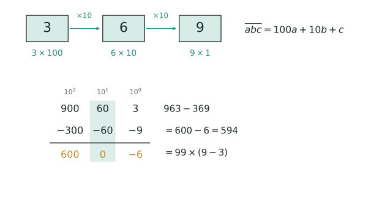

## 讲解

> 上排三格下方的 $3\times100$、$6\times10$、$9\times1$ 就是「位值=数字×$10$ 的幂」，格间的 $\times10$ 箭头正是正文「左移一位乘 $10$」；下排青色竖带圈住十位，$60-60=0$ 说明对调时中间位自动抵消，所以差只剩 $99\times(9-3)$。

**一、模型定义：位值就是"数字 × 10 的幂"。** 十进制的本质是位置决定大小：同一个数字 $7$ 写在个位是 $7$，写在百位就是 $700$。于是任何多位数都能拆成
$$\overline{abc}=100a+10b+c,\qquad \overline{abcd}=1000a+100b+10c+d,$$
横线表示"按数位拼成的数"，不是乘法；$a$ 是首位，必须 $1\le a\le 9$，其余数位只要求 $0\le b,c,d\le 9$。这一步把"数字之间的关系"翻译成"整数的等式"，是位值类问题的总入口：题目给的商、余、倍数、整除、平均数，全都可以挂到同一个等式上。

三条基本事实贯穿全篇。其一，展开是唯一的，反过来给定位值等式就能反解数字。其二，相邻两位相差 $10$ 倍：左移一位乘 $10$，右移一位是除以 $10$ 取商，被甩下的数字就是余数。其三，$10^k-1=\underbrace{99\cdots9}_{k\text{个}9}$ 是 $9$ 的倍数，所以一个数和它的数字和除以 $9$ 的余数相同——这条"余数不变"是后面筛解的主力。

展开式还兼管"位数"：$n$ 位数满足 $10^{n-1}\le N<10^n$，于是数字和、商、余数一旦给出，就能反过来夹住位数和范围。很多压轴题的第一刀不是解方程，而是这个不等式。

**二、推导：对调、重排与模 9。** 两位对调，$\overline{ba}-\overline{ab}=(10b+a)-(10a+b)=9(b-a)$；差必是 $9$ 的倍数，且只由两个数字之差决定。三位数首尾对调，$\overline{cba}-\overline{abc}=99(c-a)$，十位的 $10b$ 在两数里完全一样，自动抵消——这就是"中间位不影响差"的来历。而两数之和 $(100a+10b+c)+(100c+10b+a)=101(a+c)+20b$，结构零散，所以"和"类条件的信息量远小于"差"类。再看重排：三个互不相同且非零的数字能排出 $6$ 个三位数，每个数字在百位、十位、个位各出现 $2$ 次，故总和 $=2\times111\times(a+b+c)=222s$，平均数恰为 $37s$。最后，"模 $9$ 不变"可以直接算出来：$\overline{abc}-(a+b+c)=99a+9b$，是 $9$ 的倍数。

**三、三个高级变形。** ①添位与截位：末尾添数字 $d$ 得 $10x+d$；去掉末位得 $(x-d)\div10$；在 $n$ 位数前面添 $k$ 得 $k\cdot10^n+x$。位数必须数清，这是最容易错的一处。②循环移位恒等式：把 $\overline{abc}$ 的百位移到末尾，新数是 $100b+10c+a=10N-999a$，把"搬家"变成"乘 $10$ 再减修正项"，遇到"移动一位后是原数的几倍"可直接列方程。③商余形式：$N=qs+r$（$s$ 为数字和，$0\le r<s$），再用 $9\mid N-s$ 与数位范围双向夹逼，通常两次试验就能锁死；若是"反序数是原数的几倍"，则从两端入手——首位由 $4a\le9$ 定，末位由 $4d$ 的个位定，中间逐位用进位推进。

**四、竞赛视角。** 信号很固定：见"数字和、数字积、各位数字"，先设字母写位值展开，别把整个数设成 $x$；见"对调、颠倒、反序"，先作差提 $9$ 或 $99$；见"添上、去掉、移到"，用 $10x+d$ 或 $10N-999a$；见"能被…整除"，拆成互质因数，末位系只管末几位、数字和系只管和；见"重排、所有排列、平均"，用 $222s$ 与 $37s$；见"商…余…"，写 $N=qs+r$。容易混的是竖式数字谜（还要额外处理进位链）和整除特征（它只是位值展开的一个推论）。竞赛做法无非三步：先用不等式把范围夹小（位数、数字和上界），再按某一位分类穷尽，最后回代检验；多解时用"最大、最小、和"收口。还有两招要主动想：一是**构造**——先猜一组数位凑出目标，再用展开式证明它确实满足；二是**极端**——让某一位取 $0$ 或 $9$，看约束还能不能成立，能成立的边界往往就是答案所在。

### 五、易错点（错误 → 正确 → 原因）。
1. 把 $\overline{ab}$ 当成 $a\times b$ → 横线是数位记号，$\overline{ab}=10a+b$ → 位值展开才是真正的乘法。
2. 三位首尾对调套 $9$ → 应套 $99$ → 百位与个位的位值差是 $100-1=99$，只有两位对调才是 $9$。
3. 认为"数字和是 $9$ 的倍数"就等于"被 $9$ 整除" → 它只是必要条件，必须回代验算 → 特征只能筛解，不能代替检验。
4. 一律排除 $0$ → 只有首位不能为 $0$，中间位、末位都可以取 $0$ → 例 $3$ 中千位的 $a=0$ 完全合法。
5. 添位时位数用错 → 在前面添数要用 $10^n$，$n$ 是原数位数 → 数错一位结果差 $10$ 倍。
6. 分类只试一个值 → 数字和可能是 $9$、$18$、$27$ 等多个值 → 范围不写全必漏解。
7. 解出字母就交卷 → 还要查 $0\le$ 数字 $\le9$、首位非零、排列数是否真的是 $6$ 个 → 方程的解不一定是合法数字。

## 竞赛真题中的考察

- **2025 秋·走美 第 1 题**：分项取极端值再检验数字互异（★★★）
- **第 30 届 WMO 第 13 题**：位值展开 x-y=99(A-C)=396，逐位枚举（★★★）
- **第 34 届 WMO 第 12 题**：11的整除特征（奇位和 − 偶位和）（★★★）
- **2024 IHC 6 培训 第 92 题**：分解质因数+枚举（★★★）
- **2024 IHC C-6 第 5 题**：按进位制展开比较系数得 4b+c=0，再由六进制数字范围定 a（★★★）
- **2024 IHC D-6 第 19 题**：化简为20(d−a)，条件化为d−a=1后计数（★★★）
- **2025 思维能力测评 第 14 题**：位值原理列方程（★★★）
- **2026 春·走美 第 6 题**：设前两位为 m 化为 N=101m−1=k²，解同余 k²≡−1 (mod 101)（★★★★）
- **第 28 届 WMO 第 14 题**：算各位置权重，最大数配最大权重（★★★★）
- **2022-23 全国总测评 第 一试10 题**：按位值列方程+整除性排除（源题待核）（★★★★）
- **2024 IHC 6 培训 第 10 题**：位值展开+约数枚举（★★★★）
- **2024 IHC 6 培训 第 15 题**：按位数分类枚举（★★★★）
- **2024 IHC A-6 第 9 题**：阶乘进制位值展开（★★★★）
- **2025 IHC J-6 第 8 题**：余数递推 r→(10r+8) mod 777（★★★★）
- **2025 IHC J-6 第 11 题**：把竖式的末位/位数条件化，枚举三位数×两位数取最大积（★★★★）
- **2026 IHC S-6 第 16 题**：枚举筛选（★★★★）
- **2024 IHC A-6 第 6 题**：分母范围 + 最大分母试填（★★★★★）
- **2024 IHC C-6 第 4 题**：第二因数看作 a+1，找 A 的十进制数字规律，数字和 B=9n（★★★★★）
- **2025 IHC J-6 第 22 题**：按位数分类枚举（首位 = 奇数数字个数，第 k 位 = n mod k）（★★★★★）
- **2025 IHC J-6 第 24 题**：正难则反：总数 2024 − 不进位 52 个有序对，再 ÷2（★★★★★）
- **2024 IHC 6 培训 第 90 题**：枚举数字组+排序条件（★★★★★★）

> 完整题目与解答见仓库 `exam/answers/` 对应试卷文件；跨卷汇总见 `exam/SUMMARY.md`。

<!-- card:auto -->
## 速查卡

> 裁剪即用：本页对应速查卡「数论 35正」。下面是本节最紧的一版摘要，公式与结论与正文完全一致，用于做题前扫一遍。全套卡片见 `tools/cards/build/cards.html`。

**位值展开**

$$\overline{abc}=100a+10b+c,\quad \overline{abcd}=1000a+100b+10c+d$$

- 横线是数位记号不是乘法；首位 $1\le a\le9$，其余 $0\le b,c\le9$
- $n$ 位数满足 $10^{n-1}\le N<10^n$，先用不等式夹位数与范围
- 模 $9$ 不变：$N$ 与各位数字之和同余，用来筛解

**对调与重排**

$$\overline{ba}-\overline{ab}=9(b-a),\quad \overline{cba}-\overline{abc}=99(c-a)$$

- 三位首尾对调差是 $99$ 倍，中间位自动抵消；“和”类信息量小于“差”类
- 三个非零互异数字排 $6$ 个三位数：总和 $=222s$，平均数 $=37s$

**添位与移位**

- 末位添 $d$ 得 $10x+d$；前面添 $k$ 得 $k\cdot10^n+x$（$n$ 为原数位数）
- 循环移位：百位移到末尾得 $10N-999a$，可直接列方程

> ✅ 识别信号：见数字和、对调、反序、重排 → 先设字母写位值展开
> ⚠️ 易错：解出字母要查数字在 $0\sim9$ 且首位非零；数字和条件只是必要
<!-- /card:auto -->

## 例题

### 例1：按商余关系还原三位数（★★）
**题目**：一个三位数，百位数字的 $3$ 倍恰好等于个位数字，十位数字是百位数字的 $2$ 倍。已知这个三位数除以它的各位数字之和，商是 $20$，余数是 $9$。求这个三位数。

**覆盖点**：位值展开与数位设元

**解析**：
为什么想到这一步：条件全是"数位之间"的关系，只有"除以数字和"是整体运算。那就把最小的那个数位设成字母，其余数位用同一个字母表示，再把商余翻译成 $N=20s+9$。两边都变成同一个字母的一次式，方程自然出现。

第一步，设元。设百位数字为 $t$，则十位数字为 $2t$，个位数字为 $3t$。由 $3t\le9$ 且 $2t\le9$ 得 $t\le3$，又首位 $t\ge1$，所以 $t\in\{1,2,3\}$。

第二步，位值展开。$N=100t+10\cdot2t+3t=123t$，数字和 $s=t+2t+3t=6t$。

第三步，翻译商余。$N=20s+9$，即 $123t=20\times6t+9$，$123t=120t+9$，$3t=9$，$t=3$。所以 $a=3$、$b=6$、$c=9$，$N=369$。

第四步，验算。$369\div18=20$ 余 $9$ ✓；数字和 $3+6+9=18$ ✓；$9=3\times3$ ✓；$6=2\times3$ ✓；且三个数位均为 $0$ 到 $9$ 的整数、首位非零 ✓。再看另外两个候选：$t=1$ 时 $123=20\times6+3$ 余 $3$，$t=2$ 时 $246=20\times12+6$ 余 $6$，都不满足余 $9$，可见解唯一。

**答案**：$369$

### 例2：四位数是它反序数的 4 倍（★★★）
**题目**：一个四位数，把它的四个数字按相反顺序重新排列，所得的新数恰好是原数的 $4$ 倍。求这个四位数。

**覆盖点**：数字对调与反序数分析

**解析**：
为什么想到这一步：$4N$ 仍是四位数，说明首位很小；而个位乘 $4$ 的个位必须等于首位，说明末位被反向锁定。两端一夹，剩下的两位就只能靠"乘 $4$ 加进位"的竖式逐位推。这正是位值展开加进位分析的标准套路，比死列方程更快。

第一步，定首位 $a$。设 $N=\overline{abcd}$，反序数 $\overline{dcba}=4N$。因为 $4N$ 是四位数，$4a\le9$，故 $a\in\{1,2\}$。若 $a=1$，则 $4d$ 的个位是 $1$，但 $4d$ 是偶数，矛盾；所以 $a=2$。

第二步，定末位 $d$。$4d$ 的个位是 $2$，故 $d=3$ 或 $8$。又 $4N\ge4\times2000=8000$，四位数的首位就是 $d$，故 $d=8$，且个位向十位进 $3$。

第三步，用位值展开列方程。$4(2000+100b+10c+8)=8000+100c+10b+2$。左边 $=8000+400b+40c+32$，右边 $=8000+100c+10b+2$，两边减去 $8000$ 并整理：$390b+30=60c$，约去 $30$ 得 $13b+1=2c$。

第四步，夹逼求解。由 $2c\le18$ 得 $13b+1\le18$，$b\le1$。$b=0$ 时 $2c=1$ 非整数，舍；故 $b=1$，$c=7$。得 $N=2178$。

第五步，验算。$2178\times4=8712$，正好是 $2178$ 的反序数 ✓；四个数位 $2,1,7,8$ 互不冲突且都在 $0$ 到 $9$ 之间 ✓。回头看 $d=3$ 为何被淘汰：那样 $4N$ 会以 $3$ 开头，与 $4N\ge8000$ 矛盾，所以末位只能是 $8$。

**答案**：$2178$

### 例3：能被 36 整除的五位数之和（★★★★）
**题目**：五位数 $\overline{2a34b}$（万位是 $2$、千位是 $a$、百位是 $3$、十位是 $4$、个位是 $b$）能被 $36$ 整除。求所有这样的五位数之和。

**覆盖点**：位值原理与整除特征

**解析**：
为什么想到这一步：$36=4\times9$ 且 $4$ 与 $9$ 互质，所以必须"末两位被 $4$ 整除"与"数字和被 $9$ 整除"同时成立。末两位 $\overline{4b}$ 只含 $b$，可以先把 $b$ 锁成少数几个值；数字和条件再把 $a$ 锁死。题目问"所有…之和"，等于提醒必须分类穷尽、一个不漏，否则和就算错。

第一步，锁 $b$。$4\mid\overline{4b}=40+b$，在 $40\sim49$ 中 $4$ 的倍数是 $40,44,48$，故 $b\in\{0,4,8\}$。

第二步，锁 $a$。数字和 $2+a+3+4+b=a+b+9$ 是 $9$ 的倍数，故 $a+b$ 是 $9$ 的倍数。注意 $a$ 是千位、不是首位，可以取 $0$，这是本题最容易漏的地方。

- $b=0$：$a$ 是 $9$ 的倍数，$a=0$ 或 $9$，得 $20340$、$29340$；
- $b=4$：$a+4$ 是 $9$ 的倍数，$a=5$（$a=14$ 超出范围），得 $25344$；
- $b=8$：$a+8$ 是 $9$ 的倍数，$a=1$（$a=10$ 超出范围），得 $21348$。

第三步，求和。$20340+21348+25344+29340=96372$。

第四步，验算。$20340\div36=565$、$21348\div36=593$、$25344\div36=704$、$29340\div36=815$，四个都整除；数字和分别为 $9,18,18,18$，都是 $9$ 的倍数；末两位 $40,48,44,40$ 都被 $4$ 整除 ✓。$b$ 的三个取值已全部穷尽，每一类里 $a$ 在 $0\sim9$ 中也只解出一个值，故这样的五位数恰有四个，和为 $96372$。

**答案**：$96372$

### 例4：六个排列的平均数与首尾差（★★★★★）
**题目**：一个三位数，它的三个数字互不相同且都不为 $0$。把这三个数字重新排列，共得到 $6$ 个不同的三位数，它们的平均数是 $666$；这 $6$ 个数中最大的与最小的相差 $594$。求这 $6$ 个三位数中最大的一个。

**覆盖点**：数字重排与位值求和

**解析**：
为什么想到这一步：$6$ 个排列的"总和"有统一算法——每个数字在百位、十位、个位各出现 $2$ 次，总和 $=2\times(100+10+1)\times$ 数字和 $=222s$，所以平均数必是 $37s$。平均数一给出，数字和立刻确定。再看"最大与最小之差"：把数字从大到小排与从小到大排，中间那位相同，只剩百位与个位互换，差是 $99\times$(最大数字 $-$ 最小数字)。两个条件各管一个量，最后用"大小顺序"夹逼，不必分类。

第一步，求数字和。$37s=666$，得 $s=18$。

第二步，求首尾差。设三个数字从大到小为 $a>b>c$。最大的数是 $100a+10b+c$，最小的数是 $100c+10b+a$，两者之差为 $99(a-c)=594$，故 $a-c=6$。

第三步，夹逼定三个数字。由 $a+b+c=18$ 与 $a=c+6$ 得 $b=18-(c+6)-c=12-2c$。再用大小顺序：$b>c$ 给出 $12-2c>c$，即 $c<4$；$b<a$ 给出 $12-2c<c+6$，即 $c>2$。所以 $c=3$，于是 $b=6$、$a=9$，三个数字是 $9,6,3$，互不相同且非零 ✓。

第四步，写最大数。最大排列即从大到小排：$963$。

第五步，验算。六个排列为 $369,396,639,693,936,963$，和为 $3996=6\times666$，平均数 $666$ ✓；$963-369=594$ ✓；数字和 $9+6+3=18$ ✓；$963$ 确实是六个数中最大的 ✓。

**答案**：$963$

## 变式与自测

> 四道题按「模仿 → 变式 → 综合 → 自测」排。见到「对调」「重排」就先写成 $10a+b$、$100a+10b+c$，位值一展开，数字就变成可以算的量。

### 变式1：对调之后用和（★）

**题目**：一个两位数，十位数字比个位数字大 $3$；把两个数字对调后所得的新数与原数相加等于 $121$。求原数。

**覆盖点**：位值展开与数位设元

**解析**：设原数为 $10a+b$，则新数为 $10b+a$，两者相加为 $11(a+b)=121$，所以 $a+b=11$。再配上 $a-b=3$，得 $a=7$、$b=4$。

为什么不用试：$11(a+b)=121$ 直接给出 $a+b$，条件已经足够定死唯一解，试数只会更慢。

**答案**：$74$。

### 变式2：差是 $99$ 的倍数（★★★）

**题目**：一个三位数，把百位数字与个位数字对调后得到的新数比原数小 $297$；已知三个数字之和为 $15$，十位数字是 $6$。求原数。

**覆盖点**：数字对调与反序数分析

**解析**：百位与个位对调，差恒为 $99(a-c)$，与十位数字无关——这是位值原理最常用的一条。于是 $99(a-c)=297$，得 $a-c=3$；又 $a+c=15-6=9$，解得 $a=6$、$c=3$。

所以原数是 $663$，新数是 $366$，$663-366=297$ ✓。

**答案**：$663$。

### 变式3：位值与 $36$ 联立（★★★★）

**题目**：求所有形如 $\overline{3a5b}$ 且能被 $36$ 整除的四位数。

**覆盖点**：位值原理与整除特征

**解析**：$36=4\times9$ 且 $4$ 与 $9$ 互质，所以要同时满足两条——这一步串的是《数的整除特征》里「互质拆分」的做法。

末两位 $\overline{5b}$ 要被 $4$ 整除，$b$ 只能取 $2$ 或 $6$；数字和 $3+a+5+b=8+a+b$ 要被 $9$ 整除：$b=2$ 得 $a=8$，$b=6$ 得 $a=4$。两条各只给一个 $a$，所以解只有两个。

双验证：$3852=36\times107$ ✓，$3456=36\times96$ ✓。

**答案**：$3852$ 与 $3456$。

### 自测：重排求和的位值算法（★★★）

**题目**：用 $2,3,4$ 三个数字各一次组成的所有三位数之和是多少？

**覆盖点**：数字重排与位值求和

**解析**：共有 $3!=6$ 个数，每个数字在百位、十位、个位上各出现 $2$ 次。所以总和

$$2\times(2+3+4)\times(1+10+100)=2\times9\times111=1998 .$$

回代验算：$234+243+324+342+423+432=1998$ ✓。

**答案**：$1998$。
