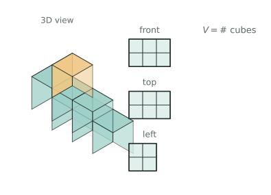

## 讲解

**模型与记号**：用小正方体（棱长 $a$）在桌面上搭几何体。约定俯视图的"排"从前往后数、"列"从左往右数。在俯视图第 $i$ 排第 $j$ 列的格子里写上该处摞的个数 $h_{ij}$（没有方块写 $0$），于是总个数与体积为
$$N=\sum_{i,j}h_{ij},\qquad V=N\,a^{3}.$$
三张视图各管一件事：**俯视图管"底"**（哪些格子有方块）；**主视图管"列高"**，从左到右第 $j$ 列的高度 $c_j=\max_i h_{ij}$；**左视图管"排高"**，俯视图第 $i$ 排（从前往后）的最高层数 $r_i=\max_j h_{ij}$ 决定左视图，且左视图从左到右依次对应最后一排到第一排。三件事合起来，还给出每格的双重上界
$$1\le h_{ij}\le \min(c_j,r_i)\quad(\text{有方块的格子}).$$

**为什么**：主视图是把物体沿前后方向"压扁"——第 $j$ 列里最高的那摞露在最外面，矮的全被挡住，所以主视图只记得列最大值，记不得每格究竟几层。左视图同理只记排最大值，俯视图只记有无。一格同时住在第 $j$ 列和第 $i$ 排里，两把尺子都不许它超高，所以只能取较小者。反过来，单看一张图一定还原不出立体图形：主视图相同的搭法可以有很多种，俯视图只说明有几摞，要靠主视图与左视图一起才把每摞的高度卡出来。求最多个数时每格都顶到上界，$N_{\max}=\sum\min(c_j,r_i)$；求最少个数时先"铺底"每格记 $1$，再让每一列、每一排各派一个格子长高到规定高度，能一格兼管列和排的就让它兼管，这样加得最少。

**三个高级变形**：①**缺格**：俯视图有空格时 $h=0$，既不求和也不参与取最大，它会让某列、某排的"顶格"无处安放，最值随之改变；②**打通洞**：一条洞沿视线贯穿，等价于把整条线上的 $h$ 全记 $0$，先按每条线各减一次，再把重复减掉的交点加回来；③**视图不全或三视图相同**：答案常常不唯一，要问"可能值"，就先定上界 $\sum\min(c_j,r_i)$ 与下界（铺底加抬升），再证明中间每个值都能靠"给某些格子加 $1$"搭出来。

**竞赛视角**：题目出现"最多/最少""至少""能否搭出""共有几种"，先想"每格上界 + 极值构造"；出现"打洞、贯穿、通道"，先画三条互相垂直的通道并找交点；出现"三视图相同"，先把三张图翻译成 $c_j$ 与 $r_i$ 的相等关系。最易混的三对概念是：列高之和与总体积（不是一回事）、左视图的左右与俯视图的左右（对应的是前后）、体积最大与表面积最大（两回事）。构造时优先让"最高的格子"同时充当列代表和排代表，这是压榨个数的关键。

### 易错点
1. 错：主视图三列高 $3,4,2$，就写 $3+4+2=9$ 个。正：逐格取 $\min(c_j,r_i)$ 再求和。为什么：视图是压扁的轮廓，不是剖面。
2. 错：求最多时把整列都填成 $c_j$。正：还要被该排的 $r_i$ 卡住。为什么：那一格同时属于这一排。
3. 错：求最少时全填 $1$。正：每列、每排都要有格子真的达到规定高度。为什么：否则对应视图会变矮。
4. 错：把左视图最左列当成俯视图最左列。正：左视图最左对应最后一排。为什么：从左面看时，视线沿左右方向，图的左右对应俯视图的前后，最后一排落在最左边。
5. 错：打洞时把三条通道的方块数直接相加。正：用容斥，交点只算一次。为什么：中心块被重复减掉。
6. 错：算出最大值就认为体积唯一。正：中间值往往也搭得出，要给出构造。为什么：上界不必每格都取到。

## 竞赛真题中的考察

- **2025 秋·走美 第 12 题**：俯视图定位、左视图定层数；表面积=上下底面积+底面周长×高（★★★★）
- **第 30 届 WMO 第 6 题**：下界估计（每块每视图只贡献 1 格）+ 构造（★★★★）
- **第 34 届 WMO 第 4 题**：三视图还原（透明能看穿）+ 试摆验证（★★★★）
- **2024 IHC 6 培训 第 34 题**：三视图还原几何体（源题待核）（★★★★）
- **2026 春·走美 第 11 题**：按生成树顺序贴块，每块最多新增2个投影格，得 3+19×2=41 并构造达到（★★★★★）

> 完整题目与解答见仓库 `exam/answers/` 对应试卷文件；跨卷汇总见 `exam/SUMMARY.md`。

<!-- card:auto -->
## 速查卡

> 裁剪即用：本页对应速查卡「几何 44正」。下面是本节最紧的一版摘要，公式与结论与正文完全一致，用于做题前扫一遍。全套卡片见 `tools/cards/build/cards.html`。

**视图含义**

$$V=Na^{3}$$

- 俯视图每格记层数 $h$，$N$ 为总块数、$a$ 为棱长
- 俯视图管底（哪格有方块）；主视图给各列最高层
- 左视图给各排最高层，其左右对应俯视图的前后

**每格上界**

- 每格层数不超过所在列高、排高的较小者
- 求最多：每格顶到上界求和，空格记 $0$ 不参与
- 求最少：每格先铺 $1$，再让每列每排各有一格长高

**变形**

- 打通洞：整条线记 $0$，重复减掉的交点要加回
- 视图不全或三视图相同：先定上下界再证可搭

> ✅ 信号：最多/最少、至少、能否搭出、打洞贯穿、三视图相同
> ⚠️ 易错：左视图最左对应俯视图最后一排；列高和 $\ne$ 体积
<!-- /card:auto -->

## 例题

### 例1：由两张视图反推标数表再求体积（★★）

**题目**：用棱长 $2$ 厘米的小正方体搭成一个几何体，俯视图是 $3$ 排 $3$ 列，$9$ 个位置都放了方块。各位置摞的个数如下表，其中两格看不清，记作 $x,y$：

| | 左列 | 中列 | 右列 |
|---|---|---|---|
| 前排 | 2 | 1 | 2 |
| 中排 | 1 | $x$ | 1 |
| 后排 | 3 | 1 | $y$ |

已知主视图从左到右三列的高度是 $3,4,2$；左视图从左到右三列（依次对应后排、中排、前排）的高度是 $3,4,2$；并且一共用了 $17$ 个小正方体。求 $x,y$ 和这个几何体的体积。

**覆盖点**：俯视图标数法求体积

**解析**：
第一步，为什么先盯住中列。主视图第 $2$ 列高 $4$，是全图最高，说明中列三格中必有一格摞到 $4$ 层；但一格能到几层，还要它所在的排"允许"——左视图告诉我们前排最高 $2$、后排最高 $3$，都到不了 $4$。所以只有中排中列那一格能到 $4$，即 $x=4$。这一步不用试数，是两张视图"夹"出来的。

第二步，为什么 $y$ 要用总数。主视图第 $3$ 列高 $2$，给出 $\max(2,1,y)=2$，即 $y\le 2$；左视图后排高 $3$，给出 $\max(3,1,y)=3$，即 $y\le 3$。两条合起来只知 $y\le 2$，$y=1$ 还是 $y=2$ 定不下来，必须动用"共 $17$ 个"这个总量条件：
$$2+1+2+1+4+1+3+1+y=17\ \Rightarrow\ 15+y=17\ \Rightarrow\ y=2,$$
恰好满足 $y\le 2$，说明数据自洽。

第三步，标数求和。$N=2+1+2+1+4+1+3+1+2=17$（个）。

第四步，验算三视图。列高：$\max(2,1,3)=3$、$\max(1,4,1)=4$、$\max(2,1,2)=2$，正是 $3,4,2$；排高：前排 $\max(2,1,2)=2$、中排 $\max(1,4,1)=4$、后排 $\max(3,1,2)=3$，按后排、中排、前排读出正是 $3,4,2$。全部吻合。

第五步，换体积。每个小正方体体积 $2^3=8$ 立方厘米，故
$$V=17\times 8=136\ (\text{立方厘米}).$$

**答案**：$x=4$，$y=2$，体积是 $136$ 立方厘米

### 例2：俯视图缺两格时的最多与最少（★★★）

**题目**：一个几何体由同样大小的小正方体搭成，俯视图是 $3$ 排 $3$ 列，但只有 $7$ 个位置有方块——中排右列、后排中列是空的。主视图从左到右三列高度为 $3,2,2$；左视图从左到右三列（依次对应后排、中排、前排）高度为 $2,3,2$。求这个几何体最多、最少各用多少个小正方体。

**覆盖点**：三视图下小正方体个数的最值与构造

**解析**：
第一步，为什么先画"上界表"。每格的高度既不能超过所在列高 $c_j$，也不能超过所在排高 $r_i$，所以先算 $\min(c_j,r_i)$：

| | 左列 $c=3$ | 中列 $c=2$ | 右列 $c=2$ |
|---|---|---|---|
| 前排 $r=2$ | 2 | 2 | 2 |
| 中排 $r=3$ | 3 | 2 | 空 |
| 后排 $r=2$ | 2 | 空 | 2 |

第二步，求最多。每格都顶到上界，总和
$$N_{\max}=2+2+2+3+2+2+2=15.$$
验算：列高为 $\max(2,3,2)=3$、$\max(2,2)=2$、$\max(2,2)=2$；排高为前排 $\max(2,2,2)=2$、中排 $\max(3,2)=3$、后排 $\max(2,2)=2$，全部符合。所以 $15$ 个真能搭出来。

第三步，求最少的下界。先给 $7$ 个格子各铺 $1$ 个，共 $7$ 个。第 $1$ 列要有格子到 $3$，必须再加 $2$ 个；第 $2$ 列、第 $3$ 列各有格子要到 $2$，各再加 $1$ 个。三列是三个不同的格子，抬升不能合并，所以至少
$$7+2+1+1=11\ (\text{个}).$$

第四步，构造说明 $11$ 个能搭出。取：前排 $1,2,1$；中排 $3,1$、空；后排 $1$、空、$2$。逐项核对：第 $1$ 列 $\max(1,3,1)=3$；第 $2$ 列 $\max(2,1)=2$；第 $3$ 列 $\max(1,2)=2$；前排最高 $2$、中排最高 $3$、后排最高 $2$。三视图全对，个数 $1+2+1+3+1+1+2=11$。

第五步，为什么 $11$ 不能再少。抬升的总量 $2+1+1=4$ 与位置无关，$7+4=11$ 已经是任何搭法的下界，而上面又搭出了 $11$ 个，故最小值就是 $11$。

**答案**：最多 $15$ 个，最少 $11$ 个小正方体

### 例3：三个方向各打穿一个方洞（★★★★）

**题目**：用 $64$ 个棱长 $1$ 厘米的小正方体拼成一个 $4\times 4\times 4$ 的大正方体。然后从前面、上面、左面三个面的正中央各打一个 $2$ 厘米 $\times\,2$ 厘米的正方形洞，每个洞都笔直打穿到对面。求打洞后剩余部分的体积。

**覆盖点**：穿透挖洞后的体积计算

**解析**：为什么不能直接写 $64-16\times3$？因为三条通道都在正中央穿过，中央那块被减了三次，先算清每条通道扣多少、再单独处理撞在一起的部分，才不会漏也不会重。
第一步，先给三条通道"定位"。每个面是 $4\times 4$，正中央的 $2\times 2$ 就是第 $2,3$ 行与第 $2,3$ 列围出的那一块。所以每条通道都是截面 $2\times 2$、长 $4$ 的长方体，各含
$$2\times 2\times 4=16\ (\text{个})$$
小正方体。

第二步，为什么不能直接用 $64-16\times 3$。三条通道都从"正中央"穿过，它们在大正方体正中心撞在一起：前后通道要求左右、上下都在第 $2,3$ 位，上下通道要求前后、左右都在第 $2,3$ 位，左右通道要求前后、上下都在第 $2,3$ 位。三者共同的部分正是中央的 $2\times 2\times 2$ 小块，共 $8$ 个。这块被减了三次，要补回两次。

第三步，容斥计算。两两的交、三者的交都恰好是这 $8$ 个，所以被挖掉的并集是
$$16\times 3-8\times 3+8=48-24+8=32\ (\text{个}),$$
剩余 $64-32=32$ 个，体积 $32$ 立方厘米。

第四步，分层验算。从下往上数四层，每层 $16$ 格：
- 第 $1$ 层：只有上下通道穿过，挖去 $4$ 个，剩 $12$ 个；
- 第 $2$ 层：前后通道挖去 $8$ 个、左右通道挖去 $8$ 个，中间重叠 $4$ 个；上下通道在这层挖的 $4$ 个正好就是这 $4$ 个重叠，所以共挖 $12$ 个，剩 $4$ 个；
- 第 $3$ 层：与第 $2$ 层同理，剩 $4$ 个；
- 第 $4$ 层：只有上下通道，剩 $12$ 个。

合计 $12+4+4+12=32$ 个，与容斥结果一致。

**答案**：剩余部分的体积是 $32$ 立方厘米

### 例4：三视图不变时体积的所有可能值（★★★★★）

**题目**：一个几何体由棱长 $1$ 厘米的小正方体搭成，俯视图是 $3$ 排 $3$ 列且 $9$ 个位置都有方块。主视图从左到右三列高度为 $3,2,2$；左视图从左到右三列（依次对应后排、中排、前排）高度为 $1,3,2$。问这个几何体的体积可能是多少？共有几种可能？

**覆盖点**：三视图下体积所有可能值的分类

**解析**：
第一步，为什么先求上界。设第 $i$ 排、第 $j$ 列的高度为 $h_{ij}$，它同时受 $c_j$ 与 $r_i$ 限制，故 $h_{ij}\le\min(c_j,r_i)$：

| | 左列 $c=3$ | 中列 $c=2$ | 右列 $c=2$ |
|---|---|---|---|
| 前排 $r=2$ | 2 | 2 | 2 |
| 中排 $r=3$ | 3 | 2 | 2 |
| 后排 $r=1$ | 1 | 1 | 1 |

把表填满得 $2+2+2+3+2+2+1+1+1=16$，而且这张表本身就满足列高 $3,2,2$ 与排高 $2,3,1$，所以 $16$ 一定搭得出，最大值是 $16$。

第二步，为什么第 $1$ 列的高 $3$ 被"逼"在中排。前排的排高是 $2$，后排是 $1$，这两排都不许出现 $3$ 层，否则左视图就会变高；所以第 $1$ 列那个 $3$ 只能放在中排左列，即 $h_{21}=3$，这一步同时把中排的排高 $3$ 满足了。

第三步，求下界。先铺底 $9$ 个。第 $1$ 列抬到 $3$，加 $2$；第 $2$ 列要出现 $2$，加 $1$；第 $3$ 列要出现 $2$，加 $1$。三列是不同格子，抬升无法合并；但前排还要求出现 $2$，可以让第 $2$ 列那个 $2$ 就放在前排中列，顺带满足，不额外加。于是
$$N_{\min}\ge 9+2+1+1=13.$$

第四步，构造出 $13$ 个：前排 $1,2,1$；中排 $3,1,2$；后排 $1,1,1$。核对：第 $1$ 列 $\max(1,3,1)=3$；第 $2$ 列 $\max(2,1,1)=2$；第 $3$ 列 $\max(1,2,1)=2$；前排最高 $2$、中排最高 $3$、后排最高 $1$。完全符合，共 $1+2+1+3+1+2+1+1+1=13$ 个，故最小值就是 $13$。

第五步，为什么中间值也都行。把"上界表"减去刚才的构造，多出来的余量只有三格：前排左列、前排右列、中排中列，各多 $1$ 层。给其中任意几格加 $1$ 层，高度仍不超过上界，列高、排高的最大值既不降低也不会超过规定值，所以视图不变。因此加 $1,2,3$ 层分别得到 $14,15,16$ 个，四种都能搭出。

第六步，结论与验算。可能值是 $13,14,15,16$；最大与最小相差 $3$，正好等于三格余量之和。取全满的上界表复核：$16$ 个，列高 $3,2,2$、排高 $2,3,1$ 均吻合。

**答案**：体积可能是 $13$、$14$、$15$、$16$ 立方厘米，共 $4$ 种可能

## 变式与自测

> 四道题按「模仿 → 变式 → 综合 → 自测」排。先盖住答案自己做，做完再对；三视图题的失分点集中在两处——把"俯视图有几格"当成"体积是多少"，以及打洞时重叠部分只扣了一次。

### 变式1：俯视图标数后求和（★★）

**题目**：一个几何体由若干个棱长 $1$ 厘米的小正方体堆成，它的俯视图是 $3\times3$ 的方格（每个方格上都有小正方体），各位置堆的层数如下表（从上往下三行）：

$$\begin{matrix}1&2&1\\2&3&1\\1&1&2\end{matrix}$$

求这个几何体的体积，以及从正面能看到的最大高度。

**覆盖点**：俯视图标数法求体积

**解析**：为什么俯视图要"标数"？俯视图只告诉你有几摞、不告诉每摞多高；标上层数之后，体积就是把九个数字加起来——每一格的层数就是那一摞的小正方体个数，这是最不会出错的做法。

$$V=1+2+1+2+3+1+1+1+2=14\ \text{立方厘米}.$$

最高的一摞是 $3$ 层，所以从任何方向看，最大高度都是 $3$。

验算：$9$ 摞、每摞至少 $1$ 块，$9\le14$ 且不超过 $9\times3=27$ ✓；再把表格横着、竖着各加一遍：三行和 $4+6+4=14$，三列和 $4+6+4=14$ ✓，两个方向统计一致。

**答案**：体积 $14$ 立方厘米，最大高度 $3$。

### 变式2：正视图定高，求最多与最少（★★★）

**题目**：一个几何体由小正方体堆成，俯视图是 $2$ 行 $3$ 列的 $6$ 个方格且每格都有块；从正面看，三列的高度依次是 $3$、$1$、$2$。求小正方体个数的最小值与最大值。

**覆盖点**：三视图下小正方体个数的最值与构造

**解析**：为什么用"每列的最大值"来卡？正视图看到的是每一列的最高点，所以每一列里至少有一摞达到那个高度，其余各摞可以从 $1$ 层到该高度随便取。取最小值就让"只有一摞达标"，取最大值就让"每摞都堆到顶"。

最小值：每列只让一摞达到规定高度，另一摞只放 $1$ 层——

$$(3+1)+(1+1)+(2+1)=9 .$$

最大值：每列的两摞都堆到该列高度——

$$2\times(3+1+2)=12 .$$

验算：最小值 $9$ 时正视图确实是 $3,1,2$（每列最高点都在）✓；最大值 $12$ 时每列两摞等高，正视图仍是 $3,1,2$ ✓；两者之间每个整数也都能构造，$9\le V\le12$。

**答案**：最少 $9$ 个，最多 $12$ 个。

### 变式3：三个方向各打穿一个方洞（★★★★）

**题目**：用 $216$ 个棱长 $1$ 厘米的小正方体拼成一个 $6\times6\times6$ 的大正方体，然后从前面、上面、左面三个面的正中央各打一个 $2$ 厘米 $\times\,2$ 厘米的正方形洞，每个洞都笔直打穿到对面。求打洞后剩余部分的体积。

**覆盖点**：穿透挖洞后的体积计算

**解析**：为什么不能直接算 $216-24\times3$？三条通道都从正中央穿过，它们在正中心撞在一起，中央那块被重复减了多次。这类题的正确姿势是**容斥**：先各自减，再把多减的补回来。

每条通道是截面 $2\times2$、长 $6$ 的长方体，各含 $2\times2\times6=24$ 块。三条通道都过正中央，两两相交的部分是"两个方向都落在 $2,3$ 号位"的那一块，正是一个 $2\times2\times2$ 的小立方体，$8$ 块；三条公共的部分同样是这 $8$ 块（三个方向都占 $2,3$ 号位）。

按容斥算被挖掉的块数：

$$24\times3-8\times3+8=72-24+8=56 .$$

于是剩余体积

$$216-56=160\ \text{立方厘米}.$$

验算：把 $8$ 块三交部分想清楚就知道它被减了 $3$ 次、又被加了 $3$ 次，最终恰好算一次 —— 这正是一般容斥里"奇加偶减"的落点；再用"每条通道独有部分 $24-8-8+8=16$ 块"验算：三条独有 $16\times3=48$，加上两两相交但不属三交的 $0$ 块，再加三交 $8$ 块，$48+8=56$ ✓。

**答案**：剩余部分的体积是 $160$ 立方厘米。

### 自测：三视图不变时的体积取值（★★★）

**题目**：一个几何体由小正方体堆成（每块都要落地或被下面的块垫住），俯视图、正视图、左视图都是 $2\times2$ 的正方形（四格全满）。求它体积的所有可能值。

**覆盖点**：三视图下体积所有可能值的分类

**解析**：为什么先找上下界？三视图都满，说明它装得进 $2\times2\times2$ 的方盒（体积不超过 $8$）；俯视图满意味着四个位置各至少 $1$ 块。

下界不能是 $4$：四个位置各 $1$ 块时，每个方向看到的都只有 $1$ 层，正视图就对不上 $2\times2$。要让正视图左列高 $2$，左列两格中必有一格堆到 $2$ 层；右列同理；左视图的两行也各要有一格到 $2$ 层。把两个"到 $2$ 层"的格子放成斜对角——$(1,1)$ 与 $(2,2)$ 各堆 $2$ 层，另两格各 $1$ 层——三个方向的投影同时满足（俯视四格都有块、正视两列都到 $2$ 层、左视两行都到 $2$ 层），共 $2+1+1+2=6$ 块，这就是最小值。

上界是 $8$（方盒填满）。从 $6$ 块那种摆法出发，每次在空格或顶层添一块，投影只会变高不会变矮，所以 $7$ 也取得到；四个位置全堆到 $2$ 层就是 $8$。

$5$ 也做不到：$5$ 只能是"一格 $2$ 层、三格 $1$ 层"，那一格只照顾得了自己所在的一列和一行，另一列（另一行）最高仍是 $1$，正视图或左视图立刻对不上。

验算：把四摞的高度记为 $h_{11},h_{12},h_{21},h_{22}$，各自只能取 $1$ 或 $2$（三视图的高都是 $2$），共 $2^4=16$ 种。逐个按"每列取大值、每行取大值"算两个侧视图，能同时得到 $[2,2]$ 与 $[2,2]$ 的只有 $7$ 种：两条斜对角各 $1$ 种（和 $6$）、在其上再升一格共 $4$ 种（和 $7$）、四格全 $2$ 共 $1$ 种（和 $8$），$2+4+1=7$，其余 $9$ 种都被排除，体积只能落在 $6,7,8$ ✓。

**答案**：可能是 $6$、$7$、$8$ 立方厘米，共 $3$ 种（最小 $6$，最大 $8$）。
