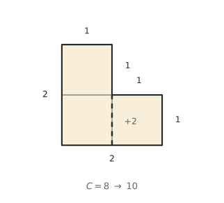

## 讲解

**模型是什么**：周长是封闭图形一周边线的总长度，单位是长度单位（厘米、米），它只回答"边界有多长"，不回答"里面有多大"。本专题三类结构：长方形、正方形及其逆用；拼、剪、挖之后边界被重新分配；一个大长方形被分成若干块，由其中几块的周长反求其余。三类的共同动作只有一个——**数边界**：一条线段在最终边界上算一次，藏进内部就不算，下面所有公式都是这句话的推论。边太多、一条条数不过来时，还有平移、拉角、标向这类"巧求"的旁路（另见「巧求周长」专题）；本专题先把公式本身与常规题型守稳。

**结论一（公式与逆用）**：$C_{\text{长方形}}=2(a+b)$，$C_{\text{正方形}}=4a$；反过来 $a+b=C\div2$，$a=C\div4$。由此得全篇最要紧的一句：**对长方形，周长一定，长与宽的和一定**。铁丝改围的题，第一步永远先求铁丝总长（周长）；无论改围成什么形状，总周长不变，但面积必须按新图形的面积公式重算。同一张公式表还要配上圆与弧：圆 $C=2\pi r=\pi d$，圆心角 $n^\circ$ 所对的弧 $l=\dfrac{n^\circ\pi r}{180^\circ}$。

**结论二（拼与切）**：设两块图形的周长分别为 $C_1$、$C_2$，公共边长 $d$。公共边在两块周长里各数过一次，拼好后却进了内部，所以扣两次：

$$C_{\text{拼}}=C_1+C_2-2d$$

沿长 $d$ 的线剪开正相反，一刀多出两条长 $d$ 的新边界：$C_{\text{切}}=C_{\text{原}}+2d$，剪 $n$ 刀加 $2\times$（各刀长之和）。为什么是 $2$ 倍？公共边"原本数两次，现在一次也不算"，差额就是 $2d$。于是拼接后公共边越长，周长减少得越多；若题目给出多个可完全重合的候选边，应在这些候选中选长度最长者。两条边必须等长才能成为公共边，不能把不等长的边强行拼接。

**结论三（拼合对齐产生比例）**：几个同样的小长方形拼成大长方形，接缝两侧必须等长，否则拼不齐；这条要求会自动给出边长关系。例如上排 $2$ 个横放、下排 $3$ 个竖放，两排同宽，就有 $2a=3b$，即 $a:b=3:2$。此时别急着设 $x$，用份数：令 $a=3k$、$b=2k$，把周长写成 $k$ 的倍数，一次解出。边界：必须严丝合缝铺满，错位就没有这个等式。

**结论四（整体代换）**：一横一竖两条贯穿线把大长方形分成四块，对角两块周长之和相等，且都等于大长方形的周长——横向两段拼成大长方形的长、纵向两段拼成宽，各数了两次。带孔带框的图形：内周长 $=$ 外周长 $-8\times$ 框宽；四个长方形围成大正方形并留中孔时，大正方形边长 $=$ 长 $+$ 宽，中孔边长 $=$ 长 $-$ 宽。边界：分割线要贯穿到对边，孔要居中且四周等宽。

**变形一：周长相等比面积**。对长方形而言，周长相等等价于长宽和相等，"长多 $4$、宽少 $4$"是同一件事的两种说法，不能当两个条件。长宽和固定时越接近正方形面积越大，长宽相等时最大——这条极端原理既可判断"围得最大"，也可检查算出的答案是否落在最大处。

**变形二：边框与孔洞**。内周长 $=$ 外周长 $-8d$，反过来 $d=(C_{\text{外}}-C_{\text{内}})\div8$。它与"角上剪去不变、边上挖去加 $2h$"是同一套数边逻辑：$8d$ 就是四条边各多走两趟回头路。

**变形三：把周长和当整体**。$n$ 块拼合时，

$$\sum C_i-C_{\text{拼}}=2\times(\text{各公共边长度之和})$$

题目不给边长、只给周长和，这是唯一出口：先算公共边总长，再拆成各段；它还是最好的自查工具。

**竞赛视角**：看到"同一根铁丝"→ 周长不变；看到"拼、剪、挖"→ 找公共边，用 $\pm2d$；看到"几块的周长"→ 写成 $2(\text{长}+\text{宽})$ 后配对抵消；看到"拼成大长方形"→ 先问接缝是否对齐。易混三处：**周长与面积**（含义、单位都不同）；**正方形算不算长方形**（求最值必须声明，否则 $10\times10$ 与 $11\times9$ 会打起来）；**剪角与挖槽**（前者不变，后者增加）。顺序：画图标数 → 归类 → 找不变量或设份数 → 具体数字回代验算。

### 易错点

1. 周长 $36$ cm、宽 $8$ cm，直接用 $36-8=28$ 当长。正确：$36\div2-8=10$。为什么：$36$ 是两组长加宽，必须先折半。
2. 拼接只扣一条公共边，写成 $C_1+C_2-d$。正确：扣 $2d$。为什么：公共边在两块周长里各出现一次。
3. 把"角上剪去"当成"边上挖去"。正确：角上剪不变，边上挖加 $2h$。为什么：角上缺口与原边重合，边上缺口多出两条回头路。
4. 认为剪开后周长不变。正确：每刀加 $2\times$ 剪痕长。为什么：一刀产生两条新边界。
5. 不检查接缝就写 $2a=3b$。正确：先确认对齐再列比例。为什么：比例来自"接缝两侧等长"。
6. 认为周长相等面积就相等。正确：和相等、积不等，越接近正方形越大。为什么：$4\times4$ 与 $5\times3$ 周长都 $16$，面积是 $16$ 与 $15$。
7. 单位写错，把周长答成"平方厘米"。正确：周长用厘米。为什么：平方厘米量面，不量线。

## 竞赛真题中的考察

- **2024 IHC 6 培训 第 27 题**：直角梯形只给周长 40、高 8、斜腰 10，先用"周长减去两条腰"求出上下底之和，再乘高除以 2——与例1「铁丝改围，先抓长宽和」同构（★★）
- **考前 60 题 第 19 题**：绳子围成的三角形周长为 22 cm，改围长方形后"长＋宽"固定为 11，再按"去掉哪个顶点、哪条边当长"分类枚举面积——与例1、例4「周长一定，长宽和一定」同构（★★★★）
- **2025 秋·走美 第 10 题**：面积为 150、长宽都是整数的长方形逐一验算能裁成什么样，最后用 $2\times($长＋宽$)$ 报出可能的周长——与例3「拼合后由边长关系反求周长」同路（★★★★★）

> 完整题目与解答见仓库 `exam/answers/` 对应试卷文件；跨卷汇总见 `exam/SUMMARY.md`。

<!-- card:auto -->
## 速查卡

> 裁剪即用：本页对应速查卡「几何 43正」。下面是本节最紧的一版摘要，公式与结论与正文完全一致，用于做题前扫一遍。全套卡片见 `tools/cards/build/cards.html`。

**基本公式**

- 长方形 $C=2(a+b)$，正方形 $C=4a$
- 长方形周长一定则长宽和一定；改围先求铁丝总长

**拼与切**

$$C_{\text{拼}}=C_1+C_2-2d$$

- 剪开相反：每刀加 $2\times$ 剪痕长；拼得越紧越短
- 接缝两侧等长才拼得齐，据此列长宽比（按份数设）

**分割与最值**

- 四周等宽 $d$ 的矩形边框：内周长 $=$ 外周长 $-8d$
- 各块周长和减拼后周长 $=2\times$ 公共边总长
- 长方形周长相等时，越接近正方形面积越大

> ✅ 信号：同一根铁丝、拼剪挖、给几块周长、拼成大长方形
> ⚠️ 易错：公共边要扣 $2d$；角上剪不变、边上挖加 $2h$
<!-- /card:auto -->

## 例题

### 例1：铁丝改围，先抓长宽和（★★）

**题目**：一根铁丝恰好围成一个长方形，周长是 $48$ cm，且长比宽的 $2$ 倍少 $3$ cm。（1）求这个长方形的长和宽；（2）把这根铁丝改围成一个正方形，正方形的面积比原长方形的面积大多少？

**覆盖点**：周长公式的正用与逆用

**解析**：

为什么先折半？周长公式里长和宽是"捆在一起"出现的，$48$ 对应的是两组"长 $+$ 宽"，所以任何逆用都必须先算 $48\div2=24$，得到"长 $+$ 宽"。这一步不做，后面的数全错。

第一步，求长宽和：$a+b=48\div2=24$。

第二步，把"长比宽的 $2$ 倍少 $3$"翻译成 $a=2b-3$，代入：$2b-3+b=24$，即 $3b=27$，得 $b=9$，$a=2\times9-3=15$。

（不用方程也可以：若宽再添 $3$ cm，长就正好是宽的 $2$ 倍，此时和变成 $24+3=27$，恰为宽的 $3$ 倍，所以宽 $=27\div3=9$。两种算法互相印证。）

第三步，改围正方形。铁丝长度没变，周长仍是 $48$，边长 $=48\div4=12$，面积 $12\times12=144$ cm²。

第四步，原长方形面积 $15\times9=135$ cm²，相差 $144-135=9$ cm²。

验算：$2\times(15+9)=48$ ✓；$15=2\times9-3$ ✓；正方形 $4\times12=48$ ✓。同一个周长，面积却从 $135$ 变成 $144$，说明面积不能靠周长推。

**答案**：长 $15$ cm、宽 $9$ cm；正方形边长 $12$ cm，面积比原长方形大 $9$ cm²。

### 例2：一刀剪下去，多出多少边（★★★）

**题目**：一张长方形纸片，长 $36$ cm、宽 $24$ cm。沿一条与边平行的直线把它剪成两个长方形，剪后两个小长方形的周长之和是 $168$ cm，周长之差是 $24$ cm。求剪痕的长度，以及剪出的两个小长方形的面积。

**覆盖点**：切割与拼合的边线增减

**解析**：

为什么先算原周长？因为"剪"只新增边界，新增量恰为 $2\times$ 剪痕长，所以"周长和比原来多多少"是唯一能倒推出剪痕的线索；先把它算出来，就等于先把剪痕锁死。

第一步，原周长：$2\times(36+24)=120$ cm。

第二步，定剪痕长。周长和 $168$ 比原来多 $168-120=48$ cm，这是一刀带来的 $2d$，所以 $d=48\div2=24$ cm。这里必须**分类**：与边平行的剪痕只有两种长度——垂直于长边时长为 $24$，平行于长边时长为 $36$。若是 $36$，周长和应为 $120+72=192$，与 $168$ 不符，所以剪痕只能长 $24$ cm，它平行于宽，把长分成两段。

第三步，设两段为 $x$ 与 $36-x$，两块分别是 $x\times24$ 与 $(36-x)\times24$，周长是 $2(x+24)$ 与 $2(60-x)$。由周长之差为 $24$：

$$\left|2(x+24)-2(60-x)\right|=24\ \Rightarrow\ |4x-72|=24$$

得 $x=24$ 或 $x=12$。这两个值给出的是同一对长方形（只是左右互换），正好说明答案唯一。

第四步，两块是 $24\times24$ 与 $12\times24$，面积分别为 $576$ cm² 与 $288$ cm²。

验算：$2\times(24+24)=96$，$2\times(12+24)=72$，和 $96+72=168$ ✓，差 $24$ ✓；面积和 $576+288=864$，而原纸片 $36\times24=864$ ✓，说明既没重叠也没剩下。

**答案**：剪痕长 $24$ cm；两块面积分别是 $576$ cm² 与 $288$ cm²。

### 例3：五个一样的长方形拼成一块（★★★★）

**题目**：$5$ 个完全相同的小长方形拼成一个大长方形：上排 $2$ 个横放（长边水平），下排 $3$ 个竖放（长边竖直），恰好铺满、没有重叠。已知大长方形的周长是 $22$ cm。求每个小长方形的长、宽、周长和面积，以及大长方形的面积。

**覆盖点**：拼合对齐与边长比例

**解析**：

为什么先找比例？题目没给任何一条边长，只给了大长方形的周长，说明小长方形的长宽之比已经被拼法锁死了；只有先把这个比找出来，周长才能写成只含一个字母的式子。而比例的唯一来源，就是"接缝两侧必须等长"。

第一步，看接缝。上排 $2$ 个横放，宽度共 $2a$；下排 $3$ 个竖放，宽度共 $3b$。上下两排严丝合缝，必须一样宽，所以 $2a=3b$，即 $a:b=3:2$。

第二步，用份数。令 $a=3k$、$b=2k$，则大长方形宽为 $2a=6k$，高为 $b+a=5k$。由周长 $2(6k+5k)=22k=22$，得 $k=1$。

第三步，$a=3$、$b=2$。小长方形周长 $2\times(3+2)=10$ cm，面积 $3\times2=6$ cm²。

第四步，大长方形是 $6\times5$，面积 $30$ cm²，恰好等于 $5\times6$。

验算（用数边法复核，最保险）：$5$ 个小长方形的周长和是 $5\times10=50$ cm。接缝共 $4$ 处——上排两块之间长 $2$，下排三块之间有两条各长 $3$，上下两排之间长 $6$，公共边总长 $2+3+3+6=14$。于是大长方形周长 $=50-2\times14=22$ cm ✓，与题设完全一致。再查比例方向：接缝要求上排宽 $2a$ 与下排宽 $3b$ 相等，若误写成 $3a=2b$，就变成 $a:b=2:3$，此时两排宽度之比为 $4:9$，无论怎么取值都拼不齐，可见 $2a=3b$ 是唯一正确的对齐方式。

**答案**：小长方形长 $3$ cm、宽 $2$ cm，周长 $10$ cm，面积 $6$ cm²；大长方形面积 $30$ cm²。

### 例4：周长相等，面积差在哪里（★★★★★）

**题目**：甲、乙两个长方形的周长都等于 $40$ cm，长和宽都是整厘米数且长大于宽。甲的长比乙的长多 $4$ cm，乙的面积比甲大 $24$ cm²。

（1）求甲、乙各自的长和宽；

（2）在周长 $40$ cm、长大于宽的所有整厘米长方形中，面积最大的是哪一个？最大面积是多少？它是否就是乙？

（3）用围成甲的那根铁丝改围成一个正方形，正方形的面积比甲大多少？

**覆盖点**：周长相等时的和差与最值

**解析**：

为什么只设一个字母就够？因为周长相等意味着"长 $+$ 宽"相等，都是 $40\div2=20$；甲的长比乙多 $4$，那么甲的宽必然比乙少 $4$。这不是第二个条件，而是等周长的必然结果——看清这一点，两个长方形就被一个字母控制住了，方程也就不必列两个。

第一步，$40\div2=20$。设乙的长为 $x$（因长大于宽，$10<x<20$），则乙宽 $20-x$；甲长 $x+4$，甲宽 $20-(x+4)=16-x$。

第二步，把"乙的面积比甲大 $24$"写成等式：

$$x(20-x)-(x+4)(16-x)=24$$

左边展开：

$$20x-x^2-\left(16x-x^2+64-4x\right)=20x-x^2-\left(12x-x^2+64\right)=8x-64$$

于是 $8x-64=24$，$8x=88$，$x=11$。

第三步，乙是 $11\times9$，甲是 $15\times5$。检查长大于宽：$11>9$ ✓，$15>5$ ✓。

第四步（最值）。周长 $40$ 时长宽和为 $20$，把所有可能列出来：$19\times1$、$18\times2$、$17\times3$、$16\times4$、$15\times5$、$14\times6$、$13\times7$、$12\times8$、$11\times9$，面积依次是 $19$、$36$、$51$、$64$、$75$、$84$、$91$、$96$、$99$。最大是 $11\times9=99$，所以乙正是面积最大的那个，而且是唯一的——$10\times10$ 虽然面积 $100$ 更大，但它是正方形，题设要求长大于宽，不能计入。

第五步（改围）。铁丝长 $40$ cm，正方形边长 $10$ cm，面积 $100$ cm²，比甲的 $75$ cm² 大 $25$ cm²。

验算：$2\times(15+5)=40$、$2\times(11+9)=40$ ✓；$15-11=4$ ✓；$99-75=24$ ✓；$4\times10=40$ ✓。再看规律：甲的长宽差是 $10$，乙的长宽差是 $2$，差越小面积越大，与极端原理吻合。

**答案**：（1）甲长 $15$ cm、宽 $5$ cm，乙长 $11$ cm、宽 $9$ cm；（2）面积最大的是 $11\times9$，最大面积 $99$ cm²，正是乙；（3）正方形面积 $100$ cm²，比甲大 $25$ cm²。

## 变式与自测

> 四道题按「模仿 → 变式 → 综合 → 自测」排。先盖住答案自己做，做完再对；周长题的失分点几乎只有一条——把"周长"当成"面积"在用。

### 变式1：铁丝改围，先抓和再抓差（★★）

**题目**：一根铁丝恰好围成一个长方形，周长是 $56$ cm，且长比宽多 $8$ cm。（1）求这个长方形的长和宽；（2）把这根铁丝改围成一个正方形，正方形的面积比原长方形的面积大多少？

**覆盖点**：周长公式的正用与逆用

**解析**：题目给的是周长，第一步必须把它换成"长 $+$ 宽"。为什么先抓和？因为 $C=2(a+b)$ 里唯一能被周长直接定住的就是 $a+b$；再配上"长比宽多 $8$"，和与差两个条件齐全，长宽才唯一确定。改围时记住：不变的是周长，不是面积。

$$a+b=56\div2=28,\qquad a-b=8\ \Longrightarrow\ a=18,\ b=10 .$$

原长方形面积 $18\times10=180$ cm$^2$；正方形边长 $56\div4=14$ cm，面积 $14^2=196$ cm$^2$。

**答案**：长 $18$ cm、宽 $10$ cm；正方形面积比原长方形大 $16$ cm$^2$。

### 变式2：一刀剪下去，剪痕多长（★★★）

**题目**：一张长方形纸片，长 $40$ cm、宽 $25$ cm。沿一条与边平行的直线把它剪成两个长方形，剪后两个小长方形的周长之和是 $180$ cm，周长之差是 $20$ cm。求剪痕的长度，以及剪出的两个小长方形的面积。

**覆盖点**：切割与拼合的边线增减

**解析**：为什么先算原长方形的周长？因为"剪一刀"的账最好算：剪痕原本藏在纸片内部，剪开后变成两份各算一次，所以**周长之和 $=$ 原周长 $+2\times$ 剪痕长**。由周长之和反求剪痕，就能判断这一刀是横切还是竖切；再用周长之差定位剪在哪里。

原周长 $2(40+25)=130$ cm，故 $2\times$ 剪痕 $=180-130=50$，剪痕长 $25$ cm——正好等于宽，说明这一刀垂直于长边（平行于宽边）。

两块都保留宽 $25$，只是长边段被分成两段，和为 $40$ cm。周长之差只由这两段长度之差造成：$2\times$（两段之差）$=20$，两段差 $10$ cm。于是两段为 $(40+10)\div2=25$ 与 $(40-10)\div2=15$ cm，面积分别是 $25\times25=625$ 与 $15\times25=375$ cm$^2$。

验算：$625+375=1000=40\times25$ ✓；两块周长 $2(25+25)=100$、$2(15+25)=80$，和 $180$、差 $20$，与题设完全一致。

**答案**：剪痕长 $25$ cm；两块面积分别是 $625$ cm$^2$ 与 $375$ cm$^2$。

### 变式3：三块拼合里的对齐比例（★★★★）

**题目**：$3$ 个完全相同的小长方形拼成一个大长方形：上排 $2$ 个竖放（长边竖直）并排，下排 $1$ 个横放（长边水平），恰好铺满、没有重叠。已知每个小长方形的周长是 $18$ cm。求小长方形的长、宽，以及大长方形的周长和面积。

**覆盖点**：拼合对齐与边长比例

**解析**：为什么先盯"对齐"的那条线？拼合题的未知量只有长 $a$、宽 $b$ 两个，题目却只给了一个周长，看着不够用；拼合图上必定藏着一条被对齐逼出来的等式——上排并排两块的宽合起来是 $2b$，必须正好等于下排那一块的长 $a$，这就是第二个条件。

$$a=2b,\qquad 2(a+b)=18\ \Longrightarrow\ a+b=9\ \Longrightarrow\ 3b=9\ \Longrightarrow\ b=3,\ a=6 .$$

大长方形宽 $=a=6$、高 $=a+b=9$，周长 $2(6+9)=30$ cm，面积 $6\times9=54$ cm$^2$。

这一步还能与**巧求周长**的拼接公式对账：$3$ 个小长方形周长共 $3\times18=54$ cm，拼接处有 $2$ 条公共边（上排两块之间一条长 $6$，上下两排之间一条长 $6$），每条各扣两次，$54-2\times2\times6=30$ cm，与大长方形周长一致。

**答案**：长 $6$ cm、宽 $3$ cm；大长方形周长 $30$ cm，面积 $54$ cm$^2$。

### 自测：周长相同，面积差从哪里来（★★★）

**题目**：甲、乙两个长方形的周长都等于 $36$ cm，长和宽都是整厘米数且长大于宽。甲的长比乙的长多 $3$ cm，乙的面积比甲大 $15$ cm$^2$。求甲、乙各自的长和宽。

**覆盖点**：周长相等时的和差与最值

**解析**：周长相等，先写出两个长方形共用的那句"长 $+$ 宽 $=18$"。为什么要设未知数？因为要同时定位两个形状，只靠"长差 $3$"和"面积差 $15$"猜不出来；设乙的长为 $x$，甲的长就是 $x+3$，两个宽也随之写出。

设乙长 $x$、宽 $18-x$；甲长 $x+3$、宽 $15-x$。由乙的面积比甲大 $15$：

$$x(18-x)-(x+3)(15-x)=15\ \Longrightarrow\ 6x-45=15\ \Longrightarrow\ x=10 .$$

于是乙 $10\times8=80$，甲 $13\times5=65$，$80-65=15$ ✓。

回代验算：$2(13+5)=36$、$2(10+8)=36$，周长都对；两个都满足长 $>$ 宽。顺带记一条最值：周长固定为 $36$ 时，在长方形范围内，正方形 $9\times9=81$ 是面积最大的，这两个长方形都够不到。

**答案**：甲长 $13$ cm、宽 $5$ cm；乙长 $10$ cm、宽 $8$ cm。
