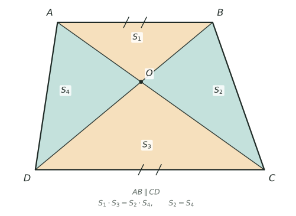

## 讲解

> 图中 $S_1=S_{\triangle AOB}$（上块），$S_2=S_{\triangle BOC}$（右翅），$S_3=S_{\triangle COD}$（下块），$S_4=S_{\triangle AOD}$（左翅）。

**一、模型是什么**

凸四边形 $ABCD$ 的两条对角线 $AC$、$BD$ 在内部交于 $O$，就把它分成四个两两共边的小三角形，形状像一只展开翅膀的蝴蝶，所以叫**蝴蝶模型**（也叫对角线面积模型）。含 $AB$ 的一块习惯叫上块，含 $CD$ 的叫下块，另外两块叫左右翅。四块都以 $O$ 为公共顶点，这正是"共高"能被反复使用的原因。它管两件事：一般四边形里四块面积满足"上下之积等于两翅之积"；只要有一组对边平行（梯形、平行四边形），四块的份数就被两底之比完全锁死，不必再一个个算高。

**二、结论一：乘积式（凸四边形，对角线在内部相交）**

同高的两个三角形，面积比等于底之比。上块与右翅共用高（底是 $AC$ 上的 $AO$、$OC$），所以上块比右翅等于 $AO:OC$；左翅与下块也共高，左翅比下块同样等于 $AO:OC$。两式相除去分母，得到
$$S_{\text{上}}\times S_{\text{下}}=S_{\text{右}}\times S_{\text{左}}$$
这条式子只用到"共高"，与是否平行无关。它的用法有两面：知三块求第四块；反过来把面积比当尺子，$AO:OC$ 直接读作上块比右翅，$BO:OD$ 读作上块比左翅。一般四边形中，已知"三块面积"（第四块用乘积式求），或"一块面积加两条线段比"，就能把整张图补齐；在梯形中两条线段比相等，一块面积加一个线段比就够了。用下标把四块记足：上块 $S_1$、右翅 $S_2$、下块 $S_3$、左翅 $S_4$，则 $S_1:S_4=S_2:S_3$，也就是 $S_1\times S_3=S_2\times S_4$；而 $AO:OC=S_1:S_2=S_4:S_3$：前一组分别以 $AO$、$OC$ 为底，共用从 $B$ 到 $AC$ 的高；后一组共用从 $D$ 到 $AC$ 的高。

**三、结论二：梯形份数（$AB\parallel CD$）**

先证两翅相等：以 $AB$ 为底的两个三角形 $ABD$、$ABC$ 同底等高，面积相等，各自减去公共的上块，剩下的左右两翅自然相等。再设 $AB:CD=a:b$。由平行得三角形 $AOB$ 与 $COD$ 相似、相似比 $a:b$，于是上下两块面积比为 $a^2:b^2$，同时 $AO:OC=BO:OD=a:b$。为什么是平方？相似的两个三角形底按 $a:b$ 缩放、高也按 $a:b$ 缩放，面积是底与高乘积的一半，两个 $a:b$ 相乘就是平方。上块与右翅共高、底之比正是 $AO:OC=a:b$，所以右翅取 $ab$ 份；上块与左翅共高、底之比是 $BO:OD=a:b$，左翅同样 $ab$ 份。四块份数为
$$a^2:ab:b^2:ab$$
把四块相加，总份数是 $a^2+2ab+b^2$，是一个**完全平方** $(a+b)^2$，不是 $a^2+ab+b^2$——这是本模型最容易丢分的一步。再代入梯形的高 $h$ 可以验出 $k=\dfrac{h}{2(a+b)}$，总面积 $\dfrac{(a+b)h}{2}$，与梯形面积公式严丝合缝，说明份数不是凑出来的，而是被平行条件唯一确定的。连起来写就是 $S_1:S_3=a^2:b^2$，$S_1:S_2:S_3:S_4=a^2:ab:b^2:ab$。

**四、三个高级变形**

（1）**腰延长**：不妨设 $a<b$（若 $a>b$，把 $a,b$ 对调即可），延长 $AD$、$BC$ 交于 $P$，三角形 $PAB$ 与 $PDC$ 相似、比 $a:b$，于是 $PA:PD=a:b$、$PA:AD=a:(b-a)$，两三角形面积比 $a^2:b^2$，且大三角形减小三角形恰好等于梯形面积；求 $P$ 到上底的高时，只需把梯形的高按 $a:(b-a)$ 放大。（2）**和差还原**：上块加下块为 $(a^2+b^2)k$，两翅和为 $2abk$，相减得 $(a-b)^2k$；把它与总面积 $(a+b)^2k$ 联立，先开方、再用和差公式，就能由面积还原两底之比。（3）**面积读线段**：$AO:OC$、$BO:OD$ 都能从四块面积里读出来，已知线段比和一块面积，整张图就定了。

**五、竞赛视角**

看到对角线交点、梯形分块、同底共高，先标两翅相等与乘积式。别和燕尾混：燕尾是三角形内一点连三个顶点，分出的三块共顶点；也别和鸟头混：鸟头是共角三角形的面积比。缺对角线就补一条，缺平行就找平行，梯形没给 $P$ 就延长两腰造相似，这是本专题最常见的两次构造。固定四步：标两翅相等、写份数、定 $k$、回头用乘积式验算。题目没说哪条底在上时，$a:b$ 与 $b:a$ 只是同一个梯形换了标注，答案按"两块面积"报即可。平行四边形是 $a=b$ 的极端情形，四块全相等，可用来快速验算。

### 六、易错点

1. 把 $AB:CD=2:3$ 当面积比：应平方成 $4:9$，面积比是长度比的平方。
2. 总份数写成 $a^2+ab+b^2$：应为 $(a+b)^2$，漏了另一只翅膀。
3. 以为任意四边形两翅相等：一般四边形不保证两翅相等；$AB\parallel CD$ 是推出两翅相等的充分条件。
4. 把 $AO:OC$ 当四块之比：它只管同侧共高的两块。
5. 由面积 $9:25$ 反求底比忘开方：应为 $3:5$。
6. 腰延长后写 $PA:AD=a:b$：应为 $a:(b-a)$，差了一段。
7. 同高面积比量错端点：先写清从哪端量、对应哪条底。

## 竞赛真题中的考察

> 本库题库尚无与本节模型完全对应的真题，下列实引均标注卷次，未标卷次的为同类题型描述，不作真题出处引用。

- **2024 IHC 6 培训 第 28 题**：四边形被一条对角线三等分，用"共高 → 面积比＝底比"读出中间两块各占整体的 $\frac13$——蝴蝶乘积式正是这条共高比的直接推论（★★★）
- **同类题型**：梯形两条对角线交于 $O$，四块面积满足"上×下＝左翅×右翅"，且上下两块面积比等于两底之比的平方，给一块面积就能补全整张图（与例1 同构）（★★）
- **同类题型**：只给梯形的"上下面积和"与"两翅面积和"，先反求两底之比、再还原各块面积（与例3 同构）（★★★★）

> 完整题目与解答见仓库 `exam/answers/` 对应试卷文件；跨卷汇总见 `exam/SUMMARY.md`。

<!-- card:auto -->
## 速查卡

> 裁剪即用：本页对应速查卡「几何 38正」。下面是本节最紧的一版摘要，公式与结论与正文完全一致，用于做题前扫一遍。全套卡片见 `tools/cards/build/cards.html`。

**乘积式**

- 记四块：上块 $S_1$、右翅 $S_2$、下块 $S_3$、左翅 $S_4$

$$S_1\times S_3=S_2\times S_4$$

- 任意四边形都成立，只用共高；知三块可求第四块
- $AO:OC=S_1:S_2=S_4:S_3$，即同侧两块相加再比

**梯形份数**

- 条件：$AB\parallel CD$ 时两翅才相等（一般四边形不成立）

$$S_1:S_3=a^2:b^2,\quad S_1:S_2:S_3:S_4=a^2:ab:b^2:ab$$

- 设 $AB:CD=a:b$，总份数 $(a+b)^2$，定 $k$ 后分配四块

**变形**

- 腰延长交于 $P$：$PA:AD=a:(b-a)$，两三角形面积比 $a^2:b^2$
- 和差还原：$(a+b)^2k$ 与 $(a-b)^2k$ 联立，开方再用和差求 $a:b$

> ✅ 识别信号：对角线交点、梯形四块、同底共高
> ⚠️ 易错：总份数是 $(a+b)^2$；底比 $2:3$ 对应面积比 $4:9$
<!-- /card:auto -->

## 例题

### 例1：由两条对角线的比推四块面积（★★）

**题目**：四边形 $ABCD$ 的对角线 $AC$、$BD$ 相交于点 $O$。已知 $AO:OC=2:3$，$BO:OD=3:4$，$S_{\triangle AOB}=12$ 平方厘米。求另外三块的面积和四边形 $ABCD$ 的面积。

**覆盖点**：对角线乘积式与共高比

**解析**：

为什么想到用共高比：题目给的是"同一条对角线上的线段比"，而 $\triangle AOB$ 与 $\triangle BOC$ 恰好以 $AC$ 上的 $AO$、$OC$ 为底、共用以 $B$ 到 $AC$ 的距离为高，于是线段比就是面积比，两个条件正好各管一对三角形。剩下的一块再用乘积式收口，不必第三次求高。

第一步，右翅。$\triangle AOB$ 与 $\triangle BOC$ 共高，
$$\frac{S_{\triangle BOC}}{S_{\triangle AOB}}=\frac{OC}{AO}=\frac{3}{2}\ \Rightarrow\ S_{\triangle BOC}=12\times\frac{3}{2}=18$$

第二步，左翅。$\triangle AOB$ 与 $\triangle AOD$ 共用以 $A$ 到 $BD$ 的距离为高，底是 $BO$、$OD$，
$$S_{\triangle AOD}=12\times\frac{OD}{BO}=12\times\frac{4}{3}=16$$

第三步，下块。此时三块已知，直接调用乘积式，比再算一次共用高更稳：
$$12\times S_{\triangle COD}=18\times16=288\ \Rightarrow\ S_{\triangle COD}=24$$

第四步，求和：$S_{ABCD}=12+18+24+16=70$（平方厘米）。

验算：取 $AO=2$、$OC=3$，$B$ 到 $AC$ 的距离为 $12$，则 $S_{\triangle AOB}=\frac12\times2\times12=12$、$S_{\triangle BOC}=\frac12\times3\times12=18$；再取 $D$ 到 $AC$ 的距离为 $16$，则 $S_{\triangle AOD}=\frac12\times2\times16=16$、$S_{\triangle COD}=\frac12\times3\times16=24$。此时 $BO:OD=12:16=3:4$，与题设一致；乘积 $12\times24=288=18\times16$，四块合计 $70$。

**答案**：$S_{\triangle BOC}=18$、$S_{\triangle AOD}=16$、$S_{\triangle COD}=24$ 平方厘米，四边形面积 $70$ 平方厘米

### 例2：延长两腰，用蝴蝶份数求大三角形（★★★）

**题目**：梯形 $ABCD$ 中 $AB\parallel CD$，$AB:CD=2:3$，对角线 $AC$、$BD$ 相交于点 $O$，$S_{\triangle AOB}=8$ 平方厘米。延长 $AD$、$BC$ 交于点 $P$。求 $S_{\triangle PAB}$ 与 $S_{\triangle PDC}$。

**覆盖点**：梯形份数分配与腰延长

**解析**：

为什么想到先算份数：$P$ 点不在梯形里，但 $S_{\triangle PAB}$ 与 $S_{\triangle DAB}$ 共用底 $AB$，只要知道两条高的比就能把面积搬过去；而高之比由 $PA:AD$ 决定，$PA:AD$ 又要靠梯形的份数把整块面积先"称"出来。所以顺序是：先份数，再定高比，最后搬面积。

第一步，定份数。$AB:CD=2:3$，四块之比为 $2^2:2\times3:3^2:2\times3=4:6:9:6$。由 $4k=8$ 得 $k=2$，于是
$$S_{\triangle BOC}=S_{\triangle AOD}=6\times2=12,\quad S_{\triangle COD}=9\times2=18,\quad S_{\text{梯形}}=25\times2=50$$

第二步，求 $PA:AD$。由 $AB\parallel CD$，$\triangle PAB$ 与 $\triangle PDC$ 相似，比 $2:3$，所以 $PA:PD=2:3$，即 $PA$ 占 $2$ 份、$AD$ 占 $1$ 份：
$$PA:AD=2:1$$

第三步，搬面积。$\triangle PAB$ 与 $\triangle DAB$ 都以 $AB$ 为底，高之比等于 $PA:AD=2:1$（$P$、$A$、$D$ 共线，到 $AB$ 的距离与到 $A$ 的距离成正比），而 $S_{\triangle DAB}=8+12=20$，故
$$S_{\triangle PAB}=20\times2=40$$

第四步，求 $S_{\triangle PDC}$。$P$、$A$、$D$ 共线、$P$、$B$、$C$ 共线，所以 $S_{\triangle PDC}=S_{\triangle PAB}+S_{\text{梯形}}=40+50=90$；也可用相似比平方校验：$S_{\triangle PAB}:S_{\triangle PDC}=4:9=40:90$，一致。

验算：取 $AB=2$、$CD=3$、梯形高 $20$。由 $k=\dfrac{h}{2(a+b)}=2$、$a+b=2+3=5$ 反推 $h=20$，梯形面积 $\frac{(2+3)\times20}{2}=50$；$O$ 到 $AB$ 的距离为 $20\times\frac{2}{5}=8$，$S_{\triangle AOB}=\frac12\times2\times8=8$，与题设吻合。由 $PA:AD=2:1$，$P$ 到 $AB$ 的距离为 $2\times20=40$，$S_{\triangle PAB}=\frac12\times2\times40=40$；$P$ 到 $CD$ 的距离为 $40+20=60$，$S_{\triangle PDC}=\frac12\times3\times60=90$，且 $90-40=50$ 正好是梯形面积。

**答案**：$S_{\triangle PAB}=40$ 平方厘米，$S_{\triangle PDC}=90$ 平方厘米

### 例3：由"上下和"与"两翅和"还原两底之比（★★★★）

**题目**：梯形 $ABCD$ 中 $AB\parallel CD$ 且 $AB>CD$，对角线 $AC$、$BD$ 相交于点 $O$。已知上块与下块的面积之和为 $58$ 平方厘米，左右两翅的面积之和为 $42$ 平方厘米。求 $AB:CD$、四块的面积和梯形的总面积。

**覆盖点**：面积和差与底比还原

**解析**：

为什么想到作差：题目给的两个数据，一个像"平方和"、一个像"乘积"，正好是 $(a+b)^2$ 与 $(a-b)^2$ 的两半。上块加下块 $=a^2k+b^2k$，两翅和 $=2abk$，相减恰好剩 $(a-b)^2k$；相加恰好是总面积 $(a+b)^2k$。先凑出这两个完全平方，再开方、用和差公式，$a:b$ 就出来了。

第一步，总面积：$S_{\text{梯形}}=58+42=100$（平方厘米）。

第二步，凑两个完全平方：
$$(a+b)^2k=100,\qquad (a-b)^2k=58-42=16$$

第三步，开方取比。两式相除：
$$\left(\frac{a+b}{a-b}\right)^2=\frac{100}{16}=\frac{25}{4}\ \Rightarrow\ (a+b):(a-b)=5:2$$

第四步，和差还原。把 $a+b$ 看作 $5$ 份、$a-b$ 看作 $2$ 份，则 $a$ 是 $5+2=7$ 份的一半、$b$ 是 $5-2=3$ 份的一半，同时除以 $2$ 不影响比：
$$a:b=(5+2):(5-2)=7:3$$
又已知 $AB>CD$，所以取 $AB:CD=7:3$，不是 $3:7$。

第五步，定 $k$：$(7+3)^2k=100\Rightarrow k=1$。四块为
$$S_{\triangle AOB}=49,\quad S_{\triangle BOC}=21,\quad S_{\triangle COD}=9,\quad S_{\triangle AOD}=21\ (\text{平方厘米})$$

验算：取 $AB=7$、$CD=3$、高 $h=20$，则梯形面积 $\frac{(7+3)\times20}{2}=100$；$O$ 到 $AB$ 的距离为 $20\times\frac{7}{10}=14$，$S_{\triangle AOB}=\frac12\times7\times14=49$；$O$ 到 $CD$ 的距离为 $6$，$S_{\triangle COD}=\frac12\times3\times6=9$；$\triangle AOD$ 与 $\triangle AOB$ 同底 $AO$，高之比 $OD:OB=3:7$，故 $S_{\triangle AOD}=49\times\frac{3}{7}=21$。检验：$49+9=58$，$21+21=42$，$49+21+9+21=100$，三组数据全部对上。

**答案**：$AB:CD=7:3$，$S_{\triangle AOB}=49$、$S_{\triangle COD}=9$、两翅各 $21$ 平方厘米，梯形面积 $100$ 平方厘米

### 例4：梯形内一点 E 引线截对角线，求两块面积（★★★★★）

**题目**：梯形 $ABCD$ 中 $AB\parallel CD$，$AB:CD=2:3$，对角线 $AC$、$BD$ 相交于点 $O$。点 $E$ 在边 $AB$ 上，且 $AE:EB=1:3$。连接 $CE$，与 $BD$ 交于点 $F$。已知 $S_{\triangle AOB}=8$ 平方厘米，求 $S_{\triangle CDF}$ 与 $S_{\triangle COF}$。

**覆盖点**：相似比与同高分割

**解析**：

为什么这样拆：$F$ 落在 $BD$ 上，而 $C$ 不在 $BD$ 上，所以 $\triangle CDF$、$\triangle COF$、$\triangle CDB$、$\triangle COD$ 全都是"以 $BD$ 上一段为底、以 $C$ 到 $BD$ 的距离为高"的三角形——它们在 $BD$ 这条线上共用同一个高。于是整道题化为两件事：先把 $BD$ 上各分点的位置（比）求出来，再把线段比搬到面积上。

第一步，蝴蝶份数。$AB:CD=2:3$，四块之比 $4:6:9:6$。由 $4k=8$ 得 $k=2$：
$$S_{\triangle BOC}=S_{\triangle AOD}=12,\quad S_{\triangle COD}=18,\quad S_{\text{梯形}}=50$$
同时 $BO:OD=AB:CD=2:3$，即 $BO=\frac25 BD$。

第二步，求 $F$ 在 $BD$ 上的位置。这是全题的构造点：$E$ 在 $AB$ 上，$EB$ 与 $DC$ 方向相同，所以 $\triangle FBE$ 与 $\triangle FDC$ 相似。由 $AE:EB=1:3$ 得 $EB=\frac34 AB$，而 $DC=\frac32 AB$，于是
$$EB:DC=\frac34 AB:\frac32 AB=1:2\ \Rightarrow\ BF:FD=1:2$$
即 $BF=\frac13 BD$、$DF=\frac23 BD$。

第三步，求 $S_{\triangle CDF}$。$\triangle CDF$ 与 $\triangle CDB$ 都以 $CD$ 为底，高之比等于 $DF:DB=\frac23$，而 $S_{\triangle CDB}=S_{\triangle COD}+S_{\triangle BOC}=18+12=30$，故
$$S_{\triangle CDF}=30\times\frac{2}{3}=20$$

第四步，求 $S_{\triangle COF}$。关键是比较 $OF$ 与 $OD$ 这两段。以 $B$ 为起点在 $BD$ 上量：
$$OF=BO-BF=\left(\frac25-\frac13\right)BD=\frac{1}{15}BD,\qquad OD=\frac35 BD$$
$\triangle COF$ 与 $\triangle COD$ 同高（高是 $C$ 到 $BD$ 的距离），面积比等于底之比：
$$\frac{S_{\triangle COF}}{S_{\triangle COD}}=\frac{OF}{OD}=\frac{1/15}{3/5}=\frac19\ \Rightarrow\ S_{\triangle COF}=18\times\frac19=2$$

验算：取 $AB=2$、$CD=3$、高 $20$，则梯形面积 $\frac{5\times20}{2}=50$，$O$ 到 $AB$ 的距离 $20\times\frac25=8$，$S_{\triangle AOB}=\frac12\times2\times8=8$，与题设相符。按 $AE:EB=1:3$ 取坐标 $D(0,0)$、$C(3,0)$、$A(0,20)$、$B(2,20)$，则 $E(0.5,20)$、$O(1.2,12)$、$F\left(\frac43,\frac{40}{3}\right)$。$\triangle CDF$ 以 $CD=3$ 为底，$F$ 到 $CD$ 的高为 $\frac{40}{3}$，面积 $=\frac12\times3\times\frac{40}{3}=20$；$\triangle COF$ 用三点坐标求面积：
$$\frac12\left|3\left(12-\frac{40}{3}\right)+\frac65\cdot\frac{40}{3}+\frac43(0-12)\right|=\frac12\left|-4+16-16\right|=2$$
两块面积分别落在 $20$ 与 $2$ 上，唯一。

**答案**：$S_{\triangle CDF}=20$ 平方厘米，$S_{\triangle COF}=2$ 平方厘米

## 变式与自测

> 四道题按「模仿 → 变式 → 综合 → 自测」排。先盖住答案自己做，做完再对；蝴蝶题的失分点集中在两处——忘了先确认"这是梯形"，以及把份数 $a^2:ab:b^2:ab$ 记成了 $a^2:ab:b^2:ba$ 之外还多算一块。

### 变式1：给两底与高，配出四块（★★）

**题目**：梯形 $ABCD$ 中，$AD\parallel BC$，$AD=4$ 厘米，$BC=6$ 厘米，高为 $5$ 厘米，对角线 $AC$、$BD$ 交于点 $O$。求 $\triangle AOD$、$\triangle AOB$、$\triangle BOC$、$\triangle DOC$ 的面积。

**覆盖点**：对角线乘积式与共高比

**解析**：为什么先用"份数"再算总面积？四块的比只由两底之比决定，与高无关；先写份数、再拿梯形总面积去除，比一块一块找底和高省得多。写份数前必须先确认 $AD\parallel BC$（这是蝴蝶结论成立的前提），题面第一句已经给了。

两底比 $a:b=4:6=2:3$，四块份数 $a^2:ab:b^2:ab=4:6:9:6$，共 $25$ 份。

$$\text{梯形面积}=\frac{(4+6)\times5}{2}=25\ \Longrightarrow\ \text{每份}=1 .$$

于是 $S_{\triangle AOD}=4$、$S_{\triangle AOB}=6$、$S_{\triangle BOC}=9$、$S_{\triangle DOC}=6$（平方厘米）。

验算：乘积式 $4\times9=36=6\times6$ ✓；两翅相等 $6=6$ ✓；四块相加 $4+6+9+6=25$，与梯形面积相等 ✓。

**答案**：上 $4$、下 $9$、左右两翅各 $6$，共 $25$ 平方厘米。

### 变式2：延长两腰，用份数求大三角形（★★★）

**题目**：梯形 $ABCD$ 中，$AD\parallel BC$，$AD=3$ 厘米，$BC=5$ 厘米。延长两腰 $BA$、$CD$，交于点 $P$。已知梯形面积为 $32$ 平方厘米，求 $\triangle PAD$ 与 $\triangle PBC$ 的面积。

**覆盖点**：梯形份数分配与腰延长

**解析**：为什么延长两腰就能用份数？延长后出现了两个相似三角形，面积比是两底比的平方，而它们的差正好是已知的梯形。所以梯形的面积对应"两份平方之差"，除一下就是每份。

$$\frac{S_{\triangle PAD}}{S_{\triangle PBC}}=\left(\frac35\right)^2=\frac{9}{25},\qquad S_{\triangle PBC}-S_{\triangle PAD}=32 .$$

$25-9=16$ 份对应 $32$ 平方厘米，每份 $2$ 平方厘米，于是 $S_{\triangle PAD}=18$、$S_{\triangle PBC}=50$。

验算：$50-18=32$ ✓；再看腰延长的线段比 $PA:AB=a:(b-a)=3:2$，与 $\triangle PAD$ 和梯形的高之比一致，可自查 $18:32=9:16$ ✓。

**答案**：$S_{\triangle PAD}=18$ 平方厘米，$S_{\triangle PBC}=50$ 平方厘米。

### 变式3：由"和"还原两底之比（★★★★）

**题目**：梯形 $ABCD$ 中，$AD\parallel BC$，对角线交于点 $O$。已知上、下两块面积之和为 $52$ 平方厘米，左右两翅面积之和为 $48$ 平方厘米。求四块各自的面积与 $AD:BC$。

**覆盖点**：面积和差与底比还原

**解析**：为什么把两个"和"拿来凑完全平方？设两底为 $a:b$、每份为 $k$，则上下和为 $(a^2+b^2)k$、两翅和为 $2abk$。把它们相加得 $(a+b)^2k$、相减得 $(a-b)^2k$——两个完全平方一出来，$(a+b)$ 与 $(a-b)$ 就同时知道了，底比自然还原。

$$(a+b)^2k=52+48=100,\qquad (a-b)^2k=52-48=4 .$$

开方相除得 $\dfrac{a+b}{a-b}=\dfrac{10}{2}=5$，即 $a:b=3:2$（取 $a<b$ 则为 $2:3$）。再由 $(a^2+b^2)k=52$：取 $a=2$、$b=3$ 时 $13k=52$，$k=4$。

故上 $4k=16$、下 $9k=36$、两翅各 $6k=24$（平方厘米），$AD:BC=2:3$。

验算：$16+36=52$ ✓，$24+24=48$ ✓，乘积式 $16\times36=576=24^2$ ✓，四块和 $100$ 也等于 $(2+3)^2\times4$ ✓。

**答案**：上 $16$、下 $36$、两翅各 $24$ 平方厘米，$AD:BC=2:3$。

### 自测：相似比与同高分割（★★★）

**题目**：梯形 $ABCD$ 中，$AD\parallel BC$，$AD=6$ 厘米，$BC=9$ 厘米，高为 $10$ 厘米，对角线 $AC$、$BD$ 交于点 $O$。求 $S_{\triangle AOD}:S_{\triangle BOC}$、$AO:OC$，以及梯形面积与 $S_{\triangle AOB}$。

**覆盖点**：相似比与同高分割

**解析**：这道自测把蝴蝶的三条结论一次串起来：由平行得相似，相似比决定面积比的平方与对角线之比的本身；再由总份数分配出单块。判断依据只有一句——**相似比一维是 $k$、二维是 $k^2$**。

相似比 $AD:BC=6:9=2:3$，所以

$$S_{\triangle AOD}:S_{\triangle BOC}=4:9,\qquad AO:OC=2:3 .$$

四块份数 $4:6:9:6$，共 $25$ 份；梯形面积 $\dfrac{(6+9)\times10}{2}=75$ 平方厘米，每份 $3$ 平方厘米，故 $S_{\triangle AOB}=6\times3=18$。

验算：$4+6+9+6=25$ 份对应 $75$ ✓；$S_{\triangle AOD}=12$、$S_{\triangle BOC}=27$，乘积式 $12\times27=324=18^2$ ✓。

**答案**：面积比 $4:9$，$AO:OC=2:3$，梯形面积 $75$ 平方厘米，$S_{\triangle AOB}=18$ 平方厘米。
