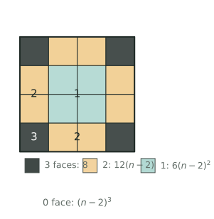

## 讲解

### 一、模型：位置定，答案就定

表面染色题的结构是固定的：给一个大正方体（或长方体）的表面涂色，再沿三个方向把它切成棱长 $1$ 的小正方体，问"恰好三面、两面、一面、零面涂色"的各有多少块。适用条件很明确——三个方向都切成整数份，每块都是单位小正方体。核心结论只有一句：**一块小正方体涂到几面，完全由它在大立体中的位置决定**，与颜色、涂色先后、切割顺序都无关。

位置与面数是"由外向内"的四层：$8$ 个顶点处→三面；棱上除两端→两面；面的内部除边框→一面；剥掉外壳剩下的内核→零面。设大正方体棱长为 $n$，记内棱长 $m=n-2$，则

$$\text{三面}=8,\qquad \text{两面}=12m,\qquad \text{一面}=6m^{2},\qquad \text{零面}=m^{3}.$$

这四类把 $n^{3}$ 块小正方体不重不漏地分完，所以
$$8+12m+6m^{2}+m^{3}=(m+2)^{3}=n^{3}.$$

### 二、推导：剥洋葱与两条守恒

为什么处处是 $n-2$？三条理由各管一类。每条棱上本来有 $n$ 块，但两端各 $1$ 块已经是顶点块，必须先被顶点"领走"，中间才剩 $n-2$ 块恰好两面；每个面是 $n\times n$ 的方阵，最外一圈被顶点和棱占完，只剩 $(n-2)^{2}$ 块恰好一面；把外壳整层剥掉，内核是棱长 $n-2$ 的正方体，共 $(n-2)^{3}$ 块。这就是"剥洋葱"：$3\to2\to1\to0$ 四层，每向内一层，三个方向的坐标各少掉两个边界值。

公式之外还有两条守恒式，比公式更耐用于验算。

（1）**块数守恒**：四类之和 $=n^{3}$（长方体为 $abc$）。

（2）**红面守恒**：所有小正方体上涂色小正方形的总数，等于大立体的表面积。正方体是 $6n^{2}$，长方体是 $2(ab+bc+ca)$。于是
$$3\times8+2\times12m+1\times6m^{2}=6n^{2}.$$
取 $n=7$ 检验：$24+120+150=294=6\times49$。任何一类数错，这条式子立刻失衡。注意"红面数"与"块数"是两套计数，前者才乘每块的面数。

### 三、三个高级变形

**变形1（长方体）**：设 $A=a-2$、$B=b-2$、$C=c-2$（三个棱长都至少为 $2$）。$12$ 条棱分成三组、每组 $4$ 条，净长分别是 $A,B,C$；$6$ 个面两两相对，净面积分别是 $AB,BC,CA$，顶点处的三面块仍是 $8$ 个。故
$$\text{两面}=4(A+B+C),\quad \text{一面}=2(AB+BC+CA),\quad \text{零面}=ABC,$$
也就是 $\text{两面}=4[(a-2)+(b-2)+(c-2)]$、$\text{一面}=2[(a-2)(b-2)+(b-2)(c-2)+(c-2)(a-2)]$、$\text{零面}=(a-2)(b-2)(c-2)$。
要紧的是次数："两面"对 $A+B+C$ 是一次式，"一面"是二次式。所以题目给两面板数时，可以直接列一元一次方程反解棱长；给一面块数时，通常先解出棱长再代入。

**变形2（缺面与补差）**：有面不涂时，绝不照搬六面公式。做法是先按六面全涂算，再把缺掉的那个面逐块"降级"：该面的角块 $3\to2$、棱中块 $2\to1$、面内块 $1\to0$。若缺的是两个相对的面，则沿这一方向的各层结构完全相同（这一方向根本没涂色），可以把立体压扁成一排 $n\times n$ 的柱子，先在一层里分类，再乘层数。这个"降维法"是压轴题最省事的入口。

**变形3（拼合与重分类）**：两个立体分别涂色后再粘合，贴缝处的红色被夹在内部，看不见但确实涂过。此时等价于在标准答案上给贴缝两侧的块各加一面，但必须回到贴缝那一层重新分类，不能只把总数加一，因为一层之内不同位置的块原本的等级并不相同。

### 四、竞赛视角

看到"表面涂色＋切成小正方体"，先写四类公式；看到"至少一面"，立刻用补集 $n^{3}-(n-2)^{3}$，不要一类一类去加；看到"没有涂色"，就想"剥掉一层皮"。题目给"某一类的块数"或"两类之差、之比"时，先判断这个量对 $m$ 是几次的：一次的直接列方程，二次的试算后用块数守恒收尾。

要区分三套语言：表面染色数的是"块"，三视图数的是"层高"，体积问题算的是"单位立方体个数"。题中问"红色面的总面积"时才按面数乘，问"块数"时只做加法。出现"有面不涂""粘合""挖去一块"这类词，说明位置结构变了，信号是：先画图定位，把立体拆成"标准部分＋被改动的那一层"，再分类修正。

### 五、易错点

1. **用 $n$ 顶替 $n-2$**。错：棱长 $6$ 时两面写成 $12\times6=72$ 块。对：$12\times(6-2)=48$ 块。因为每条棱两端的块属于顶点，不能再计入棱。
2. **顶点被重复计数**。错：棱上数满 $n$ 块，又另外加上 $8$ 块三面，总数超过 $n^{3}$。对：先把 $8$ 块钉死，之后任何一类都不许再含顶点块。
3. **长方体硬套正方体公式**。错：$4\times4\times8$ 也写"一面 $=6(n-2)^{2}$"。对：按三组棱、三对面分别算，得 $8,40,56,24$，相加恰为 $128$。
4. **忽略 $n=1,2$ 的边界**。错：$n=2$ 套公式得两面 $0$、零面 $0$，就以为无解。对：$n=2$ 时 $8$ 块全是三面；$n=1$ 时唯一一块六面全涂，公式中的"中间段"根本不存在。
5. **缺面后仍写"三面 $8$ 块"**。错：有面不涂还照抄 $8$。对：缺面后三面块数会降，两面相对不涂时可降到 $0$，要重新分类。
6. **对同一块重复降级**。错：两个面不涂，就对某块连减两次面数。对：先看这块实际碰到几个被涂的面，再定等级；相对两面不涂时，每块最多只被两面涂到。

## 竞赛真题中的考察

> 本库题库尚无与本节模型完全对应的真题，下列实引均标注卷次，未标卷次的为同类题型描述，不作真题出处引用。

- **同类题型**：长方体三条棱长不等时，六面涂色后一面涂色块数为 $2(AB+BC+CA)$、两面为 $4(A+B+C)$（$A=a-2$、$B=b-2$、$C=c-2$），已知其中某一类的块数（常配“三棱长为连续整数”），反求三条棱长再补算其余三类（★★★★）
- **同类题型**：两个已涂色的立体拼合后再切块，贴缝处两侧的块红面被夹在内部，必须回到贴缝那一层重新分级，用“红面总数＝六面标准答案＋贴缝增量”作检验（★★★★★）
- **2024 IHC 6 培训 第 32 题**：容斥+表面积增减（源题待核）（★★★★★★）

> 完整题目与解答见仓库 `exam/answers/` 对应试卷文件；跨卷汇总见 `exam/SUMMARY.md`。

<!-- card:auto -->
## 速查卡

> 裁剪即用：本页对应速查卡「几何 44背」。下面是本节最紧的一版摘要，公式与结论与正文完全一致，用于做题前扫一遍。全套卡片见 `tools/cards/build/cards.html`。

**四类公式**

- 以下公式适用于 $n\ge2$；若 $n=1$，唯一小正方体的六个面都涂色
- 设内棱长 $m=n-2$，则三面 $=8$ 块（全在顶点）
- 两面 $=12m$（棱上除两端）
- 一面 $=6m^{2}$（面内除边框）、零面 $=m^{3}$（内核）
- 四类之和 $=n^{3}$；至少一面用补集 $n^{3}-(n-2)^{3}$

**长方体**

$A=a-2,\quad B=b-2,\quad C=c-2\qquad(a,b,c\ge2)$

- 两面 $=4(A+B+C)$ 为一次式，可直接反解棱长
- 一面 $=2(AB+BC+CA)$、零面 $=ABC$ 为二次、三次式

**变形**

- 缺面：先按六面算再逐块降级；两相对面不涂可降维成一排
- 粘合：贴缝处红色仍在，须回该层重新分类

> ✅ 信号：表面涂色后切成小正方体、至少一面、没涂色
> ⚠️ 易错：棱上只数 $n-2$ 块，两端属顶点；长方体别套正方体
<!-- /card:auto -->

## 例题

### 例1：正方体切开后的四类块数与红面总数（★★）

**题目**：把一个棱长 $7$ 厘米的正方体的六个面全部涂成红色，再切成 $343$ 个棱长 $1$ 厘米的小正方体。（1）恰好三面、两面、一面涂色以及没有涂色的小正方体各有多少块？（2）至少一面涂色的有多少块？（3）所有小正方体上红色小正方形面的总数是多少？用第（3）问检验前三问。

**覆盖点**：染色块位置分类

**解析**：为什么先算"内棱长"？四类公式里出现的都不是 $7$，而是同一个小量 $m=n-2$，所以第一步只做一件事：把 $n$ 换成 $m$。

第一步，求内棱长。$m=7-2=5$，意思是每条棱的两端各剥掉 $1$ 块、每个面剥掉最外一圈后，剩下的"净尺寸"都是 $5$。

第二步，按位置分四类。三面只在大正方体的 $8$ 个顶点处，共 $8$ 块；两面在 $12$ 条棱的中间段，每条 $5$ 块，
$$12\times5=60\ \text{块};$$
一面在 $6$ 个面的内部，每个面是 $5\times5$ 的方阵，
$$6\times5^{2}=6\times25=150\ \text{块};$$
零面藏在核心里，是棱长 $5$ 的正方体，
$$5^{3}=125\ \text{块}.$$

第三步，块数守恒验算：$8+60+150+125=343=7^{3}$，四类不重不漏。

第四步，求"至少一面"。用补集最快：只有零面的 $125$ 块没被涂到，故
$$343-125=218\ \text{块},$$
与 $8+60+150=218$ 一致。

第五步，求红面总数并检验。每块贡献的红面数就是它的涂色面数，所以总红面数为
$$3\times8+2\times60+1\times150=24+120+150=294.$$
另一方面，红面总数必须等于大正方体的表面积 $6\times7^{2}=6\times49=294$，两边相等。这一步同时验证了"三面 $8$ 块、两面 $60$ 块、一面 $150$ 块"三个数都没错：只要有一个数错，红面总数就不可能刚好是 $294$。

**答案**：三面 $8$ 块，两面 $60$ 块，一面 $150$ 块，零面 $125$ 块；至少一面 $218$ 块；红面总数 $294$ 个。

### 例2：由两面涂色块数反求三条棱长（★★★）

**题目**：一个长方体，长、宽、高是三个连续整数（单位：厘米，长 $>$ 宽 $>$ 高）。把六个面全部涂色后切成棱长 $1$ 厘米的小正方体，已知恰好两面涂色的有 $60$ 块。求：（1）长方体的长、宽、高；（2）恰好一面涂色的块数；（3）没有涂色的块数；（4）长方体的体积。

**覆盖点**：长方体剥层与逆推

**解析**：为什么设"中间的那个数"？三个棱长本来有三个未知量，但"连续整数"把它们压成了一个；而恰好两面的块数是 $4(A+B+C)$，对三个净长只是一次式，最合适用来列方程。若改用"一面"列式，会出现平方，还得再试算，多绕一步。

第一步，设元并写出净长。设宽为 $b$ 厘米，则长为 $b+1$、高为 $b-1$。三条净长为
$$A=(b+1)-2=b-1,\qquad B=b-2,\qquad C=(b-1)-2=b-3.$$
（要有"棱上中间段"，需 $C\ge1$，即 $b\ge4$。）

第二步，用两面块数列方程。$12$ 条棱分三组，每组 $4$ 条，所以
$$4(A+B+C)=4\big[(b-1)+(b-2)+(b-3)\big]=4(3b-6)=60.$$
两边除以 $4$ 得 $3b-6=15$，故 $3b=21$，$b=7$。于是长 $8$、宽 $7$、高 $6$ 厘米，净长 $A=6$、$B=5$、$C=4$。因为方程是一次方程且解唯一，棱长唯一确定。

第三步，求一面。$6$ 个面两两相对，三对面的净面积是 $AB=30$、$BC=20$、$CA=24$，每对有两个面：
$$2(30+20+24)=2\times74=148\ \text{块}.$$

第四步，求零面。核心是 $A\times B\times C$ 的长方体：
$$6\times5\times4=120\ \text{块}.$$

第五步，双重验算。块数：$8+60+148+120=336$，而体积 $8\times7\times6=336$，相等；红面：$3\times8+2\times60+148=24+120+148=292$，而表面积 $2(8\times7+7\times6+8\times6)=2(56+42+48)=2\times146=292$，也相等。

**答案**：长 $8$ 厘米、宽 $7$ 厘米、高 $6$ 厘米；一面涂色 $148$ 块；没有涂色 $120$ 块；体积 $336$ 立方厘米。

### 例3：两个相对面不涂色（★★★★）

**题目**：一个棱长 $8$ 厘米的正方体，把上、下、前、后四个面涂成红色，左、右两个面不涂色，然后切成 $512$ 个棱长 $1$ 厘米的小正方体。（1）恰好三面、两面、一面、零面涂色的小正方体各有多少块？（2）所有小正方体上红色面的总数是多少？它与"涂了四个面"是否吻合？（3）至少一面涂色的有多少块？

**覆盖点**：缺面涂色的补差修正

**解析**：为什么先想"能不能降维"？注意不涂色的左、右两个面是一对**相对**的面，而"相对"意味着：沿左右方向看，$8$ 层小正方体的染色情况完全一样——任何一块的红面都只可能来自上、下、前、后，与它在左右方向排第几层毫无关系（靠左右两端的块也只是碰到没涂色的面而已）。所以不必一块一块数，把 $8$ 层"压扁"成一层 $8\times8$ 的方格，数清一层再乘 $8$。

第一步，数一层。这一层是 $8\times8$ 的方阵，四个方向中上、下、前、后都涂了色，于是方阵的四条边就是"被涂色的边界"：

- 四个角上的格子，同时靠两条被涂的边，得 $2$ 面，共 $4$ 格；
- 四条边上除去四角，每边 $6$ 格，共 $4\times6=24$ 格，只靠一条被涂的边，得 $1$ 面；
- 内部 $6\times6=36$ 格，哪条被涂的边都不靠，得 $0$ 面；
- 三面：一格最多靠两条边，故一层里没有三面的格子。

第二步，乘层数（左右方向共 $8$ 层，每层结构相同）：
$$\text{三面}=0,\quad \text{两面}=4\times8=32,\quad \text{一面}=24\times8=192,\quad \text{零面}=36\times8=288.$$

第三步，块数守恒：$0+32+192+288=512=8^{3}$，四类齐全。

第四步，红面总数检验。每块的红面数乘块数：
$$2\times32+1\times192=64+192=256.$$
另一方面，涂了 $4$ 个面，每个面有 $8\times8=64$ 个红色小正方形，共 $4\times64=256$，两者相等。这说明"上、下、前、后各涂一面"确实只留下 $256$ 个红面，没有漏算左右两面。

第五步，求至少一面。用补集：$512-288=224$ 块，与 $32+192=224$ 一致。

**答案**：三面 $0$ 块，两面 $32$ 块，一面 $192$ 块，零面 $288$ 块；红面总数 $256$ 个，恰等于 $4\times64$；至少一面 $224$ 块。

### 例4：粘合后贴缝处的重新分类（★★★★★）

**题目**：把一个 $4\times4\times8$ 的长方体沿中间的 $4\times4$ 截面锯成两个 $4\times4\times4$ 的正方体，把这两个正方体的六个面都涂成红色（包括将来要粘合的那个面），再拼回 $4\times4\times8$ 的长方体，最后切成 $128$ 个棱长 $1$ 厘米的小正方体。问：恰好三面、两面、一面、零面涂色的小正方体各有多少块？并用红色面总数检验。

**覆盖点**：拼合染色的重分类

**解析**：为什么想到"先算标准答案，再修正贴缝"？因为如果不涂贴缝、只涂大长方体的六个外表面，这就是一道标准题；现在的图形与它只差一件事——贴缝处的红色被夹在内部，看不见，却确实涂在两个正方体的面上。所以差别全部集中在贴缝两侧的那两层块上，其余部分照标准答案不动。这个"找参照、算差值"的思路，比从头分类省一半力气。

第一步，算标准答案。$a=4,b=4,c=8$，净长
$$A=2,\quad B=2,\quad C=6.$$
于是
$$\text{三面}=8,\qquad \text{两面}=4(2+2+6)=40,$$
$$\text{一面}=2(2\times2+2\times6+6\times2)=2(4+12+12)=56,\qquad \text{零面}=2\times2\times6=24.$$
检验：$8+40+56+24=128=4\times4\times8$。

第二步，看贴缝层原来是什么等级。贴缝把长度 $8$ 分成两半，靠缝的两层分别是第 $4$ 层和第 $5$ 层，每层 $4\times4=16$ 块，共 $32$ 块。这两层在"长"的方向上处于内部，红面只能来自宽、高两个方向，所以层内的等级正好和一张 $4\times4$ 方阵一样：

- 层内四角：宽、高两个方向都靠外，原本 $2$ 面，共 $4$ 块；
- 层内边上除四角：每边 $2$ 块，共 $8$ 块，原本 $1$ 面；
- 层内中间 $2\times2$：原本 $0$ 面，共 $4$ 块。

贴缝给这 $16$ 块各多添一面，于是每层的变化是：$4$ 块由 $2$ 面升为 $3$ 面，$8$ 块由 $1$ 面升为 $2$ 面，$4$ 块由 $0$ 面升为 $1$ 面。两层合计：$8$ 块 $2\to3$，$16$ 块 $1\to2$，$8$ 块 $0\to1$。

第三步，逐类结算。升级与降级要成对处理，不能只加不减：

$$\text{三面}=8+8=16,$$
$$\text{两面}=40-8+16=48,$$
$$\text{一面}=56-16+8=48,$$
$$\text{零面}=24-8=16.$$

第四步，块数守恒：$16+48+48+16=128$，与原长方体体积一致。

第五步，红面总数检验。按块数乘面数：
$$3\times16+2\times48+1\times48=48+96+48=192.$$
另一方面，两个 $4\times4\times4$ 正方体各自六面涂色，红面数各为 $6\times16=96$，共 $2\times96=192$，两边相等。这条检验很关键：标准答案的红面数是
$$3\times8+2\times40+1\times56=24+80+56=160,$$
贴缝层"每块加一面"共加 $32$ 个红面，$160+32=192$，加得不多不少。反过来说，若把贴缝两侧误当成"原本零面的块"，就会漏掉那些原本两面、一面的块，结果对不上 $192$。

**答案**：三面 $16$ 块，两面 $48$ 块，一面 $48$ 块，零面 $16$ 块；红面总数 $192$ 个，等于两个正方体红面数之和。

## 变式与自测

> 四道题按「模仿 → 变式 → 综合 → 自测」排。先盖住答案自己做，做完再对；染色题的失分点只有一个——套公式前没数清"表面涂了几个面"。

### 变式1：棱长 7 的四类块数（★★）

**题目**：一个棱长 $7$ 的正方体，六个面全部涂红，再切成 $343$ 个棱长 $1$ 的小正方体。求三面、两面、一面、零面涂色的块数各是多少。

**覆盖点**：染色块位置分类

**解析**：为什么按"位置"分四类？涂色块数的公式不是背出来的，而是看小正方体站在哪里：顶点上的块三个面外露、棱上的块两个面外露、面上的块一个面外露、里层的块哪面都不外露。数清每一类有几"站位"，乘上就行。

$$三面=8,\quad 两面=12\times(7-2)=60,\quad 一面=6\times(7-2)^2=150,\quad 零面=(7-2)^3=125 .$$

验算：四类相加 $8+60+150+125=343=7^3$ ✓；再算红面总数 $8\times3+60\times2+150\times1=24+120+150=294$，而整块表面 $6\times49=294$ ✓，两路吻合。

**答案**：三面 $8$ 块，两面 $60$ 块，一面 $150$ 块，零面 $125$ 块。

### 变式2：由两类块数反求三条棱长（★★★）

**题目**：一个长方体表面涂红后切成棱长 $1$ 的小正方体。已知两面涂色的有 $48$ 块，一面涂色的有 $94$ 块，且三条棱长都是大于 $2$ 的整数。求三条棱长与总块数。

**覆盖点**：长方体剥层与逆推

**解析**：为什么先把三条棱都"减 2"？两面涂色只出现在棱上、且不算两端，所以每条棱贡献 $(\text{棱长}-2)$ 块；一面涂色只出现在面上、且要挖去四周一圈，所以每个面贡献两个"减 2"的乘积。把 $a-2,b-2,c-2$ 记成 $x,y,z$，两条公式就变成中学的和与积。

$$4(x+y+z)=48\ \Longrightarrow\ x+y+z=12,$$
$$2(xy+yz+zx)=94\ \Longrightarrow\ xy+yz+zx=47 .$$

试 $x,y,z$ 为 $3,4,5$：和 $12$ ✓，两两积和 $12+20+15=47$ ✓。故三条棱长为 $5,6,7$。

验算：两面 $4\times(3+4+5)=48$ ✓；一面 $2\times47=94$ ✓；三面 $8$、零面 $3\times4\times5=60$，四类相加 $8+48+94+60=210=5\times6\times7$ ✓，总块数对得上。

**答案**：三条棱长是 $5,6,7$，总块数 $210$。

### 变式3：少涂一个面的补差修正（★★★★）

**题目**：棱长 $4$ 的正方体，把四个侧面和顶面涂红，底面不涂，再切成 $64$ 个小正方体。求三面、两面、一面、零面涂色的块数。

**覆盖点**：缺面涂色的补差修正

**解析**：为什么不能直接用六面全涂的 $8,24,24,8$？少涂一个面，受影响的全是"贴着底面"那一层：底面的 $4$ 个角由三面掉到两面，底面四条棱上的块由两面掉到一面，底面中间 $4$ 块由一面掉到零面。补差要一块一块对号，不能整体相减。

六面全涂时四类是 $8,24,24,8$；底面不涂后，逐类重数：

- 三面：只剩顶面四角，$4$ 块（底面四角此时只有两个涂色面，掉到两面）；
- 两面：顶面四条边各 $4-2=2$ 块，共 $8$ 块；四条竖棱上，底角块仍是两面、中间两块也是两面、顶角已算进三面，故每条棱含 $3$ 块，共 $12$ 块。合计 $20$ 块；
- 一面：顶面内部 $2\times2=4$ 块；每个侧面有 $2$（贴底那一排）$+4$（中间两排）$=6$ 块，四面共 $24$ 块。合计 $28$ 块；
- 零面：内部 $2\times2\times2=8$ 块，加底面上不贴边的那一圈 $2\times2=4$ 块（底面不涂，这些块一面都不外露），共 $12$ 块。

验算：$4+20+28+12=64$ ✓；再核红面总数：$4\times3+20\times2+28\times1=12+40+28=80$，而对五个涂色面直接算 $5\times16=80$ ✓，两路完全一致。

**答案**：三面 $4$ 块，两面 $20$ 块，一面 $28$ 块，零面 $12$ 块。

### 自测：粘合之后的重新分类（★★★）

**题目**：两个棱长 $3$ 的正方体六个面都涂红，把一个面与另一个面粘合，得到一个 $3\times3\times6$ 的长方体。求：（1）贴缝处被夹在内部、看不见的红面有几个；（2）这个长方体上三面、两面、一面、零面涂色的块数。

**覆盖点**：拼合染色的重分类

**解析**：为什么可以直接按新长方体算？粘合后贴缝处的两片红面都被夹在内部、谁也看不见，所以"能看见的红面"恰好等于整个 $3\times3\times6$ 长方体的表面——于是问题回到标准的染色分类，只需把棱长换成 $3,3,6$。

（1）贴缝面是 $3\times3$，两面各有 $9$ 个红面被夹住，共

$$2\times9=18\ \text{个}.$$

（2）按 $3\times3\times6$ 的长方体：

$$三面=8,\quad 两面=4\big[(3-2)+(3-2)+(6-2)\big]=4\times6=24,$$
$$一面=2\big[1\times1+1\times4+4\times1\big]=18,\quad 零面=1\times1\times4=4 .$$

验算：$8+24+18+4=54=3\times3\times6$ ✓；红面总数 $8\times3+24\times2+18\times1=24+48+18=90$，而长方体表面积 $2(9+18+18)=90$ ✓，也等于"两个正方体表面 $2\times54=108$ 减去被夹住的 $18$"$=90$ ✓，三条路都对得上。

**答案**：被夹住的红面 $18$ 个；三面 $8$、两面 $24$、一面 $18$、零面 $4$ 块。
