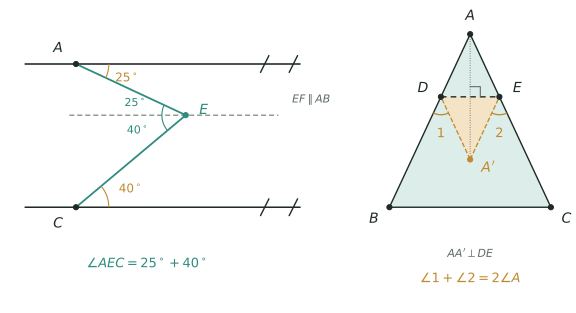

## 讲解

> 左图是两平行线之间的拐点，过拐点作一条平行线，一个角就拆成两个；右图是把 $\triangle ABC$ 的 $\angle A$ 沿 $DE$ 折到 $A'$，折痕两侧完全重合，所以 $\angle ADE=\angle A'DE$、$\angle AED=\angle A'ED$。

### 一、模型：内角和只由边数决定

三角形内角和 $180^\circ$ 是全部角度题的起点。多边形不必另记公式：从一个顶点出发连对角线，$n$ 边形被分成 $n-2$ 个三角形，所以

$$\text{内角和}=(n-2)\times180^\circ .$$

四边形 $360^\circ$、五边形 $540^\circ$、十边形 $1440^\circ$。反过来给内角和求边数，就是解 $n-2=\text{内角和}\div180^\circ$。

**外角和恒为 $360^\circ$**，与边数无关。理由是一行加法：每个顶点"内角 $+$ 外角 $=180^\circ$"，$n$ 个顶点共 $n\times180^\circ$，减去内角和 $(n-2)\times180^\circ$，剩 $360^\circ$。正 $n$ 边形每个外角就是 $360^\circ\div n$——这是"给外角求边数"的唯一依据，比先用内角和绕一圈快。

### 二、外角定理：把外面的角换进里面

三角形的一个外角，等于与它**不相邻**的两个内角之和：

$$\angle ACD=\angle A+\angle B .$$

证明只有一步：$\angle A+\angle B+\angle ACB=180^\circ$，而外角 $\angle ACD=180^\circ-\angle ACB$，两式相减即得。它的用处是**把分散的角搬到同一个三角形里**——五角星、凹多边形、任意"尖角求和"的题，都是靠这一步把五个、六个角塞进一个三角形。

### 三、平行线拐点：过拐点作平行线

两条平行线之间夹一个折点 $E$，这是角度题里最常见也最容易做错的图形。唯一动作：**过 $E$ 作一条与它们平行的直线**，于是内错角相等，一个角被拆成两个。

- 拐点在两平行线**之间**（$M$ 型）：$\angle E=\angle B+\angle D$，外面的大角等于两个小角之和。
- 拐点在两平行线**同侧之外**：$\angle E=|\angle B-\angle D|$，变成相减。

两类不要死记，画一条辅助平行线，看内错角落在哪一侧，结论自己就出来了。若折点有多个，就每个折点各作一条平行线，逐个拆。

### 四、折叠：折痕两侧完全重合

折叠是轴对称，落笔前只写一句话：**折痕两侧的图形全等，对应角相等**。常用的两个推论：

- 折痕把某个角对半分：若 $A$ 折到 $A'$，则 $\angle ADE=\angle A'DE$。
- 折叠后出现的"新角"是 $180^\circ$ 减去两个相等的角：如图中 $\angle 1=180^\circ-2\angle ADE$。

把两条推论合起来，就得到折叠题最常考的那条结论：三角形纸片把 $\angle A$ 折到 $A'$，则 $\angle 1+\angle 2=2\angle A$。证明见例 4，全过程只用"内角和 $180^\circ$"和"对应角相等"，不需要任何超纲工具。

### 五、易错点

1. **把外角当成"外面的那个大角"随便取**。→ 外角必须由三角形的一边延长得到，与它相邻的内角加起来才是 $180^\circ$。→ 取错边，$180^\circ$ 减出来的就不是外角。
2. **多边形内角和写成 $n\times180^\circ$**。→ 应为 $(n-2)\times180^\circ$。→ 三角形 $n=3$ 时要能退回 $180^\circ$，这一步可以当验算。
3. **给外角求边数时先算内角和**。→ 直接用 $360^\circ\div$ 外角。→ 外角和恒为 $360^\circ$，绕道内角和容易在减法上出错。
4. **拐点题不画辅助平行线，硬套 $\angle E=\angle B+\angle D$**。→ 先判断拐点在内侧还是外侧。→ 内侧是相加、外侧是相减，套错方向直接差一个角的量。
5. **折叠题把"相等的角"认错对象**。→ 只有关于折痕对称的两个角才相等，即 $\angle ADE=\angle A'DE$，不是 $\angle ADE=\angle AED$。→ 折叠是把 $\triangle ADE$ 整体翻过去，$D$、$E$ 在折痕上不动，$A$ 与 $A'$ 才是对应点。
6. **算出负角或超过 $180^\circ$ 不回头检查**。→ 角一定是 $0^\circ\sim180^\circ$ 之间的正数。→ 出现负值说明辅助线画在了另一侧，或把相减当成了相加。

## 竞赛真题中的考察

> 本库题库 18 套六年级卷中未见纯粹的"角度计算"题，下列三条均为同类题型描述，未标卷次，不作真题出处引用。

- **同类题型**：多边形内角和反求边数——给内角和先除以 $180^\circ$ 再加 $2$；给每个外角则用 $360^\circ$ 除，两条路要分清（★★★）
- **同类题型**：多个尖角求和（五角星、凹多边形、折线）——用外角定理把分散的角逐个搬进同一个三角形，凑成 $180^\circ$（★★★★）
- **同类题型**：折叠求角——先写折痕两侧对应角相等，再用"平角 $180^\circ$"或"三角形内角和"列式，最后用 $\angle 1+\angle 2=2\angle A$ 验算（★★★★★）

> 完整题目与解答见仓库 `exam/answers/` 对应试卷文件；跨卷汇总见 `exam/SUMMARY.md`。

<!-- card:auto -->
## 速查卡

> 裁剪即用：本页对应速查卡「几何 45正」。下面是本节最紧的一版摘要，公式与结论与正文完全一致，用于做题前扫一遍。全套卡片见 `tools/cards/build/cards.html`。

**内角和与外角和**

$$\text{内角和}=(n-2)\times180^\circ,\qquad \text{外角和}=360^\circ$$

- 外角和与边数无关；给一个外角的度数求边数，直接 $360^\circ\div$ 外角，不必先算内角和

**外角定理**

$$\angle ACD=\angle A+\angle B$$

- 五角星、凹四边形、折线求尖角和，都靠它把分散的角逐个搬进同一个三角形

**平行线拐点**

- 唯一动作：过拐点作第三条平行线，用内错角把一个大角拆成两个
- 拐点夹在两平行线之间时相加（$\angle E=\angle B+\angle D$），移到延长线外侧时相减

**折叠**

$$\angle1+\angle2=2\angle A$$

- 折痕两侧全等，$D$、$E$ 在折痕上不动：$\angle ADE=\angle A'DE$、$\angle AED=\angle A'ED$，再借 $D$、$E$ 处的平角列式

> ✅ 识别：问边数 → 内角和；问若干个尖角之和 → 外角定理；见折痕 → 等角加平角
> ⚠️ 易错：外角必须由三角形的一边延长得到；拐点内侧相加、外侧相减，套反就差一整个角
<!-- /card:auto -->

## 例题

### 例1：给内角和、给外角，各求边数（★★）

**题目**：一个多边形的内角和是 $1440^\circ$，它是几边形？另一个正多边形每个外角是 $24^\circ$，它是几边形？若一个正多边形每个内角是 $150^\circ$，它的内角和是多少？

**覆盖点**：多边形内角和与外角和的换算

**解析**：**为什么先想"内角和里能装几个 $180^\circ$"，而不是先猜边数？** 因为内角和与边数是一一对应的，只要除出来是整数，边数就唯一确定；猜边数还得逐个验算，慢且容易漏。

第一步，第一问用内角和公式反解：

$$(n-2)\times180^\circ=1440^\circ\ \Longrightarrow\ n-2=8\ \Longrightarrow\ n=10 .$$

第二步，第二问走外角：外角和恒为 $360^\circ$，每个外角 $24^\circ$，所以

$$n=\frac{360^\circ}{24^\circ}=15 .$$

第三步，第三问先由内角求外角。每个外角 $=180^\circ-150^\circ=30^\circ$，故 $n=360^\circ\div30^\circ=12$，内角和 $=(12-2)\times180^\circ=1800^\circ$。

**验算**：正十二边形每个内角 $=1800^\circ\div12=150^\circ$，与题设一致；十边形内角和 $1440^\circ$ 除以 $180^\circ$ 得 $8$，加 $2$ 是 $10$ ✓。

**答案**：十边形；十五边形；内角和 $1800^\circ$。

### 例2：凹四边形里的"大角"（★★★）

**题目**：在凹四边形 $ABCD$ 中，点 $D$ 落在 $\triangle ABC$ 内部。已知 $\angle A=40^\circ$，$\angle ABD=25^\circ$，$\angle ACD=35^\circ$，求 $\angle BDC$（取小于 $180^\circ$ 的那个角）。

**覆盖点**：三角形外角定理与不相邻内角

**解析**：**为什么不去直接凑 $\angle BDC$ 的内角和，而要延长一条线？** 因为 $\angle BDC$ 在 $D$ 点，而已知的三个角分别贴着 $A$、$B$、$C$，彼此不在同一个三角形里，硬凑内角和永远差一块。外角定理正好相反：它专门把"外面的大角"换成"里面两个不相邻角之和"，延长 $BD$ 就把三个角串成一条链。

第一步，延长 $BD$ 交 $AC$ 于 $E$。

第二步，在 $\triangle ABE$ 中用外角定理：$E$ 处的外角 $\angle BEC$ 等于两个不相邻内角之和，

$$\angle BEC=\angle A+\angle ABD=40^\circ+25^\circ=65^\circ .$$

第三步，在 $\triangle DEC$ 中再用一次外角定理：$D$ 处的外角 $\angle BDC$ 等于

$$\angle BDC=\angle BEC+\angle ACD=65^\circ+35^\circ=100^\circ .$$

**验算**：把结论写成一般式 $\angle BDC=\angle A+\angle ABD+\angle ACD$，三个角各用一次、没有重复计算；再取特例——若 $\angle ABD=\angle ACD=0$，即 $D$ 退到 $A$ 附近，$\angle BDC\to\angle A$ ✓，与 "$E$ 与 $A$ 重合时两次外角定理退化为一次"相符。

**答案**：$\angle BDC=100^\circ$。注意凹四边形在 $D$ 处的内角是这个角的优角，为 $360^\circ-100^\circ=260^\circ$——题目问的是小于 $180^\circ$ 的那个，别答成 $260^\circ$。

### 例3：平行线之间的拐点（★★★★）

**题目**：直线 $AB\parallel CD$，点 $E$ 在两条平行线之间，$\angle BAE=40^\circ$，$\angle DCE=25^\circ$。（1）求 $\angle AEC$；（2）若 $E$ 移到两条平行线的同侧之外，$\angle BAE$ 与 $\angle DCE$ 不变，求 $\angle AEC$。

**覆盖点**：平行线拐点的角度拆分

**解析**：**为什么一定要过 $E$ 作平行线？** 因为 $40^\circ$ 与 $25^\circ$ 分别贴着两条不同的平行线，它们谁也够不到对方；过 $E$ 作第三条平行线后，每个已知角都能找到一个内错角与它相等，两个角才第一次出现在同一个顶点上。

第一步，过 $E$ 作 $EF\parallel AB$，则 $EF\parallel CD$。

第二步，用内错角。$AB\parallel EF$ 时 $\angle AEF=\angle BAE=40^\circ$；$EF\parallel CD$ 时 $\angle CEF=\angle DCE=25^\circ$。

第三步，$E$ 在两平行线之间时，$EF$ 落在 $\angle AEC$ 内部，所以

$$\angle AEC=\angle AEF+\angle CEF=40^\circ+25^\circ=65^\circ .$$

第四步，第二问：$E$ 移到同侧之外后，两条射线 $EA$、$EC$ 都在平行线的同一侧，$EF$ 不再夹在中间，而是落在 $\angle AEC$ 外部。此时

$$\angle AEC=|\angle AEF-\angle CEF|=|40^\circ-25^\circ|=15^\circ .$$

**验算**：第一问另走一条路——延长 $AE$ 交 $CD$ 于 $G$。由 $AB\parallel CD$ 得内错角 $\angle EGC=\angle BAE=40^\circ$，在 $\triangle ECG$ 中 $\angle AEC$ 是 $E$ 处外角，故 $\angle AEC=\angle EGC+\angle ECG=40^\circ+25^\circ=65^\circ$ ✓，与辅助平行线法一致。第二问同理：$\angle EGC=40^\circ$、$\angle ECG=25^\circ$，此时两者在 $E$ 的同侧，外角定理给出 $\angle AEC=40^\circ-25^\circ=15^\circ$ ✓。

**答案**：（1）$65^\circ$；（2）$15^\circ$。

### 例4：折叠三角形的一个角（★★★★★）

**题目**：把 $\triangle ABC$ 的顶点 $A$ 沿直线 $DE$ 折叠，点 $A$ 落在 $A'$ 处，其中 $D$ 在边 $AB$ 上、$E$ 在边 $AC$ 上。折痕与边 $AB$、$AC$ 的夹角分别为 $\angle ADE$、$\angle AED$，折叠后在 $B$、$C$ 一侧形成的两个角为 $\angle 1=\angle BDA'$、$\angle 2=\angle CEA'$。（1）证明 $\angle 1+\angle 2=2\angle A$；（2）若 $\angle A=50^\circ$，求 $\angle 1+\angle 2$。

**覆盖点**：折叠与翻折中的等角转化

**解析**：**为什么盯住 $\angle 1$、$\angle 2$ 这两个"新角"，而不是去追 $A'$ 的位置？** 因为 $A'$ 只要落在形内，位置就被折痕唯一决定，追它等于重新解一遍题；而 $\angle 1$、$\angle 2$ 与折痕角之间各有一个"平角"关系，两式一加，$A'$ 就自动消掉了。

第一步，写折叠给出的等角。折痕两侧全等，所以

$$\angle ADE=\angle A'DE,\qquad \angle AED=\angle A'ED .$$

第二步，在 $D$ 处用平角。$A$、$D$、$B$ 共线，$\angle ADE+\angle A'DE+\angle 1=180^\circ$，于是

$$\angle 1=180^\circ-2\angle ADE .$$

同理在 $E$ 处：$\angle 2=180^\circ-2\angle AED$。

第三步，两式相加：

$$\angle 1+\angle 2=360^\circ-2(\angle ADE+\angle AED) .$$

第四步，在 $\triangle ADE$ 中用内角和：$\angle ADE+\angle AED=180^\circ-\angle A$，代入得

$$\angle 1+\angle 2=360^\circ-2(180^\circ-\angle A)=2\angle A .$$

第五步，代入 $\angle A=50^\circ$：$\angle 1+\angle 2=100^\circ$。

**验算**：取特殊折法——把 $DE$ 取得使 $\angle ADE=\angle AED=65^\circ$（等腰折），则 $\angle 1=\angle 2=180^\circ-130^\circ=50^\circ$，和是 $100^\circ$ ✓；而 $2\angle A=2\times50^\circ=100^\circ$，两路一致。再用 $\angle A=50^\circ$ 反查：$\angle ADE+\angle AED=130^\circ$ ✓ 与 $180^\circ-50^\circ$ 相符。

**答案**：（1）$\angle 1+\angle 2=2\angle A$，证毕；（2）$100^\circ$。
