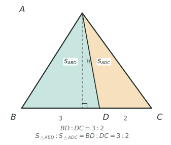

## 讲解

> 图中 $BD:DC=3:2$，所以 $S_{\triangle ABD}:S_{\triangle ADC}=3:2$。

面积比题考的不是背公式，而是判断“哪两个三角形共顶点、共底，或共角”。小学奥数里绝大多数面积比题，都能拆成两个基本模型，再用设份数或设未知面积收尾。记三角形 $XYZ$ 的面积为 $S_{XYZ}$。

### 一、模型定义

**等高模型**：两个三角形的高相同——公共顶点，或两个顶点在同一条平行于底的直线上——则
$$\frac{S_1}{S_2}=\frac{a_1}{a_2}.$$
最常用的是 $D$ 在 $BC$ 上：
$$\frac{S_{ABD}}{S_{ADC}}=\frac{BD}{DC},\qquad S_{ABD}=\frac{BD}{BC}S_{ABC}.$$

**等底模型（$E\in AD$、$D\in BC$）**：两个三角形底相同，面积比等于高之比。若 $E$ 在 $AD$ 上、$D$ 在 $BC$ 上，则
$$\frac{S_{EBC}}{S_{ABC}}=\frac{ED}{AD}.$$
它把“斜线上的分点”翻译成“高之比”，是综合题里最常被忽略的一步。两个模型都靠一个“等”字成立：等高要真正共顶点，或顶点落在同一条平行线上；等底要真正共用同一条底边。少了这个前提，面积比就不等于线段比。

### 二、推导与证明

由 $S=\frac12 ah$ 看：高同为 $h$ 时，面积比 $\frac12a_1h:\frac12a_2h=a_1:a_2$，公共的 $\frac12h$ 约掉；底同为 $a$ 时同理，面积比就是 $h_1:h_2$。

等底模型也不必用相似：$S_{EBD}=\frac{ED}{AD}S_{ABD}$，$S_{EDC}=\frac{ED}{AD}S_{ADC}$，两式相加即得 $S_{EBC}=\frac{ED}{AD}S_{ABC}$。这里两次都用“共顶点 $B$、$C$，底在 $AD$ 上”的等高模型。

反用同样成立：同高的两个三角形，面积比是几比几，底边比就是几比几；同底的，面积比是几比几，高之比就是几比几。题目给面积、问线段比时，把比例式倒过来即可。

### 三、三个高级变形

1. **共角模型（鸟头）**：$D$ 在 $AB$ 上，$E$ 在 $AC$ 上，且 $\angle DAE=\angle BAC$，则
$$\frac{S_{ADE}}{S_{ABC}}=\frac{AD}{AB}\cdot\frac{AE}{AC}.$$
两次等高即可：$\frac{S_{ADE}}{S_{ABE}}=\frac{AD}{AB}$，$\frac{S_{ABE}}{S_{ABC}}=\frac{AE}{AC}$，相乘。边界是“夹角相等”，不能对任意两个三角形套用。

2. **燕尾模型**：$AD$、$BE$ 交于 $P$，则
$$\frac{S_{ABP}}{S_{BDP}}=\frac{AP}{PD},\qquad \frac{S_{ABP}}{S_{AEP}}=\frac{BP}{PE}.$$
前者共顶点 $B$、底在 $AD$ 上，后者共顶点 $A$、底在 $BE$ 上。把两条比串起来，就能用一块面积表示其余各块。注意 $P$ 必须在三角形内部；若交点跑到形外，几块面积之间是相减关系，不能直接相加。

3. **平行线**：过 $E$ 作 $BC$ 的平行线，截得的小三角形与原三角形的面积比等于对应边比的平方。它只在平行时成立，不能和共角模型混用。

### 四、竞赛视角

看到中点、三等分点、面积比、交点，先找公共底或公共高；看到两条从顶点连到对边的线段相交，想燕尾；看到“给一块面积求整体”，设总面积为 $S$，设最小块为 $x$，把其余各块都用 $x$ 表示，最后用“各块之和等于整体”列方程。图形不规整时，连一条辅助线，把四边形拆成两个三角形。中点对应 $1:1$，三等分点对应 $1:2$，这是杯赛题最常埋的两个信号。最容易混的三处是：共角模型被当成等高模型、燕尾比配错边、面积比被当成周长比。算完做两项验算：各块相加是否等于整体，面积比是否回到题给线段比。

### 五、易错点

1. **比例方向写反**。$BD:DC=3:2$ 时，错误做法是取 $S_{ABD}=\frac25S_{ABC}$；正确做法是 $ABD$ 对应 $BD$，占全底 $\frac35$。错因是把另一段的份数当成了自己的份数。
2. **等底模型高取错段**。$E$ 在 $AD$ 上时，错误做法是用 $\frac{AE}{AD}$；正确做法是用 $\frac{ED}{AD}$，因为顶点从 $A$ 移到了 $E$，剩下的是 $E$ 到 $D$ 那一段。
3. **没共线就套比例**。错误做法是看到两个三角形就写面积比等于线段比；正确做法是先确认共顶点且底共线，或共底，否则先连辅助线造出共底、共高。
4. **共角模型漏乘一个比**。错误做法是写 $S_{ADE}:S_{ABC}=AD:AB$；正确做法是乘上 $\frac{AE}{AC}$，因为两个方向各缩一次。
5. **份数不统一**。错误做法是把 $\frac13$ 和 $\frac25$ 直接相加；正确做法是统一成总面积的几分之几，或统一设成整数份再运算。
6. **燕尾配对错误**。错误做法是写 $S_{ABP}:S_{ACP}=AP:PD$；正确做法是配共顶点 $B$ 的 $S_{ABP}:S_{BDP}=AP:PD$，两个三角形必须共顶点、底共线。
7. **面积比与周长比混用**。错误做法是由面积比 $4:9$ 直接说边长比是 $4:9$；正确做法是先看有没有平行线截出的相似图形，只有这时面积比才等于对应边比的平方，$4:9$ 应对应边长比 $2:3$。

## 竞赛真题中的考察

- **第 32 届 WMO 第 4 题**：折角（阴影）面积 = 折叠后图形减少的面积（★★★）
- **2024 IHC 6 培训 第 28 题**：等底等高面积比（★★★）
- **2024 IHC 6 培训 第 21 题**：比例+面积公式（正六边形）（★★★★）
- **2024 IHC 6 培训 第 35 题**：面积比（六角星与正六边形）（源题待核）（★★★★）
- **2024 IHC 6 培训 第 36 题**：面积比（分点连线）（源题待核）（★★★★）
- **2025 春·走美 第 10 题**：等高三角形面积比＋按比例分配（★★★★★）
- **2024 IHC 6 培训 第 33 题**：相似/等积（正六边形拼接）（源题待核）（★★★★★）
- **2024 IHC A-6 第 5 题**：坐标法求交点 + 面积叉积（★★★★★）
- **2024 IHC A-6 第 14 题**：方格分割+三角形拼补（以14cm定比例）（源题待核）（★★★★★）
- **2024 IHC D-6 第 7 题**：面积比=底边比 + 梅涅劳斯定理定交点（★★★★★）
- **2024 IHC D-6 第 10 题**：直角坐标定交点（证O为两线中点）+面积比=底边比（★★★★★）

> 完整题目与解答见仓库 `exam/answers/` 对应试卷文件；跨卷汇总见 `exam/SUMMARY.md`。

<!-- card:auto -->
## 速查卡

> 裁剪即用：本页对应速查卡「几何 37背」。下面是本节最紧的一版摘要，公式与结论与正文完全一致，用于做题前扫一遍。全套卡片见 `tools/cards/build/cards.html`。

**等高模型**

$$\frac{S_{ABD}}{S_{ADC}}=\frac{BD}{DC},\quad S_{ABD}=\frac{BD}{BC}S_{ABC}$$

**等底模型（$E\in AD$、$D\in BC$）**

$$\frac{S_{EBC}}{S_{ABC}}=\frac{ED}{AD}$$

- 底相同则面积比 = 高之比；$E$ 在 $AD$ 上取 $ED$ 不是 $AE$

**三个变形**

- 共角（鸟头）：面积比 = 两条夹边比的乘积
- 燕尾：$\frac{S_{ABP}}{S_{BDP}}=\frac{AP}{PD}$，须共顶点且底共线
- 给一块求整体：设总面积 $S$、最小块 $x$，用各块和 = 整体列方程

> ✅ 识别：中点 $1:1$、三等分点 $1:2$，先找公共底或公共高
> ⚠️ 易错：没共顶点、底没共线别套比例；面积比 $4:9$ 是边长 $2:3$
<!-- /card:auto -->

## 例题

### 例1：由三块面积反求整体（★★）

**题目**：点 $D$ 在边 $BC$ 上，点 $E$ 在 $AD$ 上。已知 $S_{ABE}=8$、$S_{BDE}=12$、$S_{CDE}=15$（单位：平方厘米），求 $S_{ABC}$。

**覆盖点**：等高模型与底边比

**解析**：为什么想到这一步？三块已知面积都与 $A$、$E$、$D$ 这条直线有关，先找“同顶点、底共线”的等高对，把面积比换成线段比。

第一步，$S_{ABE}$ 与 $S_{BDE}$ 共顶点 $B$，底 $AE$、$ED$ 都在直线 $AD$ 上，所以
$$\frac{AE}{ED}=\frac{S_{ABE}}{S_{BDE}}=\frac{8}{12}=\frac23.$$
第二步，$S_{CDE}$ 与 $S_{CDA}$ 共顶点 $C$，底 $ED$、$DA$ 都在直线 $AD$ 上，所以
$$\frac{S_{CDE}}{S_{CDA}}=\frac{ED}{AD}=\frac35,$$
得 $S_{CDA}=15\times\frac53=25$。
第三步，$S_{ABD}=8+12=20$，故
$$S_{ABC}=S_{ABD}+S_{CDA}=20+25=45.$$
验算：$S_{BDE}:S_{CDE}=12:15=4:5$，而 $BD:DC=S_{ABD}:S_{ADC}=20:25=4:5$，两路一致；$S_{ACE}=25-15=10$，四块 $8+12+15+10=45$，正好等于整体。

**答案**：$45$ 平方厘米

### 例2：同底三角形的高之比（★★★）

**题目**：$S_{ABC}=100$ 平方厘米，$D$ 在 $BC$ 上，$BD:DC=2:3$，$E$ 在 $AD$ 上，且 $S_{EBC}=30$ 平方厘米。求 $AE:ED$ 与 $S_{ABE}$。

**覆盖点**：等底模型与高之比

**解析**：为什么想到这一步？$EBC$ 与 $ABC$ 共用底 $BC$，是标准的等底模型；先由面积比得到高之比，就能确定 $E$ 在 $AD$ 上的位置，再用一次等高模型即可。

第一步，等底：$\frac{h_E}{h_A}=\frac{S_{EBC}}{S_{ABC}}=\frac{30}{100}=\frac{3}{10}$。因为 $D$ 在 $BC$ 上、$E$ 在 $AD$ 上，$E$ 到 $BC$ 的距离与 $ED$ 成正比，所以
$$\frac{ED}{AD}=\frac{3}{10},\qquad AE:ED=7:3.$$
第二步，$S_{ABD}=\frac{BD}{BC}S_{ABC}=\frac25\times100=40$。
第三步，$ABE$ 与 $ABD$ 共顶点 $B$，底 $AE$、$AD$ 共线：
$$S_{ABE}=\frac{AE}{AD}S_{ABD}=\frac{7}{10}\times40=28.$$
验算：$S_{BDE}=\frac{3}{10}\times40=12$，$S_{ADC}=60$，$S_{CDE}=\frac{3}{10}\times60=18$，所以 $S_{EBC}=12+18=30$，与题相符；又 $S_{ACE}=\frac{7}{10}\times60=42$，$28+12+18+42=100$。

**答案**：$AE:ED=7:3$，$S_{ABE}=28$ 平方厘米

### 例3：面积比与线段比互化（★★★★）

**题目**：$S_{ABC}=120$ 平方厘米，$D$ 是 $BC$ 的中点，$E$ 在 $AD$ 上，$AE:ED=1:2$。连接 $BE$ 并延长交 $AC$ 于 $F$，求 $S_{AEF}$。

**覆盖点**：面积比与线段比互化

**解析**：为什么想到这一步？已知 $E$ 在 $AD$ 上的比，可先算 $S_{ABE}$；要求 $AEF$，还需知道 $F$ 在 $AC$ 上的位置，而 $F$ 由 $BE$ 决定，于是要把“$A$、$D$ 到直线 $BF$ 的距离比”翻译成面积比。

第一步，$D$ 是中点，$S_{ABD}=S_{ADC}=60$。
第二步，$AE:AD=1:3$，$ABE$ 与 $ABD$ 共顶点 $B$，所以
$$S_{ABE}=\frac13\times60=20.$$
同理 $S_{BDE}=\frac23\times60=40$。
第三步，$B$、$E$、$F$ 共线。以 $BE$ 为底看 $ABE$ 与 $BDE$，面积比 $20:40=1:2$，所以 $A$、$D$ 到直线 $BE$ 的距离之比为 $1:2$。直线 $BE$ 就是直线 $BF$，以 $BF$ 为底时面积比等于同一个距离比：
$$\frac{S_{ABF}}{S_{DBF}}=\frac12.$$
第四步，$D$ 是 $BC$ 中点，$DBF$ 与 $DCF$ 等底同高，面积相等，所以
$$S_{BCF}=S_{DBF}+S_{DCF}=2S_{DBF}=4S_{ABF}.$$
第五步，$S_{ABC}=S_{ABF}+S_{BCF}=5S_{ABF}=120$，得 $S_{ABF}=24$。因为 $E$ 在 $BF$ 上，$ABE$ 在 $ABF$ 内部，
$$S_{AEF}=S_{ABF}-S_{ABE}=24-20=4.$$
验算：$S_{DBF}=48$，$S_{BCF}=96$，$24+96=120$；又 $AF:FC=S_{ABF}:S_{CBF}=24:96=1:4$，与 $F$ 靠近 $A$ 一致。逐块核：$S_{BDE}=40$，$S_{CDE}=40$，$S_{AEF}=4$，由 $AF:FC=1:4$ 得 $S_{EFC}=16$，$20+40+40+4+16=120$。

**答案**：$4$ 平方厘米

### 例4：双线分割与面积方程（★★★★★）

**题目**：在三角形 $ABC$ 中，$D$ 在 $BC$ 上，$BD:DC=1:2$；$E$ 在 $AC$ 上，$AE:EC=1:3$。$AD$ 与 $BE$ 交于 $P$。已知 $S_{ABP}=12$ 平方厘米，求 $S_{ABC}$ 与四边形 $CDPE$ 的面积。

**覆盖点**：面积比与方程综合

**解析**：为什么想到这一步？两条从顶点连到对边的线段相交，把三角形分成五块；已知一块、要求整体，最稳的办法是设总面积为 $S$，用两个线段比把其余各块都写成 $S$ 与 $x$ 的式子，再用“五块之和等于 $S$”列方程。

第一步，定“份数”。由 $BD:DC=1:2$，得
$$S_{ABD}=\frac13S,\qquad S_{ADC}=\frac23S.$$
由 $AE:EC=1:3$，得
$$S_{ABE}=\frac14S,\qquad S_{CBE}=\frac34S.$$
第二步，设 $S_{ABP}=x$。在 $ABD$ 中，$P$ 在 $AD$ 上，由共顶点 $B$、底共线，
$$S_{BDP}=\frac13S-x.$$
在 $ABE$ 中，$P$ 在 $BE$ 上，同理
$$S_{AEP}=\frac14S-x.$$
第三步，用共顶点、底共线的面积比表示另外两块。三角形 $ACD$ 中，$P$ 在 $AD$ 上，$CDP$ 与 $ADC$ 共顶点 $C$，底 $PD$、$AD$ 共线，所以
$$\frac{S_{CDP}}{S_{ADC}}=\frac{PD}{AD}=\frac{S_{BDP}}{S_{ABD}},$$
于是
$$S_{CDP}=\frac23S\cdot\frac{\frac13S-x}{\frac13S}=2\left(\frac13S-x\right).$$
三角形 $CBE$ 中，$P$ 在 $BE$ 上，$CEP$ 与 $CBE$ 共顶点 $C$，底 $PE$、$BE$ 共线，所以
$$\frac{S_{CEP}}{S_{CBE}}=\frac{PE}{BE}=\frac{S_{AEP}}{S_{ABE}},$$
于是
$$S_{CEP}=\frac34S\cdot\frac{\frac14S-x}{\frac14S}=3\left(\frac14S-x\right).$$
第四步，列方程。五块 $ABP$、$BDP$、$AEP$、$CDP$、$CEP$ 恰好铺满 $ABC$：
$$x+\left(\frac13S-x\right)+2\left(\frac13S-x\right)+\left(\frac14S-x\right)+3\left(\frac14S-x\right)=S.$$
左边合并同类项得 $2S-6x=S$，故 $x=\frac{S}{6}$。已知 $x=12$，所以 $S=72$。
第五步，求四边形。对角线 $CP$ 把它分成 $CDP$ 与 $CEP$：
$$S_{CDPE}=2\left(\frac{72}{3}-12\right)+3\left(\frac{72}{4}-12\right)=24+18=42.$$
验算：$S_{BDP}=24-12=12$，$S_{AEP}=18-12=6$，$S_{CDP}=24$，$S_{CEP}=18$，五块和 $12+12+6+18+24=72$。再取 $A(0,48)$、$B(0,0)$、$C(3,0)$，则 $D(1,0)$、$E\left(\frac34,36\right)$、$P\left(\frac12,24\right)$，逐块算面积正好是 $12,12,6,24,18$，且 $AP:PD=1:1$、$BP:PE=2:1$，与图形一致。

**答案**：$S_{ABC}=72$ 平方厘米，四边形 $CDPE$ 的面积为 $42$ 平方厘米

## 变式与自测

> 四道题按「模仿 → 变式 → 综合 → 自测」排。先盖住答案自己做，做完再对；面积比题的失分点只有两个——底和高配错了对象，或者把"比"当成了具体面积。

### 变式1：由三块面积反求整体（★★）

**题目**：点 $D$ 在边 $BC$ 上，点 $E$ 在 $AD$ 上。已知 $S_{\triangle ABE}=6$、$S_{\triangle BDE}=9$、$S_{\triangle CDE}=15$（单位：平方厘米），求 $S_{\triangle ABC}$。

**覆盖点**：等高模型与底边比

**解析**：为什么先看 $\triangle ABE$ 与 $\triangle BDE$？它们的顶点都在 $B$，底边 $AE$、$ED$ 都在同一条直线 $AD$ 上，高是同一个，所以面积比就是底边比。同理 $E$ 又是 $\triangle ACE$ 与 $\triangle CDE$ 的公共顶点，第二条底边比也能马上读出来。

$$\frac{AE}{ED}=\frac{S_{\triangle ABE}}{S_{\triangle BDE}}=\frac{6}{9}=\frac23 ,$$

于是

$$\frac{S_{\triangle ACE}}{S_{\triangle CDE}}=\frac{AE}{ED}=\frac23\ \Longrightarrow\ S_{\triangle ACE}=15\times\frac23=10 .$$

所以 $S_{\triangle ACD}=10+15=25$，$S_{\triangle ABD}=6+9=15$，

$$S_{\triangle ABC}=15+25=40 .$$

验算：反过来由 $BD:DC=S_{\triangle ABD}:S_{\triangle ACD}=15:25=3:5$，取 $S_{\triangle ACD}=25$ 按 $AE:ED=2:3$ 分配，$S_{\triangle CDE}=25\times\frac35=15$ ✓，与题设一致。

**答案**：$S_{\triangle ABC}=40$ 平方厘米。

### 变式2：由同底面积反求高之比（★★★）

**题目**：$S_{\triangle ABC}=96$ 平方厘米，$D$ 在 $BC$ 上，$BD:DC=3:5$，$E$ 在 $AD$ 上，且 $S_{\triangle EBC}=64$ 平方厘米。求 $AE:ED$ 与 $S_{\triangle ABE}$。

**覆盖点**：等底模型与高之比

**解析**：为什么把 $\triangle EBC$ 与 $\triangle ABC$ 放在一起看？它们的底都是 $BC$，是真正的等底，于是面积比就是高之比；而这两个高都落在 $AD$ 这条线上，高之比就是 $ED$ 与 $AD$ 之比。走这一步，就把"面积"换成了"线段"。

$$\frac{S_{\triangle EBC}}{S_{\triangle ABC}}=\frac{64}{96}=\frac23\ \Longrightarrow\ \frac{ED}{AD}=\frac23\ \Longrightarrow\ \frac{AE}{ED}=\frac12 .$$

再由 $BD:DC=3:5$ 得 $S_{\triangle ABD}=96\times\frac38=36$，于是

$$S_{\triangle ABE}=S_{\triangle ABD}\times\frac{AE}{AD}=36\times\frac13=12 .$$

验算：$S_{\triangle AEC}=S_{\triangle ACD}\times\frac13=60\times\frac13=20$，而 $S_{\triangle EBD}=36\times\frac23=24$、$S_{\triangle EDC}=60\times\frac23=40$，四块 $12+24+40+20=96$ ✓，且 $S_{\triangle EBC}=24+40=64$ ✓。

**答案**：$AE:ED=1:2$，$S_{\triangle ABE}=12$ 平方厘米。

### 变式3：平行四边形里的一半模型（★★★★）

**题目**：平行四边形 $ABCD$ 中，$E$ 是 $BC$ 的中点，$F$ 是 $CD$ 的中点，连接 $AE$、$AF$、$EF$。已知 $S_{\triangle ABE}=12$ 平方厘米，求平行四边形 $ABCD$ 的面积与 $S_{\triangle AEF}$。

**覆盖点**：面积比与线段比互化

**解析**：为什么先把平行四边形拆成两个三角形？$AC$ 一对角线就把面积平分，而 $\triangle ABE$ 与 $\triangle ABC$ 同高（都从 $A$ 到 $BC$ 所在直线），底是 $BE$ 与 $BC$，正好 $1:2$。这一步把"已知的小三角形"换成"半个平行四边形"，后面三块空白才都能用比例写出来。

$S_{\triangle ABC}=2\times12=24$，故 $S_{ABCD}=48$，且 $S_{\triangle BCD}=24$、$S_{\triangle ACD}=24$。

$F$ 是 $CD$ 中点，$E$ 是 $BC$ 中点，于是

$$S_{\triangle CEF}=S_{\triangle BCD}\times\frac12\times\frac12=24\times\frac14=6,\qquad S_{\triangle ADF}=S_{\triangle ACD}\times\frac12=12 .$$

整体减空白：$S_{\triangle AEF}=48-12-12-6=18$ 平方厘米。

验算：取 $A(0,0)$、$B(8,0)$、$C(8,6)$、$D(0,6)$，则 $E(8,3)$、$F(4,6)$，用坐标算 $\triangle AEF$ 的面积 $\frac12|8\times6-4\times3|=\frac12\times36=18$ ✓，与整体减空白一致。这条"两个中点把角上那块切到 $\frac14$"，正是**等积模型**里"三角形面积等于同底平行四边形的一半"的连环用法。

**答案**：$S_{ABCD}=48$ 平方厘米，$S_{\triangle AEF}=18$ 平方厘米。

### 自测：中点与分点交出的面积（★★★）

**题目**：在 $\triangle ABC$ 中，$D$ 是 $BC$ 的中点，$E$ 在 $AC$ 上且 $AE:EC=1:2$，$AD$ 与 $BE$ 交于点 $P$。已知 $S_{\triangle ABP}=15$ 平方厘米，求 $S_{\triangle ABC}$、$S_{\triangle PBD}$ 与四边形 $PDCE$ 的面积。

**覆盖点**：面积比与方程综合

**解析**：为什么先定 $AP:PD$？$P$ 是两条线的交点，位置不定就什么都算不了；而 $AP:PD$ 一旦定住，$\triangle ABP$ 与 $\triangle PBD$ 同高、"面积比＝底比"，$S_{\triangle ABC}$ 就能反求。定交点的工具就是两条分点比：$BD=DC$ 与 $AE:EC=1:2$ 给出 $AP:PD=1:1$。

$AP:PD=1:1$，所以 $S_{\triangle PBD}=S_{\triangle ABP}=15$，$S_{\triangle ABD}=30$；又 $D$ 是 $BC$ 中点，$S_{\triangle ABC}=2\times30=60$ 平方厘米。

再算另外两块：$\triangle ABE$ 与 $\triangle ABC$ 同高，底 $AE:AC=1:3$，故 $S_{\triangle ABE}=60\times\frac13=20$；减去 $S_{\triangle ABP}=15$ 得 $S_{\triangle APE}=5$。$\triangle APE$ 与 $\triangle PEC$ 同高（都从 $P$ 到 $AC$），底 $AE:EC=1:2$，故 $S_{\triangle PEC}=10$。

于是 $S_{\triangle ACD}=\frac12\times60=30=5+10+S_{\triangle PDC}$，得 $S_{\triangle PDC}=15$，四边形

$$S_{PDCE}=15+10=25\ \text{平方厘米}.$$

验算：五块拼起来 $15+15+15+5+10=60$ ✓；且 $S_{\triangle PBC}=15+15=30$，与"$S_{\triangle PBC}=S_{\triangle ABC}\times\frac{PD}{AD}$、$PD:AD=1:2$"给出的 $30$ ✓ 两路一致。

**答案**：$S_{\triangle ABC}=60$ 平方厘米，$S_{\triangle PBD}=15$ 平方厘米，四边形 $PDCE$ 为 $25$ 平方厘米。
