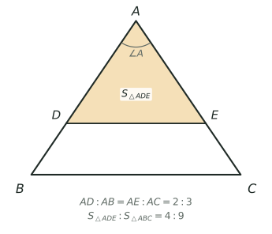

## 讲解

> 图中 $\angle A$ 公共，$AD:AB=AE:AC=2:3$，所以面积比 $4:9$。

**模型是什么**：两个三角形如果有一个角相等——公共角、对顶角、两个角都是直角都算——或者两个角互补（和为 180°），就说它们对这个角"共角"。当小三角形以这个角为顶点，"咬"在大三角形的一个角上，两条夹边分别落在对方的两条夹边上，图形像鸟头，所以叫**鸟头模型**。它专门解决"已知夹边之比、求面积之比"的问题，也常反过来由面积求线段。

**核心结论**：面积比等于夹边乘积比，
$$\frac{S_{小}}{S_{大}}=\frac{小边_1\times 小边_2}{大边_1\times 大边_2}$$
四个量必须两两落在同一条直线上：AD 与 AB 在一条边，AE 与 AC 在另一条边，不能交叉配对。分点都在线段上时，写完先看比值是否小于 1 自检。写成字母就是 $$S_{\triangle ABC}:S_{\triangle ADE}=(AB\times AC):(AD\times AE),$$ 角相等与角互补两种情形用的是同一条式子。

**为什么成立**：连 DC。三角形 ADE 与 ADC 的底 AE、AC 在同一条直线上，高都是 D 到 AC 的距离，所以面积比是 AE:AC；同理三角形 ADC 与 ABC 的底 AD、AB 在同一条直线上，高都是 C 到 AB 的距离，面积比是 AD:AB。两式相乘，中间那块面积约掉，就得到乘积比。这条"连一条线、两次同高"的辅助线，推导、检查都可靠。

**为什么互补角也行**：若两个角互补，把其中一个角的一条边反向延长。新角与原角互为邻补角，所以新角 = 180° − 原角，正好等于另一个角；而反向延长只是把那条边上的点搬到顶点的另一侧，"这一点到另一条边的距离"与"它到顶点的距离"之比并不改变。换句话说，"高 ÷ 斜边"只由角的大小决定，角相等或互补时这个比值相同。所以面积比仍是夹边乘积比，平行四边形相邻两角、两条直线相交所成的邻角，都能直接套模型，不必另记公式。

**三个高级变形**：

1. **对顶角型**：直线 AB 与 CD 交于 O，则三角形 AOC 与 BOD 的面积比等于 OA×OC : OB×OD，用于"交叉"图形，注意两组边分别在同一条直线上。
2. **与同高联用**：同一顶点先用鸟头求出一大块，再用"同底（或同高）比"细分小块；也可以反过来，先由同高得到边比，再逆用鸟头。两次的比值直接相乘，因为中间那块面积在分子、分母里各出现一次。
3. **逆用**：已知面积比和一组边比，未知边比 = 面积比 ÷ 已知边比。再配上"面积和、面积差"作条件，就变成一道份数题或方程题，例3、例4 都是这样起步的。

**竞赛视角**：看到"一个角被两个三角形共用、两条夹边上都有分点"，先写出四条边并标"小比大"。三个容易混的比要分清：鸟头是乘积比（两条边同时变），同高是一次比（只变底），相似是平方比（对应边按同一比例变）。图里没有现成共角时，连一条对角线、或把一边延长，就能造出共角或互补角。若分点落在延长线上，角会变成互补，模型仍成立，但要重新确认哪两条边夹这个角。极端检验：分点越靠近顶点，面积比越接近 0。

### 易错点

1. 只乘一条边。面积由两条夹边共同决定，必须乘两次，例1 里比的就是 5×10 与 20×25。
2. 把部分比当整体比。AD:DB=1:3 时 AD:AB=1:4 而不是 1:3，这是失分最多的一步。
3. 交叉配边。AD 只能配 AB，AE 只能配 AC，配错就得到错误的乘积比。
4. 以为互补角不能用。把一边反向延长就化成等角情形，面积比不变，例2 就靠这一点。
5. 算出比值大于 1 还不检查。分点都在线段上时，小三角形在分子，比值必定小于 1，大于 1 一定是配错边或把大小写反了；若分点落到延长线上，比值才可能大于 1。
6. 忘了整体减空白。求四边形面积时，别把中间那块重复计算或漏掉。

## 竞赛真题中的考察

> 本库题库暂未收录该模型的真题，以下为同类题型的典型考法（不标卷次，不作真题出处引用）。

- **同类题型**：小三角形"咬"在大三角形的一个角上，两条夹边分别落在对方的夹边上，用"面积比＝夹边乘积比"直接求阴影（与例1 同构）（★★）
- **同类题型**：平行四边形相邻角、或两条相交直线给出互补角，把一个角的一边反向延长后套同一条乘积式（与例2 同构）（★★★）
- **同类题型**：先由一大块面积与一条夹边之比求出小三角形，再逆用乘积式反求另一条夹边（与例3 同构）（★★★★）

> 完整题目与解答见仓库 `exam/answers/` 对应试卷文件；跨卷汇总见 `exam/SUMMARY.md`。

<!-- card:auto -->
## 速查卡

> 裁剪即用：本页对应速查卡「几何 36正」。下面是本节最紧的一版摘要，公式与结论与正文完全一致，用于做题前扫一遍。全套卡片见 `tools/cards/build/cards.html`。

**核心结论**

$$\frac{S_1}{S_2}=\frac{AD}{AB}\times\frac{AE}{AC}$$

- 两三角形共角（公共角、对顶角、直角）或互补，小三角咬在大三角一角上
- 四个量两两落在同一直线：$AD$ 配 $AB$，$AE$ 配 $AC$，不可交叉
- 互补角把一边反向延长即化成等角，面积比仍是夹边乘积比

**变形与逆用**

- 对顶角型：交叉两三角形面积比 $=OA\times OC:OB\times OD$
- 与同高联用：先鸟头求大块，再同高细分，两次比值相乘
- 逆用：未知边比 = 面积比 $\div$ 已知边比；求四边形用整体减空白

### 易错

- $AD:DB=1:3$ 时 $AD:AB=1:4$，先换算成占全长再相乘

> ✅ 识别信号：一个角被两个三角形共用，且两条夹边上都有分点
> ⚠️ 只乘一条边；分点都在线段上时比值必小于 $1$
<!-- /card:auto -->

## 例题

### 例1：咬在大角上的小三角形（★★）

**题目**：在 $\triangle ABC$ 中，$AB=20$ 厘米，$AC=25$ 厘米，$S_{\triangle ABC}=200$ 平方厘米。$D$ 在 $AB$ 上且 $AD:DB=1:3$，$E$ 在 $AC$ 上且 $AE:EC=2:3$。求 $S_{\triangle ADE}$ 和四边形 $DBCE$ 的面积。

**覆盖点**：共角三角形面积比

**解析**：为什么想到鸟头？$\triangle ADE$ 与 $\triangle ABC$ 共用顶点 $A$ 的角，两条夹边上又都给了分点——"共角 $+$ 夹边有分点"正是鸟头模型的识别信号，面积比直接等于夹边乘积比。

看到 $D$、$E$ 分别落在 $AB$、$AC$ 上，$\triangle ADE$ 与 $\triangle ABC$ 共用 $\angle A$，两条夹边上又都有分点，这就是鸟头模型的标准信号。

第一步，把"部分比"换成"占全长的比"。$AD:DB=1:3$，全长 4 份，$AD$ 占 $\frac14$，所以 $\frac{AD}{AB}=\frac14$，$AD=20\times\frac14=5$ 厘米；$AE:EC=2:3$，全长 5 份，$AE$ 占 $\frac25$，$\frac{AE}{AC}=\frac25$，$AE=25\times\frac25=10$ 厘米。这一步最容易错，必须先换再乘。

第二步，算乘积比。夹 $\angle A$ 的两条边，大三角形是 $AB$、$AC$，小三角形是 $AD$、$AE$：
$$\frac{S_{\triangle ADE}}{S_{\triangle ABC}}=\frac{AD}{AB}\times\frac{AE}{AC}=\frac14\times\frac25=\frac{1}{10}$$
比值小于 $1$，方向正确。

第三步，求面积。$S_{\triangle ADE}=200\times\frac{1}{10}=20$ 平方厘米；四边形 $DBCE$ 是大三角形去掉小三角形：
$$S_{DBCE}=200-20=180\ \text{平方厘米}$$

验算：以 $AB=20$ 为底，$C$ 到 $AB$ 的高是 $2\times200\div20=20$ 厘米。$E$ 在 $AC$ 上且 $AE:AC=2:5$，所以 $E$ 到 $AB$ 的高也是 $C$ 的高的 $\frac25$，即 $20\times\frac25=8$ 厘米。于是 $S_{\triangle ADE}=\frac12\times5\times8=20$ 平方厘米，与乘积比算出的结果一致；四边形面积 $180$ 也正好是 $200-20$。

**答案**：$S_{\triangle ADE}=20$ 平方厘米，四边形 $DBCE$ 的面积为 $180$ 平方厘米

### 例2：平行四边形里的互补角（★★★）

**题目**：平行四边形 $ABCD$ 中，$AB=12$ 厘米，$BC=9$ 厘米，面积为 $90$ 平方厘米。$E$ 在 $BC$ 上且 $BE:EC=1:2$，$F$ 在 $CD$ 上且 $CF:FD=1:2$。求 $S_{\triangle CEF}$ 与 $S_{\triangle AEF}$。

**覆盖点**：互补角与夹边乘积分份、共角模型与整体减空白

**解析**：为什么互补角也能套鸟头？鸟头要的不是"同一个角"，而是"两个角相等或互补"；平行四边形邻角相加 $180^\circ$，正弦值相同，乘积式照样成立。

$\triangle CEF$ 的角在 $C$，$\triangle ABC$ 的角在 $B$，两个角不是公共角，但平行四边形邻角互补（$\angle ABC+\angle BCD=180^\circ$），所以它们仍是共角三角形，可以用鸟头。先把对角线 $AC$ 连上，得到 $S_{\triangle ABC}=\frac12\times90=45$ 平方厘米。

第一步，两条夹边都用"占全长几分之几"表示。$BE:EC=1:2$，$BC=9$ 厘米，$EC=9\times\frac23=6$ 厘米，故 $\frac{CE}{CB}=\frac69=\frac23$；$CF:FD=1:2$，$CD=AB=12$ 厘米，$CF=12\times\frac13=4$ 厘米，故 $\frac{CF}{CD}=\frac{4}{12}=\frac13$。注意 $\angle ABC$ 的另一条夹边是 $BA$，而 $BA=CD$，所以比里写 $CF/CD$ 与写 $CF/BA$ 是一回事。

第二步，用鸟头求 $S_{\triangle CEF}$：
$$\frac{S_{\triangle CEF}}{S_{\triangle ABC}}=\frac{CE}{CB}\times\frac{CF}{CD}=\frac23\times\frac13=\frac29$$
$$S_{\triangle CEF}=45\times\frac29=10\ \text{平方厘米}$$

第三步，另外两块用"同高"求，因为 $\triangle ABE$ 与 $\triangle ABC$ 都以 $A$ 为顶点、底在同一条直线 $BC$ 上：
$$S_{\triangle ABE}=45\times\frac{BE}{BC}=45\times\frac13=15$$
同理 $\triangle ADF$ 与 $\triangle ADC$ 同高，$S_{\triangle ADC}=45$，$DF=12-4=8$ 厘米：
$$S_{\triangle ADF}=45\times\frac{DF}{DC}=45\times\frac{8}{12}=30$$

第四步，整体减空白：
$$S_{\triangle AEF}=90-15-10-30=35\ \text{平方厘米}$$

验算：四边形 $AECF$ 沿 $AC$ 分成 $\triangle ACE$ 与 $\triangle ACF$。$\triangle ACE$ 与 $\triangle ABC$ 同高，$S_{\triangle ACE}=45\times\frac{CE}{CB}=45\times\frac23=30$；$\triangle ACF$ 与 $\triangle ACD$ 同高，$S_{\triangle ACF}=45\times\frac{CF}{CD}=45\times\frac13=15$。于是 $S_{AECF}=30+15=45$，而 $S_{\triangle AEF}+S_{\triangle CEF}=35+10=45$，两边吻合；四块面积 $15+10+30+35=90$，正好是整个平行四边形。

**答案**：$S_{\triangle CEF}=10$ 平方厘米，$S_{\triangle AEF}=35$ 平方厘米

### 例3：由两块面积反求两条夹边（★★★★）

**题目**：在 $\triangle ABC$ 中，$AB=25$ 厘米，$AC=40$ 厘米，$S_{\triangle ABC}=150$ 平方厘米。$D$ 在 $AB$ 上，$E$ 在 $AC$ 上，连 $DE$、$BE$。已知 $S_{\triangle ADE}=45$ 平方厘米，$S_{\triangle BDE}=30$ 平方厘米。求 $AD$ 与 $AE$ 的长。

**覆盖点**：面积比逆用与线段反求

**解析**：为什么先找同高的两块？给的是面积、要的是线段，中间必须搭一座"面积比 $=$ 底边比"的桥，而 $\triangle ADE$ 与 $\triangle BDE$ 恰好同高、底边同在直线 $AB$ 上。

要求的是两条线段，已知的是两块面积，所以先想"哪两块三角形同高、面积比就是底边比"，再想鸟头的逆用。

第一步，用同高求 $AD$。$\triangle ADE$ 与 $\triangle BDE$ 的顶点都是 $E$，底 $AD$、$DB$ 在同一条直线 $AB$ 上，高相同：
$$\frac{AD}{DB}=\frac{S_{\triangle ADE}}{S_{\triangle BDE}}=\frac{45}{30}=\frac32$$
$AB$ 被分成 $3+2=5$ 份，$AD=25\times\frac35=15$ 厘米，$DB=10$ 厘米。

第二步，逆用鸟头求 $AE$。$\triangle ADE$ 与 $\triangle ABC$ 共 $\angle A$，把已知量代进乘积比，只剩 $AE$ 一个未知数：
$$\frac{S_{\triangle ADE}}{S_{\triangle ABC}}=\frac{AD}{AB}\times\frac{AE}{AC}
\Rightarrow \frac{45}{150}=\frac{15}{25}\times\frac{AE}{40}$$
左端 $\frac{45}{150}=\frac{3}{10}$，右端 $\frac{15}{25}=\frac35$，于是
$$\frac{AE}{40}=\frac{3}{10}\div\frac35=\frac{3}{10}\times\frac53=\frac12$$
$$AE=40\times\frac12=20\ \text{厘米}$$

验算：以 $AB=25$ 为底，$C$ 的高为 $2\times150\div25=12$ 厘米。$AE:AC=20:40=1:2$，故 $E$ 到 $AB$ 的高为 $12\times\frac12=6$ 厘米。于是 $S_{\triangle ADE}=\frac12\times15\times6=45$ 平方厘米，$S_{\triangle BDE}=\frac12\times10\times6=30$ 平方厘米，且 $S_{\triangle ABE}=\frac12\times25\times6=75=45+30$，全部与题设相符。

**答案**：$AD=15$ 厘米，$AE=20$ 厘米

### 例4：长方形中两块面积相等，反求两条分边（★★★★★）

**题目**：长方形 $ABCD$ 中，$AB=12$ 厘米，$BC=8$ 厘米。$E$ 在 $BC$ 上，$F$ 在 $CD$ 上。已知 $\triangle ABE$ 与 $\triangle ADF$ 的面积相等，且 $\triangle AEF$ 的面积为 $36$ 平方厘米。求 $BE$ 与 $CF$ 的长。

**覆盖点**：共角模型与整体减空白、面积比逆用与线段反求

**解析**：为什么长方形里也能用鸟头？四个角都是 $90^\circ$，任意两个直角都能配成"共角"，于是每个小三角形的面积都能写成相邻两边乘积的一半，条件就翻译成了等式。

长方形的四个角都是直角，任意两个直角都相等，所以 $\triangle ABE$、$\triangle ADF$、$\triangle CEF$ 与 $\triangle ABC$ 都能配成鸟头；而 $\triangle AEF$ 是被"夹"在中间的那块，只能用整体减空白。两个条件、两个未知长度，自然想到设未知数。

设 $BE=x$ 厘米，$CF=y$ 厘米，则 $CE=8-x$，$DF=12-y$，其中 $0<x<8$，$0<y<12$。

第一步，把"面积相等"写成方程。$S_{\triangle ABE}=\frac12\times12\times x=6x$，$S_{\triangle ADF}=\frac12\times8\times(12-y)=48-4y$：
$$6x=48-4y \Rightarrow 3x+2y=24 \tag{1}$$

第二步，用鸟头表示 $\triangle CEF$。$\angle C$ 与 $\angle B$ 都是直角，
$$\frac{S_{\triangle CEF}}{S_{\triangle ABC}}=\frac{CE}{CB}\times\frac{CF}{CD}=\frac{8-x}{8}\times\frac{y}{12}$$
$S_{\triangle ABC}=48$，所以 $S_{\triangle CEF}=48\times\frac{(8-x)y}{96}=\frac{(8-x)y}{2}$。

第三步，用整体减空白列第二个方程：
$$S_{\triangle AEF}=96-6x-(48-4y)-\frac{(8-x)y}{2}=36$$
把 (1) 式 $48-4y=6x$ 代进去，两块相等的面积合起来正好是 $12x$：
$$96-12x-\frac{(8-x)y}{2}=36 \Rightarrow \frac{(8-x)y}{2}=60-12x \tag{2}$$

第四步，消元。由 (1) 得 $2y=24-3x$，即 $y=12-\frac32x$，代入 (2)：
$$(8-x)\left(12-\frac32x\right)=120-24x$$
左边展开（用乘法分配律两次）：$96-12x-12x+\frac32x^2=96-24x+\frac32x^2$。两边同时减去 $96-24x$，得
$$\frac32x^2=24 \Rightarrow x^2=16 \Rightarrow x=4$$
（$x$ 是长度，取正根；$x=-4$ 不合题意。）代回 $y=12-6=6$。

第五步，验算。$S_{\triangle ABE}=6\times4=24$，$S_{\triangle ADF}=48-4\times6=24$，两块确实相等；$S_{\triangle CEF}=\frac{(8-4)\times6}{2}=12$；$S_{\triangle AEF}=96-24-24-12=36$，与题设一致。再换一条路复核：解出的 $BE=4$ 恰是 $BC$ 的一半，$CF=6$ 恰是 $CD$ 的一半，即 $E$、$F$ 都是中点。此时 $\triangle ACE$ 与 $\triangle ABC$ 同高，$S_{\triangle ACE}=24$；$\triangle ACF$ 与 $\triangle ACD$ 同高，$S_{\triangle ACF}=24$；四边形 $AECF=24+24=48$，再减去 $\triangle CEF$ 的 $12$，得 $S_{\triangle AEF}=48-12=36$，两条路结果相同。

第六步，检查唯一性。方程 $\frac32x^2=24$ 在 $x>0$ 时只有 $x=4$ 一个解；再用整数试算复核：$3x+2y=24$ 中 $x$ 只能取偶数，$(x,y)=(2,9)$ 时 $S_{\triangle AEF}=96-24-\frac{6\times9}{2}=45$，$(6,3)$ 时 $S_{\triangle AEF}=96-72-\frac{2\times3}{2}=21$，都不等于 $36$，只有 $(4,6)$ 符合。答案唯一。

**答案**：$BE=4$ 厘米，$CF=6$ 厘米
