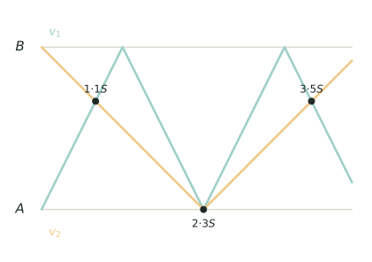

## 讲解

> 纵轴是位置（$A$ 到 $B$），横轴是时间，两条折线一相交就是相遇。第 $k$ 次迎面相遇时两人合走了 $(2k-1)S$，图中三个黑点依次对应合走 $1S$、$3S$、$5S$——注意第二个交点落在 $A$ 点，相遇可以发生在端点。

甲从 A 地、乙从 B 地同时出发相向而行，到达对方出发点后立即折返，在两地之间不断往返，于是两人会反复相遇。处理这类题的总纲只有一句话：**把两人的路程相加**。折返看起来弯弯绕绕，一旦换成"合走了多少个全程"，问题就变成一条直线上的加法。

### 一、模型与核心结论

设全程为 $S$，速度和为 $v_甲+v_乙$。第一次相遇时两人合走一个 $S$；此后每再相遇一次，两人都要各自跑到端点再折回来，合起来正好多走 $2S$。所以从出发算起：

$\text{第 }n\text{ 次迎面相遇：路程和}=(2n-1)S,\qquad t_n=\frac{(2n-1)S}{v_甲+v_乙}.$

两人用时相同，各人路程与自己的速度成正比，于是还有更省力的**奇数倍关系**：

$s_甲^{(n)}=(2n-1)s_甲^{(1)},\qquad s_乙^{(n)}=(2n-1)s_乙^{(1)}.$（这里的 $n$ 只数迎面相遇族，不包含另行计数的追及族。）

只要抓住第一次相遇时两人各走多少，任意一次的路程都能立刻写出，不必逐段模拟。

出发方式不同，倍数也随之改变。若两人从**同一端同地同向出发**，并在 $A,B$ 两端之间折返，位置相同也分成两族，不能只用“路程和”一条公式：

- 迎面族：$(v_1+v_2)t=2kS$，两人折返后迎面相遇；
- 追及族：$|v_1-v_2|t=2kS$，快者从后方追上慢者。

两族时刻取并集；若同一时刻两族都成立（通常对应端点），只能计一次。若两人速度相同且从同一点同向出发，则始终同行，不属于上述离散追及计数。

### 二、为什么一定是奇数倍

折返的本质是"到端点就掉头"，所以位置只由路程 $x$ 除以 $2S$ 的余数 $r$ 决定：

$$r\le S\ \Rightarrow\ \text{位置}=r;\qquad r>S\ \Rightarrow\ \text{位置}=2S-r.$$

设甲、乙的路程为 $a=2Sk+r$、$b=2Sl+t$（$0\le r,t<2S$）。位置相同，即 $f(a)=S-f(b)$（$f$ 是上面的折返换算，乙从 B 出发故要"反过来量"）。若 $a+b=(2n-1)S$，则 $r+t\equiv S\pmod{2S}$，而 $0\le r+t<4S$，故只可能 $r+t=S$ 或 $r+t=3S$。前者两人都在"去"的路上迎面碰上，后者两人都在"回"的路上也是迎面，位置必定相同。这就是 $(2n-1)S$ 的来历——不是背结论，而是"两个余数只能配成 $S$ 或 $3S$"。

### 三、三个高级变形

1. **位置周期**。速度比化为最简整数比 $m:n$ 后，第 $n$ 次迎面相遇时甲的路程是 $s_甲^{(1)}$ 的奇数倍，迎面相遇位置序列以 $m+n$ 次为周期（个别情况下周期更短）。求"第 2024 次在哪"时，先列一个周期内的位置表，再用余数定位，这是大数下标的标准打法。

2. **追及也成族**。上面只说明了"和为奇数倍必相遇"，反过来并不成立：两人同向、快者从后赶上时，位置也相同，此时条件变成 $|a-b|$ 是 $S$ 的奇数倍，即 $|v_甲-v_乙|\,t=(2k-1)S$。所以"位置相同"共有两族，计数时要分开列时间再合并；若某时刻两族同时成立（此时两人必在同一端点），只能算一次，这就是容斥。

3. **反求全程要分类**。已知某次相遇点距某端多远，先写出该次某人的总路程，再讨论它落在第几个 $2S$ 内：位置可能是 $r$，也可能是 $2S-r$。不同分支解出的 $S$ 必须回到"第一次相遇点"检验，通常只有一个分支自洽。

### 四、竞赛视角

看到"到达对方出发点后立即返回""第二次、第三次相遇""相遇点距 A 多少"，就该切换到本模型。它最容易与环形跑道混淆：环形上每相遇一次合走一个周长，而折返行程的**迎面相遇族**相邻两次之间合走 $2S$，累计是**奇数倍**；追及族须另按速度差计数。遇到"第几次""共几次""在哪"三类问法，分别对应奇数倍、分族计数、折返换算。数据很大时，先列前几次的时间与位置找周期；数据含未知量时，先设 $S$ 与速度比，再用"位置唯一"逼出分支。

### 五、易错点

1. **把第 $n$ 次的路程和写成 $nS$**。错误：第二次用 $2S$。正确：两端相向的迎面相遇族中，第一次 $S$，第二次 $3S$，第三次 $5S$，即 $(2n-1)S$；若问总相遇次数，还要合并追及族。错因是把"每次多走 $S$"当成了规律。
2. **把路程当位置**。错误：甲走了 $300$ 米就说相遇点距 A $300$ 米。正确：先除以 $2S$ 取余，再用 $2S-r$ 换算。漏掉这一步，答案必错。
3. **倍数用错**。错误：第 $4$ 次用 $4$ 倍。正确：是 $7$ 倍，$2n-1$ 中的 $n$ 是相遇次数，不是折返次数。
4. **漏掉端点相遇**。错误：认为在端点碰头"不算相遇"。正确：同一时刻同一地点就是相遇；只是要看清两人是迎面到达还是同向到达，后者属于追及族。
5. **只算迎面、漏掉追及**。错误：问"共相遇几次"只列 $(2n-1)S$。正确：速度差较大时还要列 $|v_甲-v_乙|t=(2k-1)S$，两族时刻合并后剔除重复。错因是以为"位置相同"只有迎面一种，忘了快者从后赶上也是同地同时。
6. **算完不检验**。错误：算出 $S$ 或位置就交卷。正确：代回核对两人位置是否一致、路程和是否为奇数倍 $S$（迎面族）或路程差是否为奇数倍（追及族）。错因是折返换算容易把 $r$ 与 $2S-r$ 取反，不检验就发现不了。

## 竞赛真题中的考察

- **2024 IHC 6 培训 第 40 题**：A、B 两船相向到对方码头后立即折返，由"两次相遇间隔 4 小时"反求水速，考的是【例1】折返后第 n 次相遇的时刻（★★★★★）
- **2024 IHC A-6 第 10 题**：甲、乙各自在 AC、BD 段往返，问一小时内相遇几次，对应【例4】的逐段周期计数——先按往返周期定各自位置，再逐段数重合（★★★★★）
- **考前 60 题 第 37 题**：小张骑摩托在 A、B 间往返、小王直行，由首次相遇与首次追上定出速度比，再数小王到 B 时迎面相遇过几次，是【例4】式的时间区间内计数（★★★★★）
- **考前 60 题 第 44 题**：甲乙相向、到对面后各自变速，由第一、二次相遇相距 72 km 反求全程，正是【例2】的用两个相遇点反求全程（★★★★★）
- **2024 IHC 6 培训 第 49 题**：客船、货船与落水物品同在一条河上运动，客船折返追物时又恰好遇货船，考的是【例3】的折返位置换算（★★★★★★）
- **2024 IHC C-6 第 18 题**：爷爷与希希在 AB 间往返，由三次迎面相遇的位置反求速度，正是【例3】的"第 n 次迎面相遇合走 (2n−1)D"折返位置折算（★★★★★★）

> 完整题目与解答见仓库 `exam/answers/` 对应试卷文件；跨卷汇总见 `exam/SUMMARY.md`。

<!-- card:auto -->
## 速查卡

> 裁剪即用：本页对应速查卡「行程 47背」。下面是本节最紧的一版摘要，公式与结论与正文完全一致，用于做题前扫一遍。全套卡片见 `tools/cards/build/cards.html`。

**核心结论**

- 两端相向迎面族：第 $n$ 次合走 $(2n-1)S$

$$t_n=\frac{(2n-1)S}{v_甲+v_乙}$$

- 同端同向折返：迎面族 $(v_1+v_2)t=2kS$；追及族 $|v_1-v_2|t=2kS$
- 总次数：合并两族时刻，同一端点时刻只计一次

**位置换算**

- 走 $x$ 米取余 $r$（模 $2S$）：$r\le S$ 位置为 $r$，否则为 $2S-r$
- 追及族：$(v_甲-v_乙)t=(2k-1)S$，两族时刻合并后去重

**辨析**

- 环形：第 $n$ 次合走（或差）$n$ 个周长
- 反求 $S$：先写该次总路程，再分它落在第几个 $2S$ 内

> ✅ 识别信号：到达对方出发点后立即返回、第二次相遇、相遇点距 A
> ⚠️ 易错：第 $n$ 次路程和写成 $nS$；把路程直接当位置
<!-- /card:auto -->

## 例题

### 例1：第四次相遇的时刻与地点（★★）

**题目**：A、B 两地相距 $150$ 千米。甲车从 A 地、乙车从 B 地同时出发相向而行，到达对方出发点后立即返回，在两地间不断往返。甲车每小时行 $45$ 千米，乙车每小时行 $30$ 千米。两车第 $4$ 次相遇是出发后几小时？相遇点距 A 地多少千米？前 $4$ 次相遇中，哪一次恰好发生在端点？

**覆盖点**：路程和与相遇次数、折返位置换算

**解析**：看到"第 $4$ 次"和"往返"，立刻想到路程和是奇数倍 $S$，不必一次一次画图。

第一步，定位第 $4$ 次的路程和。第一次合走 $S=150$ 千米，以后每次多走 $2S$，所以第 $4$ 次合走

$$(2\times4-1)\times150=1050\ \text{千米}.$$

第二步，求时间。速度和 $45+30=75$ 千米/时，

$$t_4=\frac{1050}{75}=14\ \text{小时}.$$

第三步，各自的路程。甲行 $45\times14=630$ 千米，乙行 $30\times14=420$ 千米，合计 $1050$ 千米，与第一步吻合。

第四步，折返换算成位置。甲：$630=2\times300+30$，走满两个 $2S$（往返一次）回到 A，再向 B 走 $30$ 千米，所以距 A 为 $30$ 千米。乙：$420=300+120$，走满一个 $2S$ 回到 B，再向 A 走 $120$ 千米，距 A 为 $150-120=30$ 千米。两人位置相同，确认相遇。

第五步，找端点相遇。逐个核前 $4$ 次：$t=2$ 时甲走 $90$、乙走 $60$，乙距 A 为 $150-60=90$，两人同在距 A $90$ 千米处；$t=6$ 时甲走 $270$（$2S-270=30$）、乙走 $180=S+30$，同在距 A $30$ 千米处；$t=10$ 时甲 $450=3S$、乙 $300=2S$，两人同时到达 B——第 $3$ 次在端点。

验算：$t=14$ 时两车位置都是距 A $30$ 千米，路程和 $630+420=1050=7\times150$，正是 $2\times4-1=7$ 倍。

**答案**：第 $4$ 次相遇在出发后 $14$ 小时，相遇点距 A 地 $30$ 千米；前 $4$ 次中第 $3$ 次恰好发生在端点 B

### 例2：由两个相遇点反求全程与速度比（★★★）

**题目**：甲、乙两人分别从 A、B 两地同时出发相向而行，到达对方出发点后立即返回，不断往返。第一次相遇点距 A 地 $60$ 米，第二次相遇点距 A 地 $100$ 米。求 AB 全程、甲与乙的速度比，以及第三次相遇点距 A 地多少米。

**覆盖点**：单程路程的倍数关系、折返位置换算

**解析**：两个相遇点都给了"距 A 的距离"，而甲从 A 出发，所以甲的行程最直接：第一次 $60$ 米，第二次就是 $3\times60=180$ 米。难点在于 $180$ 米可能落在不同的折返段，位置算法不同，必须分类。

第一步，写出甲第二次的总路程 $180$ 米。

第二步，分类讨论 $S$。

- 若 $S\ge180$：甲还没到 B（或刚到 B），位置就是 $180$，与"距 A $100$"矛盾。
- 若 $90<S<180$：甲已到过 B，正在返回 A，位置为 $2S-180$，令 $2S-180=100$，得 $S=140$，落在该区间内，成立。
- 若 $S=90$：甲恰好走完一个往返回到 A，位置为 $0$，不合。
- 若 $60<S<90$：甲已往返超过一整圈，位置为 $180-2S$，令其等于 $100$ 得 $S=40$，与 $S>60$ 矛盾（第一次相遇点在 $60$ 处，必须有 $S>60$）。

故 $S=140$ 米。

第三步，求速度比。第一次相遇时乙走了 $140-60=80$ 米，两人用时相同，速度比等于路程比：

$$v_甲:v_乙=60:80=3:4.$$

第四步，求第三次相遇点。甲第三次走 $5\times60=300$ 米，而 $300=2\times140+20$，即走满一个往返回到 A 后再向 B 走 $20$ 米，位置距 A $20$ 米。再用乙核对：乙第三次走 $5\times80=400$ 米，$400=280+120$，即回到 B 后向 A 走 $120$ 米，距 A 为 $140-120=20$ 米，一致。

验算：取 $t_1=1$ 分钟，甲 $60$ 米/分、乙 $80$ 米/分。$t=3$ 时甲 $180$（距 A $100$，因 $2\times140-180=100$），乙 $240=280-40$（距 A $100$）；$t=5$ 时甲 $300$、乙 $400$，位置都是 $20$；$t=1$ 时位置都是 $60$。三次全部吻合。

**答案**：AB 全程 $140$ 米，甲、乙速度比为 $3:4$，第三次相遇点距 A 地 $20$ 米

### 例3：第三次相遇点反求全程并定位大数下标（★★★★）

**题目**：甲、乙两车分别从 A、B 两地同时出发相向而行，到达对方出发点后立即返回，在两地之间不断往返。已知甲、乙速度比为 $4:5$，第三次相遇点距 A 地 $30$ 千米。求 AB 全程；并求第 $2024$ 次相遇点距 A 地多少千米。

**覆盖点**：折返位置换算

**解析**：只给速度比和一个相遇点，说明要用"比例 + 折返换算"把 $S$ 逼出来；第 $2024$ 次则要靠位置周期，不能硬算。

第一步，用比例写出甲第三次的路程。第一次甲走全程的 $\dfrac{4}{4+5}=\dfrac{4}{9}$，第三次是 $2\times3-1=5$ 倍：

$$s_甲^{(3)}=5\times\frac{4S}{9}=\frac{20S}{9}=2S+\frac{2S}{9}.$$

第二步，折返换算。余数 $\dfrac{2S}{9}<S$，说明甲走满一个往返回到 A 后又向 B 走了 $\dfrac{2S}{9}$，位置就是 $\dfrac{2S}{9}$。令 $\dfrac{2S}{9}=30$，得

$$S=135\ \text{千米}.$$

第三步，核对相遇时刻的规律。取甲 $60$ 千米/时、乙 $75$ 千米/时（比 $4:5$，速度和恰为 $135$）。迎面族 $135t=135(2k-1)$ 给出 $t=1,3,5,\cdots$；追及族 $15t=135(2m-1)$ 给出 $t=9,27,\cdots$，都已被奇数时刻包含。所以第 $n$ 次相遇就在 $t=2n-1$ 小时，不需另加时刻。

第四步，找位置周期。第 $n$ 次甲走 $60(2n-1)$ 千米，除以 $2S=270$ 取余再换算，依次得位置：

$$60,\ 90,\ 30,\ 120,\ 0,\ 120,\ 30,\ 90,\ 60,\cdots$$

$9$ 次一循环（第 $10$ 次又回到 $60$）。

第五步，用余数定位。$2024=9\times224+8$，所以第 $2024$ 次与第 $8$ 次位置相同，即距 A $90$ 千米。

验算：甲共走 $60\times4047=242820$ 千米，$242820=270\times899+90$，距 A $90$；乙共走 $75\times4047=303525$ 千米，$303525=270\times1124+45$，距 A 为 $135-45=90$；路程和 $242820+303525=546345=135\times4047$，正是 $(2\times2024-1)S$。

**答案**：AB 全程 $135$ 千米；第 $2024$ 次相遇点距 A 地 $90$ 千米

### 例4：四十小时内共相遇几次（★★★★★）

**题目**：A、B 两地相距 $200$ 千米。甲车从 A 地、乙车从 B 地同时出发，到达对方出发点后立即返回，不断往返。甲车每小时行 $50$ 千米，乙车每小时行 $30$ 千米。出发后 $40$ 小时内，两车一共相遇多少次（同一时刻在同一地点即算一次）？其中迎面相遇、追及相遇各多少次？第 $10$ 次相遇在出发后几小时、距 A 地多少千米？

**覆盖点**：迎面相遇与追及的分层计数、折返位置换算

**解析**：问"一共相遇几次"，就不能只套 $(2n-1)S$——那只是迎面族。两车速度差 $20$ 千米/时不算小，快车完全可能从后面赶上慢车，必须把"位置相同"拆成两族分别计数，再处理重复时刻。

第一步，迎面族。两人合走 $S$ 的奇数倍：

$$(50+30)t=200(2k-1)\ \Rightarrow\ t=2.5(2k-1).$$

在 $40$ 小时内，$2k-1\le16$，即 $k=1,2,\cdots,8$，共 $8$ 次。

第二步，追及族。两人路程差为 $S$ 的奇数倍：

$$(50-30)t=200(2m-1)\ \Rightarrow\ t=10(2m-1).$$

在 $40$ 小时内只有 $t=10$ 与 $t=30$，共 $2$ 次。

第三步，查重复。若某时刻两族同时成立，则 $2.5(2k-1)=10(2m-1)$，即 $2k-1=4(2m-1)$，左边是奇数、右边是偶数，不可能。所以两族时刻互不重合，直接相加：$8+2=10$ 次。

第四步，定位第 $10$ 次。把两族时刻从小到大排：$2.5,7.5,10,12.5,17.5,22.5,27.5,30,32.5,37.5$，第 $10$ 次在 $t=37.5$ 小时。此时甲走 $50\times37.5=1875=400\times4+275$，距 A 为 $400-275=125$ 千米；乙走 $30\times37.5=1125=400\times2+325$，距 A 为 $200-(400-325)=125$ 千米。

验算：$t=10$ 是追及，甲走 $500=400+100$ 距 A $100$，乙走 $300$ 距 A $200-100=100$，确为同向追上；$t=37.5$ 两人都在距 A $125$ 千米处迎面相遇；$40$ 小时内共 $10$ 个不同时刻，与 $8+2$ 一致。

**答案**：$40$ 小时内共相遇 $10$ 次，其中迎面 $8$ 次、追及 $2$ 次；第 $10$ 次在出发后 $37.5$ 小时，相遇点距 A 地 $125$ 千米

## 变式与自测

> 四道题按「模仿 → 变式 → 综合 → 自测」排。先盖住答案自己做，做完再对；对不上，多半是把相遇次数和路程和的倍数配错了。

### 变式1：第 n 次相遇的路程和（★）

**题目**：A、B 两地相距 $80$ 千米。甲车从 A 地、乙车从 B 地同时出发相向而行，到达对方出发点后立即返回，不断往返。甲车每小时行 $12$ 千米，乙车每小时行 $8$ 千米。求两车第 $3$ 次相遇的时刻，以及此时甲车距 A 地多远。

**覆盖点**：路程和与相遇次数

**解析**：折返相遇的路程和是"（$2n-1$）个全程"，与谁快谁慢无关，所以第几次相遇的时刻可以一次算出，不必逐次推。路程和除以速度和得时间，再用甲走的路程折回位置。

第 $3$ 次相遇合走 $5\times80=400$ 千米，用 $400\div20=20$（小时）；甲行 $12\times20=240$ 千米，$240=80\times3$，正好到 B。检验：乙行 $8\times20=160=2\times80$，也在 B ✓。

**答案**：第 $20$ 小时；相遇点在 B 地，即距 A 地 $80$ 千米。

### 变式2：单程路程的倍数关系（★★★）

**题目**：甲、乙两人分别从 A、B 两地同时出发相向而行，到达对方出发点后立即返回，不断往返。第一次相遇点距 A 地 $45$ 千米，第二次相遇点距 A 地 $105$ 千米。求 AB 全程、甲与乙的速度比，以及第三次相遇点距 A 地多少千米。

**覆盖点**：单程路程的倍数关系

**解析**：到第 $2$ 次相遇两人合走了 $3$ 个全程，甲走的路程正好是第一次的 $3$ 倍——这个倍数关系是本题唯一的突破口。甲走的路程一旦超过一个全程，就要用折返换算把它折回 A 端量。

甲到第 $1$、$2$ 次相遇分别走 $45$ 与 $3\times45=135$ 千米。因 $135>S$，位置为 $2S-135=105$，解得 $S=120$ 千米。速度比 $=45:(120-45)=3:5$。注意：这里的“第三次相遇”要把迎面族与追及族合并排序，不能直接把第三次迎面相遇当成第三次总相遇。

设甲、乙速度分别为 $3u,5u$。迎面族时刻为 $t=120(2k-1)/(8u)$，前两次分别是 $15/u$、$45/u$；追及族满足 $2ut=120(2j-1)$，第一次追及发生在 $t=60/u$，因此它才是总序列中的第三次相遇。此时甲走 $3u\times60/u=180$ 千米，乙走 $5u\times60/u=300$ 千米。对 $2S=240$ 取余并折返：甲余数 $180$，位置 $240-180=60$；乙余数 $60$，从 B 端反向量得位置 $120-60=60$。两人确在距 A 地 $60$ 千米处相遇。

**答案**：AB 全程 $120$ 千米；速度比 $3:5$；第三次相遇点距 A 地 $60$ 千米。

### 变式3：折返位置换算（★★★★）

**题目**：A、B 两地相距 $210$ 千米。甲、乙两车同时从 A、B 出发相向而行，到达对方出发点后立即返回，不断往返，速度比为 $3:4$。（1）求前 $5$ 次相遇点各距 A 地多少千米。（2）前 $5$ 次相遇中有几次恰好发生在端点？

**覆盖点**：折返位置换算

**解析**：先要定下"甲每一次相遇走了多少千米"，这靠的是路程和是奇数倍全程、而甲占总路程的 $\frac37$——把「比例行程」的份数思路搬过来，比逐段追位置快得多。剩下的全部工作是折返换算：路程对 $2S$ 取余，超过 $S$ 就折回来。

甲第 $n$ 次相遇走 $(2n-1)\times\frac37\times210=90(2n-1)$ 千米。对 $2S=420$ 取余得 $r$，位置为 $r$（$r\le210$）或 $420-r$（$r>210$）：$n=1$ 得 $90$；$n=2$ 得 $270\to150$；$n=3$ 得 $450\to30$；$n=4$ 得 $630\to210$；$n=5$ 得 $810\to30$。端点只出现在 $n=4$（$210$ 即 B 地）；要落到 A 地需 $90(2n-1)$ 是 $420$ 的倍数，即 $3(2n-1)$ 是 $14$ 的倍数，而左边是奇数，不可能。

**答案**：（1）依次为 $90$、$150$、$30$、$210$、$30$ 千米；（2）只有第 $4$ 次在端点（B 地），共 $1$ 次。

### 自测：迎面与追及分层计数（★★★）

**题目**：A、B 两地相距 $120$ 千米。甲车从 A 地、乙车从 B 地同时出发，到达对方出发点后立即返回，不断往返。甲车每小时行 $40$ 千米，乙车每小时行 $20$ 千米。问 $12$ 小时内（含第 $12$ 小时）两车一共相遇几次？其中迎面相遇几次、追及相遇几次？

**覆盖点**：迎面相遇与追及的分层计数

**解析**：折返行程里"相遇"有两种来源：迎面是合走奇数倍全程，追及是快的那个多跑整数倍全程，两类必须分开算，否则会重复计数。最稳的判法是解同余——把两车位置都写成对 $2S$ 取余的形式，正负号各解一次。

甲、乙的展开路程为 $40t$ 与 $120+20t$，对 $2\times120=240$ 取余后折返。解 $40t\equiv-(120+20t)$ 得 $60t\equiv120\pmod{240}$，即 $t=2,6,10$；解 $40t\equiv120+20t$ 得 $20t\equiv120\pmod{240}$，即 $t=6,18$。合并得 $t=2,6,10$（第 $18$ 小时超出 $12$ 小时）。检验：$t=2$ 时甲行 $80$、乙行 $40$，同在距 A $80$ 千米处且方向相反，是迎面；$t=6$ 时甲行 $240$、乙行 $120$，同在 A 地且都朝 B 走，是追及；$t=10$ 时甲行 $400$、乙行 $200$，折回后都在距 A $80$ 千米处、方向相反，是迎面。

**答案**：共 $3$ 次；迎面 $2$ 次（第 $2$、$10$ 小时），追及 $1$ 次（第 $6$ 小时，地点在 A 地）。
