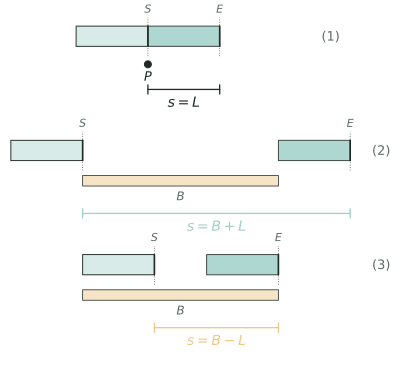

## 讲解

> 浅色是起点车、深色是终点车，虚线标出车头的起止位置。括线量的是**车头净走的距离**：过一个点为 $L$，完全通过为 $B+L$，完全在桥上为 $B-L$（要求 $B>L$）。

普通行程把人或车看成一个点，火车不行——它太长，车头和车尾不在同一处。所以"火车过桥"的全部技术可以压缩成一句话：**只盯车头，把每件事翻译成"车头走了多远"**。翻译对了，剩下的只是除法。

### 一、模型：三个路程

设车长 $L$、桥（隧道、站台）长 $B$、车速 $v$。

**完全通过**桥：车头上桥计时，车尾离桥结束，车头走 $B+L$，$t=\dfrac{B+L}{v}$。

**完全在桥上**：车尾上桥计时，车头出桥结束，车头走 $B-L$，$t=\dfrac{B-L}{v}$。若要求有正的“完全在桥上”持续时间，须 $B>L$；若 $B=L$，只有车身恰好与桥重合的一个瞬间，持续时间为 $0$；若 $B<L$，则不存在整列都在桥上的时刻。

**通过一个点**（树、电线杆、信号灯、站着不动的人）：车头对齐计时，车尾对齐结束，车头走 $L$，$t=\dfrac{L}{v}$。这就是常说的"过树"：路程就是 $s=l_{\text{车}}$。

**过一个走动的人**：人自己带着速度 $v_{\text{人}}$ 上路，相对路程仍是一个车长，但速度要换成相对速度——迎面 $s=(v_{\text{车}}+v_{\text{人}})t$，追上 $s=(v_{\text{车}}-v_{\text{人}})t$。人站着不动时这两式都退化回上面的 $t=\frac{L}{v}$。

两车**错车**（相向）与**超车**（同向）：相对路程都是 $L_1+L_2$，相对速度分别是 $v_1+v_2$ 与 $v_1-v_2$；人看成长度为 $0$ 的车。

这几种情形其实穷尽了"长度"的所有用法：桥、隧道、站台、另一列车，都只是提供一段长度，按上面的位置代入即可，不必另记公式。

### 二、推导：端点配对

为什么是 $B+L$ 而不是 $B$？看两个"守门"的时刻。开始那一瞬，车头在桥头，车尾还在桥外 $L$ 处；结束那一瞬，车尾刚离开桥尾，车头已冲出桥外 $L$。两头各多出一个车长，车头净走 $B+L$。也可以割补着想：把桥"接长"一个车长，火车就缩成一个点。

"完全在桥上"正好相反：开始是车尾压上桥头（车头已在桥内 $L$ 处），结束是车头到达桥尾，中间这段只有 $B-L$。若 $B=L$，车身恰好与桥重合一个瞬间，持续时间为 $0$；若 $B<L$，车比桥还长，任何时刻都有一截在桥外，这个瞬间根本不存在——这是边界，不是算错。

相对运动同理。把乙车按住不动，甲车相对乙的速度是 $v_1\pm v_2$；要让两车"从头到尾"互相让开，相对位移必须是 $L_1+L_2$。这就是错车、超车公式分子相同、分母不同的全部原因。

### 三、三个高级变形

1. **参考系切换**。坐在车上的人看窗外：桥"从眼前经过"用 $\dfrac{B}{v}$，一根电线杆"从眼前经过"用 $\dfrac{L}{v}$。乘客视角把两个长度拆开了——桥上的人量到的是 $B+L$，车上的人量到的是 $B$。反求车长、车速时，这一招常常一步到位。

2. **差值消元**。同一列车过两座桥：$t_1-t_2=\dfrac{B_1-B_2}{v}$，车长被消掉，先得速度，再回代得车长。若换成"两车过同一座桥"，就用**路程比 $=$ 速度比 $\times$ 时间比**，配合车长差把两份路程一起逼出来（见例3）。

3. **时间轴构造**。问"两车同时在桥上多久"，先给每列车算出"在桥区间"：左端点是车头进桥，右端点是车尾出桥，再取交集；问"只有一列车在桥上"就取并集减交集。端点永远对应"谁在守门"，不能凭感觉。端点还得成对：若题目问的是"整列都在桥上"，两个端点就都要换守门人（车尾进、车头出），区间会缩短 $\dfrac{2L}{v}$。

### 四、竞赛视角

看到"通过""穿过""完全在""错车""超过""从窗口看到""同时"，就该切到本模型。它与流水行船、环形跑道容易混：后两者算的是合走、差走，本模型的核心是"物体本身有长度"。命题人常在三处设卡：一是单位（km/h 与 m/s），二是"完全在"的减法与 $B>L$ 的边界，三是把两车问题塞进桥里问"同时"。对策分别是：先换算、先判边界、先画时间轴。再送一句口诀：反求先做减法（消掉车长），问"同时"先画时间轴，问"能否"先比车长与桥长。

### 五、易错点

1. **把火车当成点**。错：$t=B/v$。对：完全通过用 $(B+L)/v$。$200$ 米的车过 $1000$ 米桥要走 $1200$ 米，漏掉车长就少走 $200$ 米（按 $20$ 米/秒 算就少算 $10$ 秒）。
2. **单位不统一**。错：$108$ km/h 直接除 $300$ m。对：先换成 $30$ m/s 再代入。
3. **相向却用速度差**。错：错车用 $v_1-v_2$。对：相向靠近更快，用 $v_1+v_2$；只有同向超车才用差。
4. **"完全在桥上"套 $B+L$**。错：从车尾上桥算到车尾出桥。对：用 $B-L$，并且先检查 $B>L$。
5. **错车只算一个车长**。错：分子写 $L_1$。对：两车要互相让开，分子是 $L_1+L_2$。
6. **乘客视角多算车长**。错：乘客看桥用 $B+L$。对：乘客只看到桥"流过去"，用 $B$。
7. **时间轴端点取错**。错：把"车头进桥"当成"整列在桥上"的开始。对：整列在桥上从车尾进桥开始算。

## 竞赛真题中的考察

- **同类题型**：同一列车过电线杆、过大桥、过短桥的四个时间互推，考的就是【例1】的车长—桥长路程换算：先把车长从"过电线杆"里剥出来，再拿总路程减车长得桥长（★★★）
- **考前 60 题 第 36 题**：公共汽车长 15 m，同向追上甲用 6 s 离开、相向遇乙 2 s 后离开，正是【例2】的"超车用车长÷速度差、错车用车长÷速度和"，反解出甲、乙各自速度后再算两人相遇（★★★★）
- **同类题型**：两车先后过同一座桥、桥上错车位置与时间轴分类，对应【例4】的多车过桥时间轴构造，难点是判断"是否同时在桥上"的区间（★★★★★）

> 该模型的真题本库仅收录 1 道，其余为同类题型描述。

> 完整题目与解答见仓库 `exam/answers/` 对应试卷文件；跨卷汇总见 `exam/SUMMARY.md`。

<!-- card:auto -->
## 速查卡

> 裁剪即用：本页对应速查卡「行程 49正」。下面是本节最紧的一版摘要，公式与结论与正文完全一致，用于做题前扫一遍。全套卡片见 `tools/cards/build/cards.html`。

**三个路程**

- 完全通过：车头走 $B+L$，$t=\frac{B+L}{v}$
- 完全在桥上：车头走 $B-L$，$t=\frac{B-L}{v}$（须 $B>L$）
- 过一个点（树、电线杆）：车头走 $L$，$t=\frac{L}{v}$
- 过走动的人：相对速度 $v_{车}\pm v_{人}$，相对路程仍是一个车长

**反求与轴**

- 同一列车过两桥：$t_1-t_2=\frac{B_1-B_2}{v}$，先消车长得速度

> ✅ 识别信号：通过、完全在、错车、超过、从窗口看到 → 只盯车头
> ⚠️ 易错：把火车当点用 $\frac{B}{v}$；相向错车却用速度差
<!-- /card:auto -->

## 例题

### 例1：电线杆、大桥与一座短桥上的四个时间（★★）

**题目**：一列火车长 $L$ 米，以每秒 $20$ 米的速度匀速行驶，经过铁路旁的一根电线杆用了 $9$ 秒。（1）求车长。（2）它完全通过一座长 $1080$ 米的大桥需要多少秒？（3）它完全在桥上的时间是多少秒？（4）前方还有一座长 $140$ 米的短桥，这列火车能出现"整列都在桥上"的时刻吗？并求它完全通过这座短桥要多少秒？

**覆盖点**：车长与桥长的路程换算

**解析**：先看"经过电线杆"。电线杆是一个点，没有长度，从车头对齐到车尾离开，车头只走了自己的车长，所以 $L=20\times9=180$（米）。这一步是全篇地基：凡"经过一个点"，路程就是 $L$。

（2）完全通过大桥，两个守门时刻是"车头上桥"和"车尾离桥"。结束时车头已出桥 $180$ 米，故车头一共走 $1080+180=1260$ 米，$1260\div20=63$（秒）。

（3）完全在桥上，从车尾压上桥头到车头到达桥尾，车头只走 $1080-180=900$ 米，$900\div20=45$（秒）。

（4）关键在边界。整列在桥上要求桥比车长，而 $140<180$，车比桥长，任何时刻都有一截在桥外，所以这样的时刻不存在。但"完全通过"照常可算：$140+180=320$ 米，$320\div20=16$（秒）。

验算：$63-45=18$（秒），恰等于 $\dfrac{2L}{v}=2\times\dfrac{180}{20}=18$，即进桥、出桥各多走一个车长、各多 $9$ 秒；$45+2\times9=63$ 自洽；短桥 $16$ 秒 $<63$ 秒，符合"桥短用时少"。

**答案**：车长 $180$ 米；完全通过大桥 $63$ 秒；完全在桥上 $45$ 秒；短桥长 $140$ 米小于车长，不存在整列在桥上的时刻，完全通过短桥用 $16$ 秒。

### 例2：错车、超车与车窗里看到的货车（★★★）

**题目**：一列客车长 $200$ 米、速度 $30$ 米/秒，一列货车长 $300$ 米、速度 $20$ 米/秒，在平行轨道上行驶。（1）相向而行，从两车车头相遇到车尾分开需要多少秒？这段时间两车各走多少米？（2）同向而行，客车从车头追上货车车尾到完全超过货车，需要多少秒？客车比货车多走多少米？（3）小明坐在客车车尾看窗外：两车相向时，货车从他眼前经过用多少秒？客车超过货车时呢？

**覆盖点**：相向错车与同向超车

**解析**：（1）错车的本质是"两车互相让开"。把货车按住不动，客车以 $30+20=50$ 米/秒靠近它，要让开的相对路程是两车长度之和 $200+300=500$ 米，所以 $500\div50=10$（秒）。这 $10$ 秒里客车走 $30\times10=300$ 米、货车走 $20\times10=200$ 米，合起来正好 $500$ 米——这就是"路程和"的验算方式，也是判断有没有漏算车长的最快办法。

（2）同向时相对速度换成差 $30-20=10$ 米/秒，相对路程仍是 $500$ 米，所以 $500\div10=50$（秒）。这 $50$ 秒里客车走 $1500$ 米、货车走 $1000$ 米，相差 $500$ 米，正好等于两车长度和。

（3）小明是车上的一个点（长度 $0$）。货车经过他，相对路程只是货车自己的长度 $300$ 米：相向用速度和，$300\div50=6$（秒）；同向用速度差，$300\div10=30$（秒）。注意 $6<10$、$30<50$：观察者只是桥上或车上的一个点，他看到的"通过时间"一定比整列错车短。

验算：错车 $10$ 秒内两车共行 $300+200=500$ 米 ✓；超车 $50$ 秒内两车相差 $1500-1000=500$ 米 ✓；小明看货车只用 $6$ 秒，也可这样核：车头相遇时货车车头在客车车尾前方 $200$ 米，以 $50$ 米/秒靠近，$200\div50=4$ 秒后到眼前，再过 $6$ 秒车尾离开，$4+6=10$ 秒正是整列错车时间 ✓。

**答案**：（1）$10$ 秒，客车走 $300$ 米、货车走 $200$ 米；（2）$50$ 秒，客车多走 $500$ 米；（3）相向时 $6$ 秒，同向时 $30$ 秒。

### 例3：两车过同一座桥，用比例逼出车长与车速（★★★★）

**题目**：甲、乙两列火车匀速通过同一座长 $1080$ 米的大桥，甲车用 $60$ 秒，乙车用 $69$ 秒。已知甲车比乙车长 $60$ 米，且甲车速度是乙车的 $\dfrac{6}{5}$。（1）求两车车长与速度。（2）两车完全在桥上的时间各是多少？（3）甲车通过一条隧道时，整列完全在隧道内的时间是 $18$ 秒，求隧道长，以及甲车完全通过这条隧道的时间。

**覆盖点**：由过桥数据反求车长与车速、车长与桥长的路程换算

**解析**：为什么想到比例？题目给的是"时间＋速度比＋车长差"，而过桥路程是 $1080+L$，车长与速度绞在一起，直接设两个未知数列方程会出现相乘的项。但两车走的是同一座桥，两份路程只差一个车长差，正适合用"路程比＝速度比×时间比"把两份路程一起逼出来。

第一步，写路程比。设甲、乙的路程为 $S_甲$、$S_乙$，速度比 $6:5$，时间比 $60:69$：

$$S_甲:S_乙=(6\times60):(5\times69)=360:345=24:23.$$

第二步，用差定份数。$S_甲-S_乙=(1080+L_甲)-(1080+L_乙)=L_甲-L_乙=60$ 米，而份数差是 $24-23=1$ 份，故 $1$ 份 $=60$ 米：

$$S_甲=24\times60=1440\ (\text{米}),\qquad S_乙=23\times60=1380\ (\text{米}).$$

第三步，回车长与速度。$L_甲=1440-1080=360$ 米，$v_甲=1440\div60=24$ 米/秒；$L_乙=1380-1080=300$ 米，$v_乙=1380\div69=20$ 米/秒。检查：$24:20=6:5$ ✓，$360-300=60$ ✓。

第四步，完全在桥上。甲：$(1080-360)\div24=30$（秒）；乙：$(1080-300)\div20=39$（秒）。

第五步，隧道。整列在隧道内 $18$ 秒，意味着车头走了 $T-360=18\times24=432$ 米，故 $T=792$ 米；完全通过要走 $792+360=1152$ 米，$1152\div24=48$（秒）。

验算：甲 $(1080+360)\div24=60$ ✓；乙 $(1080+300)\div20=69$ ✓；隧道 $(792+360)\div24=48$ ✓，且 $48-18=30$ 恰为 $\dfrac{2\times360}{24}=30$ 秒，自洽。

**答案**：甲车长 $360$ 米、速度 $24$ 米/秒，乙车长 $300$ 米、速度 $20$ 米/秒；完全在桥上甲 $30$ 秒、乙 $39$ 秒；隧道长 $792$ 米，甲完全通过用 $48$ 秒。

### 例4：两车在桥上的时间轴与错车位置（★★★★★）

**题目**：甲、乙两列火车在平行的两条轨道上相向行驶。甲车长 $400$ 米、速度 $15$ 米/秒，从桥的一端驶入；乙车长 $200$ 米、速度 $25$ 米/秒，从桥的另一端驶入。桥长 $1100$ 米。已知甲车车头上桥后 $20$ 秒，乙车车头才到达桥的另一端。从甲车车头上桥开始计时。（1）两车各自"在桥上"（车头进桥到车尾出桥）的时间区间是什么？（2）两车同时在桥上的时间是多少秒？（3）两车错车用多少秒？错车开始处距甲车入桥端多少米？（4）从甲车车头上桥到两车车尾都离开桥共多少秒？其中"桥上只有一列车"的时间是多少秒？

**覆盖点**：多车过桥的时间轴构造与分类、相向错车与同向超车

**解析**：这题问"同时"，只算单个时间没有用，必须把两列车的"在桥区间"画到同一条时间轴上，再取交、并、差。每个区间有两个端点，各由一个守门点决定：左端是车头进桥（甲在 $0$ 秒，乙在 $20$ 秒），右端是车尾出桥。

第一步，甲车区间。车头进桥 $t=0$；车尾出桥时车头已走 $1100+400=1500$ 米，$1500\div15=100$（秒），所以甲车在桥上是 $[0,100]$。

第二步，乙车区间。乙车车头在 $t=20$ 进桥；车尾出桥时车头要走 $1100+200=1300$ 米，用 $1300\div25=52$ 秒，即 $t=20+52=72$，所以乙车在桥上是 $[20,72]$。

第三步，取交集。重叠部分是 $[20,72]$，长 $72-20=52$ 秒。也就是说，从乙车车头进桥到乙车车尾离桥，甲车始终还在桥上——甲车要到 $100$ 秒才离开，这是交集能取满乙车整段的原因。

第四步，错车。两车相向，相对速度 $15+25=40$ 米/秒。设甲车车头上桥后 $t$ 秒两车车头相遇，此时甲车头走了 $15t$、乙车头走了 $25(t-20)$，两段合起来正好是桥长：

$$15t+25(t-20)=1100\ \Rightarrow\ 40t=1600\ \Rightarrow\ t=40.$$

相遇点距甲车入桥端 $15\times40=600$ 米。错车要让开两车长度和 $400+200=600$ 米，相对速度 $40$ 米/秒，用 $600\div40=15$ 秒。

第五步，收尾与"只有一列车"。甲车车尾离开在 $t=100$，乙车在 $t=72$，故两车都离开要 $100$ 秒。桥被占用的总时间是 $[0,100]$ 共 $100$ 秒，其中两车同时在桥上 $52$ 秒，所以只有一列车在桥上的时间是 $100-52=48$ 秒（分段核：$[0,20)$ 有 $20$ 秒，$(72,100]$ 有 $100-72=28$ 秒，合计 $48$ 秒）。

验算：$t=40$ 时甲车头在 $600$ 米处，乙车头在 $1100-25\times20=600$ 米处，正好相遇 ✓；$t=55$ 时甲车头 $825$、甲车尾 $425$，乙车头 $225$、乙车尾 $425$，两车车尾重合，恰好分开 ✓；$t=72$ 时乙车头已到 $1100-25\times52=-200$ 米（完全出桥），甲车头在 $1080$ 米仍跨在桥上 ✓，交集正确。

**答案**：（1）甲车 $[0,100]$ 秒，乙车 $[20,72]$ 秒；（2）$52$ 秒；（3）错车 $15$ 秒，错车开始处距甲车入桥端 $600$ 米；（4）共 $100$ 秒，其中只有一列车在桥上 $48$ 秒。

## 变式与自测

> 四道题按「模仿 → 变式 → 综合 → 自测」排。先盖住答案自己做，做完再对；对不上，多半是路程只算了桥长，忘了车长。

### 变式1：车长加桥长（★）

**题目**：一列火车长 $150$ 米，以每秒 $25$ 米的速度匀速行驶。（1）它完全通过一座长 $450$ 米的大桥需要多少秒？（2）它完全在桥上的时间是多少秒？

**覆盖点**：车长与桥长的路程换算

**解析**：火车过桥的路程不是桥长，是"车长加桥长"——车尾离开桥的那一刻，车头已经多走了整整一个车长。反过来"完全在桥上"要减：车头出桥前车尾就得进桥，那段路程是"桥长减车长"。

（1）$(150+450)\div25=24$（秒）。（2）$(450-150)\div25=12$（秒）。

**答案**：（1）$24$ 秒；（2）$12$ 秒。

### 变式2：两次过桥反求车长车速（★★★）

**题目**：一列火车以不变的速度行驶，完全通过一座长 $800$ 米的桥用 $50$ 秒，完全通过一条长 $1400$ 米的隧道用 $74$ 秒。求这列火车的车长与速度。

**覆盖点**：由过桥数据反求车长与车速

**解析**：两次都带着同一个车长，所以两式相减时车长正好被减掉，只剩下"路程差除以时间差"这一个未知量。先求速度、再回代求车长，比设两个未知数列方程组省事得多。

速度 $=(1400-800)\div(74-50)=600\div24=25$（米/秒）；车长 $=25\times50-800=450$（米）。检验：$(1400+450)\div25=74$ ✓。

**答案**：车长 $450$ 米，速度 $25$ 米/秒。

### 变式3：桥上的时间轴（★★★★）

**题目**：甲、乙两车在平行的轨道上同向行驶，甲车长 $300$ 米、每秒 $30$ 米，乙车长 $200$ 米、每秒 $20$ 米。某时刻甲车车头刚要上桥，桥长 $900$ 米，此时乙车已在桥上、在甲车前方，乙车车头距甲车车头 $700$ 米。从甲车车头上桥开始计时。（1）乙车完全出桥时，甲车车头在桥上距桥入口多少米？（2）甲车完全超过乙车需要多少秒？（3）从甲车车头上桥算起，到两车都完全离开桥共多少秒？

**覆盖点**：多车过桥的时间轴构造与分类

**解析**：几辆车同时在桥上，最容易把"谁在哪一段"搅混，所以第一步要把每辆车的进桥、出桥时刻各自算成一个区间再叠加，而不是套一个公式。「完全超过」这一步借的是「火车追及」的位移比较——甲车尾追上乙车头时，两车位移差正好是甲车长加两车头的初始距离。

（1）乙车车尾在入口后 $700-200=500$ 米处，还差 $900-500=400$ 米出桥，用 $400\div20=20$（秒），此时甲车头走了 $30\times20=600$ 米。（2）甲车头 $30t$、乙车头 $700+20t$，令甲车尾追上乙车头：$30t-300=700+20t$，得 $t=100$ 秒。（3）甲车尾出桥要车头走 $900+300=1200$ 米，用 $40$ 秒；乙车已在第 $20$ 秒出桥，故共 $40$ 秒。

**答案**：（1）$600$ 米；（2）$100$ 秒；（3）$40$ 秒。

### 自测：错车与超车联立（★★★）

**题目**：一列客车长 $220$ 米，一列货车长 $340$ 米。两车相向而行，从车头相遇到车尾分开用 $14$ 秒；同向而行，客车从车头追上货车车尾到完全超过货车用 $35$ 秒。求两车的速度。

**覆盖点**：相向错车与同向超车

**解析**：错车和超车走的路程都是"车长和"，区别只在相对速度是"和"还是"差"，所以两式一加一减就能把两个速度解出来。先把两个相对速度算成确定的数，再联立，比直接设两个未知数清晰。

车长和 $=220+340=560$（米）；相向相对速度 $560\div14=40$，同向相对速度 $560\div35=16$。于是客车 $(40+16)\div2=28$、货车 $(40-16)\div2=12$（米/秒）。检验：$560\div(28+12)=14$ ✓，$560\div(28-12)=35$ ✓。

**答案**：客车 $28$ 米/秒，货车 $12$ 米/秒。
