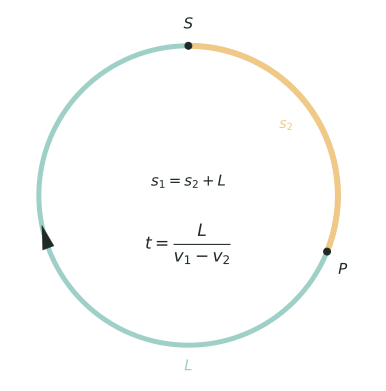

## 讲解

> 只有一条圆形跑道，整圈长就是 $L$。橙色那段是两人都走过的 $s_2$；甲跑完一整圈之后又多走了这一段才追上乙，所以 $s_1=s_2+L$，追上用时 $t=\dfrac{L}{v_1-v_2}$。

**一、模型：把"位置相同"翻译成"整圈"**

环形跑道（操场、圆形湖岸）是一条**封闭**路线。直线行程里，相遇看路程和、追及看路程差；上了环，两人重新站在同一点，等价于他们的**路程和**或**路程差**恰好是一圈长 $L$ 的整数倍。所以环形题的本质是"圈数记账"：谁比谁多走了几圈、两人合起来走了几圈。

设一圈长 $L$，速度 $v_1>v_2$，同地同时出发：

- **反向（迎面）**：每合走一圈相遇一次，$t_n=\dfrac{nL}{v_1+v_2}$，间隔 $\dfrac{L}{v_1+v_2}$；
- **同向（追及、套圈）**：快者每多跑一圈追上对方一次，$t_n=\dfrac{nL}{v_1-v_2}$，追上时快者恰比慢者多 $n$ 圈。

同地同时出发是默认前提；起点一旦不同，和与差都要先把两人之间的那段弧算清楚（究竟是 $d$ 还是 $L-d$），这是下面变形一的由来。

两句话概括：**同地背向**，第 $n$ 次相遇时两人的路程和 $=n\times$ 周长；**同地同向**，第 $n$ 次追上时两人的路程差 $=n\times$ 周长。两个 $n$ 都是次数，方向一旦判错，和与差就要对调。

任意时刻某人的位置：跑了 $s$，位置就是 $s$ 除以 $L$ 的**余数**，从出发点沿他跑的方向量；余数为 $0$ 就是回到了出发点。

**二、为什么是"合一圈、差一圈"**

把两人的位置都记成"从出发点沿同一方向量的米数"。同向时位置相同，意味着两人路程之差是 $L$ 的倍数；反向时两人的位置从两侧量，位置相同意味着路程之和是 $L$ 的倍数。反过来，只要和（差）是整圈，两人必在同一点。这就是全部推导：不必追每一步，只数圈；判断看和还是看差，剩下的只是除法与取余。

**三、三个高级变形**

1. **起点不同（差一段 $d$）**：两人把一圈分成 $d$ 与 $L-d$ 两段弧，第一次追及的"差"、第一次迎面相遇的"和"，都是两人之间**正在被走掉**的那段弧：同向追及时，若慢者在前、两人相隔 $d$，快者补上 $d$ 就追上；若快者在前，则要多跑 $L-d$ 才能套圈。迎面时沿哪段弧相向，"和"就是那段弧的长（$d$ 或 $L-d$）。此**之后**每次再加一圈。先看清方向、补差（或补弧），再记圈，别一上来就套 $L$。
2. **多次相遇的位置与周期**：反向时第 $n$ 次相遇点 $=na\bmod L$（$a$ 为甲一个间隔跑的路程）。位置只能取 $\gcd(a,L)$ 的倍数，由此可判断"某点能否成为相遇点"；位置序列以 $L/\gcd(a,L)$ 为周期循环。
3. **变向与变速：按事件切段**：转身或提速的那一瞬，位置不变，方向和速度变。以事件时刻切段，段内重算和速度或差速度，段末用余数定位置；反向量的位置要换成 $L-$ 余数，再接着算下一段。

**四、竞赛视角**

信号词：环形、圆形、操场、相背、同向、第 $n$ 次、几圈、转身、提速。第一动作判方向——反向用和、同向用差；第二动作记圈——第 $n$ 次就是 $n$ 圈（起点不同时先补差）。看到"一段时间内几次"就除法后**向下取整**；看到"某点能否成为相遇点"就用余数与最大公因数；看到变向、变速先画时间轴分段。交卷前用两人各自的路程反算位置，两条路都对上，圈数才算记对。环形题最易与直线多次相遇混：直线上第 $n$ 次相遇的路程和是 $(2n-1)s$，环上却是 $nL$，结构完全不同。

### 五、易错点

1. 同向追及却用速度和 $v_1+v_2$。正：追及用差 $v_1-v_2$，只有反向才用和。
2. 第 $n$ 次相遇只算一圈。正：$n$ 次共走 $nL$，不是一圈。
3. "几分钟内相遇几次"四舍五入。正：取整数部分，$300\div40=7.5$ 只能算 $7$ 次。
4. 圈数四舍五入。正：$s\div L$ 取整得整圈数，余数才是位置，$900\div360$ 是 $2$ 圈，不是 $3$ 圈。
5. 转身后仍按原方向、原速度差算。正：转身瞬间位置不变，先用余数定位置，再用新的和速度。
6. 变速后沿用旧的相遇间隔。正：间隔是 $\dfrac{L}{v_1\pm v_2}$，速度一变间隔立刻变。
7. 以为"多遇几次总会回到出发点"。正：位置只能是 $\gcd(a,L)$ 的倍数，如 $\gcd=80$ 时 $200$ 米处永远遇不到。

## 竞赛真题中的考察

- **第 32 届 WMO 第 14 题**：圆上位置用同余表示，解同余方程 18k≡0 (mod 24)，反向绕圈的最小正周期即相遇用时（★★★）
- **2026 春·走美 第 14 题**：相遇化为同余方程 s≡−12k (mod 60)，−12k 只能是12的倍数，于是判定哪些起点永远绕不到一起（★★★★★）
- **2025 思维能力测评 第 12 题**：长方形赛道 ABCD 上甲顺时针、乙逆时针反向出发，先用首次相遇点 P 定出速度比，再按"反向每合走一圈相遇一次"数 5 分钟内的次数，正是【例1】【例3】的反向相遇—圈数换算（★★★★★）

> 完整题目与解答见仓库 `exam/answers/` 对应试卷文件；跨卷汇总见 `exam/SUMMARY.md`。

<!-- card:auto -->
## 速查卡

> 裁剪即用：本页对应速查卡「行程 48背」。下面是本节最紧的一版摘要，公式与结论与正文完全一致，用于做题前扫一遍。全套卡片见 `tools/cards/build/cards.html`。

**基本模型**

$t=\frac{nL}{v_1+v_2}\ (\text{反向}),\quad t=\frac{nL}{v_1-v_2}\ (\text{同向})$

- 默认同地同时出发，且同向追及时 $v_1>v_2$；反向用速度和，同向用速度差

- 反向合走一圈相遇一次，同向多跑一圈追上一次

**位置与周期**

- 位置就是路程除以 $L$ 的余数，余 $0$ 即回出发点
- 相遇点 $na$ 取模 $L$，只能是 $d$ 的倍数

**变形**

- 起点不同先补弧 $d$ 或 $L-d$，之后每次加一圈
- 问几次向下取整，如 $300\div40=7.5$ 只算 $7$ 次
- 转身或提速：按事件切段，段内重算和与差

> ✅ 识别信号：环形、相背、同向、第 $n$ 次、几圈、转身、提速
> ⚠️ 易错：同向追及用速度和；第 $n$ 次相遇只算一圈
<!-- /card:auto -->

## 例题

### 例1：反向出发，由和与差反求一圈长（★★）

**题目**：甲、乙在环形跑道上从同一点**同时反向**出发。甲每秒跑 $6$ 米；出发后 $50$ 秒两人第一次相遇，此时甲比乙多跑了 $100$ 米。(1) 求乙的速度和跑道一圈的长。(2) 出发后 $10$ 分钟内（含第 $600$ 秒）两人共相遇几次？其中有几次恰好发生在出发点？是第几次？

**覆盖点**：反向相遇合走一圈、多次相遇的圈数与位置

**解析**：为什么想到：反向出发，第一次相遇时两人**合走一整圈**，所以"和"能定周长；而"甲比乙多跑 $100$ 米"给的是"差"，配合甲的速度就能先算出各自的路程。要求"在出发点"，就是把位置余数要求成 $0$，转化为整除条件。

第一步，算两人各自的路程。甲跑 $6\times50=300$（米），乙跑 $300-100=200$（米），所以

$$v_{\text{乙}}=200\div50=4\ (\text{米/秒}),\qquad L=300+200=500\ (\text{米}).$$

第二步，核对：$v_1+v_2=6+4=10$，$10\times50=500=L$，与"第一次相遇"吻合。

第三步，把"在出发点"写成条件。第 $n$ 次相遇在 $t=50n$ 秒，甲跑了 $300n$ 米，位置是 $300n\bmod 500$。要在出发点，需 $500\mid300n$，约去 $100$ 得 $5\mid3n$，即 $5\mid n$。

第四步，数次数。$50n\le600$ 得 $n\le12$，共 $12$ 次相遇；其中 $n=5,10$ 满足条件，共 $2$ 次。

第五步，验算。$n=5$：$t=250$ 秒，甲 $1500=3$ 圈、乙 $1000=2$ 圈，都在出发点；$n=10$：$t=500$ 秒，甲 $3000=6$ 圈、乙 $2000=4$ 圈，也在出发点。再看 $n=12$：$t=600$ 秒，甲 $3600=7$ 圈余 $100$ 米，乙 $2400=4$ 圈余 $400$ 米，从乙的方向量余 $400$，从甲的方向量就是 $500-400=100$ 米，两人确实同点，且不在出发点，说明"恰好 $2$ 次"没有漏数。

**答案**：乙每秒 $4$ 米，一圈 $500$ 米；$10$ 分钟内共相遇 $12$ 次，其中第 $5$ 次和第 $10$ 次在出发点，共 $2$ 次

### 例2：同向追及，两次追及时间反求速度（★★★）

**题目**：环形跑道一圈长 $L$ 米。甲、乙从同一点同时同向出发，甲每分钟跑 $100$ 米，乙每分钟跑 $v$ 米（$v<100$）。(1) 出发后 $12$ 分钟甲第一次追上乙；若甲每分钟少跑 $20$ 米、乙不变，则甲第一次追上乙需 $18$ 分钟。求 $L$ 与 $v$。(2) 按原速，$40$ 分钟内甲追上乙几次？第 $3$ 次追上时甲、乙各跑了几圈，在何处？

**覆盖点**：同向追及多跑一圈、多次相遇的圈数与位置

**解析**：为什么想到：同向追及的标志是"差一圈"，每次追上都有"速度差 $\times$ 时间 $=$ 一圈"。题目给了两种情形下的追及时间，就是两个含 $L$ 的等式；相减能消掉 $L$，直接逼出速度差——这是"两次追及反求速度"的标准套路。注意"甲少跑 $20$ 米"改的是**速度差**，不是 $L$。

第一步，列两个等式：

$$12(100-v)=L,\qquad 18(80-v)=L.$$

第二步，相减消 $L$：

$$1200-12v=1440-18v\ \Longrightarrow\ 6v=240\ \Longrightarrow\ v=40,$$

回代得 $L=12\times(100-40)=720$（米）。

第三步，核对第二次：$18\times(80-40)=720=L$，成立。

第四步，数次数。速度差 $100-40=60$，追及间隔 $720\div60=12$（分钟），$40\div12=3$ 余 $4$，取整得 $3$ 次。

第五步，定位第 $3$ 次。$t=12\times3=36$ 分钟，甲跑 $100\times36=3600=5\times720$，正好 $5$ 圈回到出发点；乙跑 $40\times36=1440=2\times720$，正好 $2$ 圈也在出发点。

第六步，验算。第 $2$ 次追上在 $t=24$ 分钟：甲 $2400=3$ 圈余 $240$ 米，乙 $960=1$ 圈余 $240$ 米，同点且差 $1440=2$ 圈，是第 $2$ 次；第 $4$ 次要 $48$ 分钟，超过 $40$ 分钟，故 $3$ 次无误。再查追上位置的规律：$480,240,0$ 循环，第 $3$ 次落在出发点与规律一致。

**答案**：一圈 $720$ 米，乙每分钟 $40$ 米；$40$ 分钟内追上 $3$ 次，第 $3$ 次时甲跑 $5$ 圈、乙跑 $2$ 圈，都在出发点

### 例3：多次相遇的圈数与位置（★★★★）

**题目**：环形跑道一圈 $400$ 米。甲、乙从同一点同时**反向**出发，$40$ 秒后第一次相遇，相遇点距出发点 $240$ 米（沿甲的方向量）。(1) 求两人的速度。(2) 第 $20$ 次相遇时，甲、乙各跑了几圈？(3) 前 $20$ 次相遇中，有多少次的相遇点与出发点的**最短跑道距离**不超过 $100$ 米？并判断 $200$ 米处能否成为相遇点。

**覆盖点**：多次相遇的圈数与位置

**解析**：为什么想到：反向第一次相遇，速度和 $=L\div40$，而相遇点 $240$ 米正是甲在 $40$ 秒内跑的路程，于是速度和与甲速都有了，比例随之确定。要求"多次相遇的位置"，就得把每次相遇点写成 $na\bmod L$（$a$ 是甲每个间隔跑的路程），再看余数序列的循环。第 (3) 问同时用到"余数"和"最短弧"两个视角，还要用最大公因数判断某个点能不能出现。

第一步，求速度。$v_1+v_2=400\div40=10$；甲 $240\div40=6$，所以乙 $10-6=4$（米/秒），速度比 $3:2$。

第二步，写出相遇点序列。每次间隔 $40$ 秒，甲每次跑 $240$ 米，第 $n$ 次相遇点的位置是 $240n\bmod400$：

$$n=1,2,3,4,5:\quad 240,\ 80,\ 320,\ 160,\ 0.$$

第三步，找周期。$240\times5=1200=3\times400$，所以位置每 $5$ 次一循环，第 $5,10,15,20$ 次都回到出发点。

第四步，第 $20$ 次相遇。$t=40\times20=800$ 秒，甲跑 $4800=12$ 圈，乙跑 $3200=8$ 圈。

第五步，数"不超过 $100$ 米"的次数。五个位置到出发点的最短距离是 $160,80,80,160,0$，其中不超过 $100$ 米的有 $3$ 个（$80,80,0$）。$20\div5=4$ 组，共 $3\times4=12$ 次。

第六步，判断 $200$ 米处。所有相遇点都是 $\gcd(240,400)=80$ 的倍数，而 $200$ 不是 $80$ 的倍数，所以 $200$ 米处（出发点正对面）永远不是相遇点。

第七步，验算。$n=3$：$t=120$ 秒，甲 $720=1$ 圈余 $320$，乙 $480=1$ 圈余 $80$，从乙方向量余 $80$，从甲方向量就是 $400-80=320$，两人同点；$n=5$：$t=200$ 秒，甲 $1200=3$ 圈、乙 $800=2$ 圈，都在出发点，与"第 $5$ 次回出发点"一致。

**答案**：(1) 甲每秒 $6$ 米、乙每秒 $4$ 米；(2) 甲 $12$ 圈、乙 $8$ 圈；(3) $12$ 次；$200$ 米处不可能成为相遇点

### 例4：转身降速后的分段追踪（★★★★★）

**题目**：环形跑道一圈长 $L$ 米。甲、乙从同一点同时同向出发，甲每秒跑 $6$ 米，乙每秒跑 $4$ 米。甲跑满 $2$ 圈时立即转身反向，同时把速度降为每秒 $3$ 米；乙始终不改变方向和速度。已知甲转身后 $42$ 秒两人第一次迎面相遇。(1) 求 $L$。(2) 甲转身后，第几次迎面相遇恰好发生在出发点？此时距出发多少秒？

**覆盖点**：变向与变速的分段追踪、多次相遇的圈数与位置

**解析**：为什么想到：$L$ 未知，唯一的时间条件是"转身后 $42$ 秒迎面相遇"。转身瞬间两人的位置都能用 $L$ 表示，而"迎面"就是两人合走完这段弧，于是得到一个只含 $L$ 的方程——先分段、再列方程。还要先排除一种可能：转身之前两人同向，万一甲已追上乙（差满一圈），那"第一次迎面"的时间点就不成立，必须验证转身前没追上。

第一步，转身时刻。甲跑 $2$ 圈用 $t_0=\dfrac{2L}{6}=\dfrac{L}{3}$ 秒，此时甲正好在出发点；乙跑了 $4\times\dfrac{L}{3}=\dfrac{4L}{3}$，即 $1$ 圈又 $\dfrac{L}{3}$，所以乙在距出发点 $\dfrac{L}{3}$ 米处（沿原方向）。

第二步，确认转身前没追上。这段时间甲比乙多跑 $6\cdot\dfrac{L}{3}-4\cdot\dfrac{L}{3}=\dfrac{2L}{3}<L$，差不满一圈，没追上；同向行驶本来就不会迎面相遇。所以第一次迎面相遇一定在转身之后。

第三步，列方程。转身后甲反向、乙同向，两人相向而行，沿甲的新方向看，两人之间的弧长是 $L-\dfrac{L}{3}=\dfrac{2L}{3}$，合速度 $3+4=7$，故

$$42\times7=\frac{2L}{3}\ \Longrightarrow\ L=\frac{294\times3}{2}=441\ (\text{米}).$$

第四步，定位第一次迎面相遇。$t_0=441\div3=147$ 秒；相遇时刻 $t_1=147+42=189$ 秒。甲先跑 $882$ 米，再反向跑 $3\times42=126$ 米，净路程 $882-126=756$，$756-441=315$ 米处；乙跑 $4\times189=756$，$756-441=315$ 米处，两人同点，验算通过。

第五步，写相遇点序列。之后两人仍相向，每合走一圈相遇一次，间隔 $441\div7=63$ 秒。每过一个间隔，乙向前 $4\times63=252$ 米，所以第 $k+1$ 次相遇点（$k=0,1,2,\cdots$）为

$$p_k=(315+252k)\bmod441.$$

第六步，解同余。要求 $p_k=0$，即 $252k\equiv-315\equiv126\pmod{441}$。两边同时除以 $\gcd(252,441)=63$，得 $4k\equiv2\pmod7$；因为 $4\times2=8\equiv1$，两边乘 $2$ 得 $k\equiv4\pmod7$。最小 $k=4$，即转身后第 $5$ 次迎面相遇。

第七步，求时间并验算。$t=189+63\times4=441$ 秒。此时甲净路程 $882-3\times(441-147)=882-882=0$，正好回到出发点；乙跑 $4\times441=1764=4\times441$，也正好 $4$ 圈回到出发点，两路算法一致。再验证前四次的位置 $315,126,378,189$ 确实都不是 $0$：它们都是 $63$ 的倍数，相邻两个位置相差 $252$（超过 $441$ 就减去 $441$），直到第 $5$ 次才归零，故"第 $5$ 次"唯一。

**答案**：$L=441$ 米；甲转身后第 $5$ 次迎面相遇发生在出发点，此时距出发 $441$ 秒

## 变式与自测

> 四道题按「模仿 → 变式 → 综合 → 自测」排。先盖住答案自己做，做完再对；对不上，多半是漏了"多跑一圈"，或者把路程当成了位置。

### 变式1：反向出发合走一圈（★）

**题目**：环形跑道一圈长 $360$ 米。甲、乙从同一点同时反向出发，甲每秒跑 $5$ 米，乙每秒跑 $4$ 米。（1）出发后多久两人第一次相遇？（2）相遇点距出发点沿甲的方向多少米？（3）第一次相遇后，再经过多少秒两人第二次相遇？

**覆盖点**：反向相遇合走一圈

**解析**：反向出发时两人从同一点分开又碰头，合起来正好把跑道补成一整圈，所以被除数是周长、除数是速度和。位置由甲单独走的路程决定，不必两人分别算。

（1）$360\div(5+4)=40$（秒）。（2）甲跑 $5\times40=200$ 米，即距出发点沿甲的方向 $200$ 米。（3）每再合走一圈就再遇一次，还是 $360\div9=40$ 秒。

**答案**：（1）$40$ 秒；（2）$200$ 米；（3）$40$ 秒。

### 变式2：同向出发多跑一圈（★★★）

**题目**：环形跑道一圈长 $240$ 米。甲、乙从同一点同时同向出发，甲每秒跑 $6$ 米，乙每秒跑 $4$ 米。（1）甲第一次追上乙需要多少秒？（2）$10$ 分钟内（含第 $600$ 秒）甲追上乙几次？（3）第 $3$ 次追上时，甲、乙各跑了几圈？

**覆盖点**：同向追及多跑一圈

**解析**：同向出发时，甲要追上乙必须比乙多跑整整一圈——这是"追及"在这里的唯一差别，所以除数是速度差。算次数先求一次追及的时间，再看这段时间在总时间里能重复几次。

（1）$240\div(6-4)=120$（秒）。（2）$600\div120=5$ 次。（3）第 $3$ 次在第 $360$ 秒，甲跑 $6\times360=2160$ 米即 $2160\div240=9$ 圈，乙跑 $4\times360=1440$ 米即 $6$ 圈。

**答案**：（1）$120$ 秒；（2）$5$ 次；（3）甲 $9$ 圈，乙 $6$ 圈。

### 变式3：相遇点落不落在出发点（★★★★）

**题目**：环形跑道一圈长 $480$ 米。甲、乙从同一点同时反向出发，甲每秒跑 $7$ 米，乙每秒跑 $5$ 米。（1）$6$ 分钟内（含第 $360$ 秒）两人相遇几次？（2）第 $4$ 次相遇点距出发点多少米（沿甲的方向）？（3）这些相遇点里有几次恰好落在出发点？

**覆盖点**：多次相遇的圈数与位置

**解析**：反向相遇每合走一圈算一次，时刻是一串等间距的数，这正是「多次相遇」里"第 $n$ 次相遇对应路程和是圈数的整数倍"的同一套记账法。判断相遇点是否落在出发点，要换成"甲走的路程是不是周长的整数倍"，而不是看时刻好不好看。

（1）每次相遇间隔 $480\div12=40$ 秒，$360\div40=9$ 次。（2）第 $4$ 次在第 $160$ 秒，甲跑 $7\times160=1120=480\times2+160$，即距出发点 $160$ 米。（3）要求 $280k$ 是 $480$ 的整数倍，即 $7k$ 是 $12$ 的整数倍，最小 $k=12$；而这里只有 $k\le9$，故一次也没有。

**答案**：（1）$9$ 次；（2）$160$ 米；（3）$0$ 次。

### 自测：转身又降速（★★★）

**题目**：环形跑道一圈长 $450$ 米。甲、乙从同一点同时同向出发，甲每秒跑 $9$ 米，乙每秒跑 $6$ 米。甲跑满 $2$ 圈时立即转身反向，同时把速度降为每秒 $6$ 米，乙始终不改变方向和速度。（1）甲转身时乙在何处？（2）转身后第一次相遇在多少秒后？（3）相遇点距出发点多少米？

**覆盖点**：变向与变速的分段追踪

**解析**：一转身，两人从"追及"变成"迎面"，相对速度也从差变成和，所以必须把转身那一刻当成分段点单独算一次。转身时两人各在哪里，决定了迎面时该补多少路程。

（1）甲跑 $2$ 圈需 $900\div9=100$ 秒，此时乙跑 $600=450+150$ 米，即距出发点（沿原方向）$150$ 米。（2）两人之间的那段弧长 $450-150=300$ 米，相向速度和 $6+6=12$，用 $300\div12=25$ 秒。（3）乙再跑 $6\times25=150$ 米，位置 $150+150=300$ 米；甲反向跑 $150$ 米，位置 $450-150=300$ 米，两边吻合。

**答案**：（1）距出发点 $150$ 米处；（2）$25$ 秒；（3）$300$ 米。
