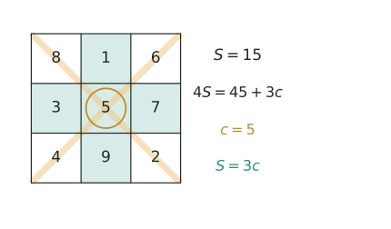

## 讲解



> 两条斜线（浅橙）与中行、中列（浅绿）都过中心，四条线加起来把九个数各数了一遍，只有中心的 $5$ 被数了 4 次、多算 3 次，于是 $4S=45+3c$，解出 $c=5$、$S=15$。

把 $1,2,\dots,n^2$ 不重不漏地填进 $n\times n$ 方格，使每行、每列、两条对角线上的 $n$ 个数之和都相等，这样的方格叫 **$n$ 阶幻方**，公共的和叫 **幻和** $S$。换一组数填时，"每条线之和相等"这条要求不变，变的只是和的大小。

### 一、幻和只由"总和"决定

$n$ 行之和正好把 $n^2$ 个数各数一遍，所以 $nS=\dfrac{n^2(n^2+1)}{2}$，即 $S=\dfrac{n(n^2+1)}{2}$：三阶 $15$，五阶 $65$。若九个数是等差数列（中位数 $m$、公差 $d$），同样用"总和 $\div n$"得 $S=n\cdot m$，三阶就是 $S=3m$。**任何幻方题，先算 $S$。**

反过来，题目给了 $S$ 也能反求数组：九数等差时 $m=S\div3$ 就是第 5 个数，再由公差定出全部九个数——这是"和 $\leftrightarrow$ 数"的双向通道，杯赛里给和求中心、给中心求和都靠它。

### 二、三阶重数法：中心数就是平均数

三阶中过中心的四条线（中行、中列、两条对角线）之和是 $4S$。这四条线把九个数各数一遍，只有中心被多算了 3 次：

$$4S=45+3c\ \Longrightarrow\ 4\times15=45+3\times5\ \Longrightarrow\ c=5 .$$

又 $3S=45$，故 $S=3c$，三阶中心数就是九数平均数。**这条中心结论不能推广为“所有奇数阶中心 $c=S\div n$”。** 一般奇数阶的幻和仍由总和确定，但中心格未必是全体平均数。例如下面这个合法的五阶标准幻方，幻和为 $65$，中心格却是 $19$，而全体平均数是 $13$：

```
11 24  7 20  3
17  5 13 21  9
23  6 19  2 15
 4 12 25  8 16
10 18  1 14 22
```

逐行、逐列及两条主对角线之和均为 $65$。因此，只有三阶可直接由重数法推出 $S=3c$；更高奇数阶若使用“中心是平均数”，必须说明是特定构造（如本节罗伯法构造）或额外条件带来的性质。

"先数每个格被算了几次，再列等式"叫 **重数法**。上式中的 3 就是中心的重数减 1，它比死记 $S=3c$ 有用得多——数阵图、缺角幻方都靠它。

### 三、结构铁律与三个变形

三阶幻方本质上只有一种（旋转、翻转算同一种）：先用重数法定出中心 5，再用四组对称和 $2c=10$ 逐格推，只剩这八种写法。它的四组对称格之和都是 $2c=10$，如 $8+2=1+9=3+7=4+6$；而且**角格等于与它不同行不同列的两个边格的平均数**，如 $(7+9)\div2=8$。

**变形1（仿射归约）**：九数等差时，把标准幻方每格 $x$ 换成 $c+d(x-5)$，仍是幻方——每条线"和相等"是线性关系，同加同乘不破坏它。于是偏移只能是 $\pm d,\pm2d,\pm3d,\pm4d$，其中角是 $\pm d,\pm3d$，边中是 $\pm2d,\pm4d$。这条专治"给定九数能否成幻方""公差是几"。

**变形2（偶数阶）**：罗伯法只对奇数阶有效，因为它靠"每段连续 $n$ 个数沿同一条斜线走、$n$ 段错开正好铺满 $n$ 行 $n$ 列"，撞数下移共 $n-1$ 次。四阶用"对角线互补"：先顺序填 $1\sim16$，再把两条对角线上的 $x$ 换成 $17-x$，幻和是 $34$。

**变形3（对角线和）**：奇数阶两条对角线之和共 $2S$，中心被算两次，故两线之和 $=2S-c$。

### 四、教材归纳点拨：罗伯法口诀与比较法

教材例题后的小结把这一节的方法提炼成三条：幻方的等和定义、罗伯法口诀、比较法。

**1. 等和**：行和 $=$ 列和 $=$ 两条对角线和 $=$ 幻和 $S$——判断是不是幻方、列方程都从这一条出发。

**2. 罗伯法口诀（适用于所有奇数阶）**

> 1 居上行正中央，依次斜填切莫忘；
> 上出框时往下填，右出框时左边放；
> 排重便在下格填，右上排重一个样。

逐句做法：
- **1 居上行正中央**：把 $1$ 填在第一行正中格；
- **依次斜填**：之后每个数都填在前一数的右上方；
- **上出框时往下填**：右上方越过上边界，就落到同一列的最下一格；
- **右出框时左边放**：右上方越过右边界，就落到同一行的最左一格；
- **排重便在下格填**：右上方已有数，就填在前一数的正下方；
- **右上排重一个样**：右上方同时越过上、右边界（顶到右上角）时按"排重"处理，也填下格。

一句话：**走右上，越界绕到对边，撞数下移**；偶数阶不能套罗伯法。

**3. 比较法：去掉公共格，比较不同**

两条等和式都等于 $S$，相减时把公共格消去，剩下的不同格之间就出现关系。这一招在竖式谜、数阵图、幻方里通用。
例如三阶中第一行与第一列都等于 $S$，去掉公共的左上角 $g$，得

$$a+f=b+e .$$

**4. 教材字母图与四组对称和**

```
g a f
b m c
e d h
```

四组关于中心 $m$ 对称的两格之和都是 $2m$：

$$a+d=b+c=e+f=g+h=2m .$$

$1\sim9$ 标准三阶幻方中 $m=5$，四组和都是 $10$。本小节的字母沿用教材、只表示位置；正文别处用 $c$ 表示中心数，两者不要混。

**5. 教材三数关系：右下 $\times2=$ 左中 $+$ 上中**

仍用上图：$a$ 在上中、$b$ 在左中、$h$ 在右下，则

$$2h=a+b .$$

它就是"角格平均数"规律在右下角的特例：右下角 $=(上中+左中)\div2$；教材第二幅图把它记作 $c\times2=a+b$（$c$ 在右下）。
比较法证明：把第 $1$ 行与第 $1$ 列两条等和式相加，公共的 $g$ 被算了两次，得

$$2g+a+b+(e+f)=2S=6m .$$

又 $e+f=2m$、$g+h=2m$，代入即得 $a+b=2h$。

### 五、竞赛视角

- 给"和"或"中心"：立刻用 $S=3c$ 互换，这是三阶题的总开关。
- 给"两个对称格"：用 $2c=\dfrac{2S}{3}$，别误当幻和。
- 要求补全：先定 $c$（九数平均数），再定 $S$，然后逐格用"三数和 $=S$""对称和 $=2c$"往下推。
- 出现"连续、等差"：先归约成标准幻方，再整体平移与伸缩。
- 问"是否存在"：先用总和能否被 $n$ 整除、偏移类型是否匹配排雷，再构造；构造完必须验不重不漏。
- 构造题先放极端：把最大、最小的数放到同一条线的两端，中间格用对称和夹逼，可省掉大半试算。
- 与数阵图易混：数阵图各线格数可以不同，幻方必须相同；两者都用重数法，但重数要重新数。

### 六、易错点（错误做法 → 正确做法 → 为什么）

1. **把九数总和当幻和**：$1\sim9$ 总和 45 就答 45 → 应为 $45\div3=15$，因为只有在三行把九数各数一遍之后才能除。
2. **把 $2c$ 当幻和**：中心 5，答对称两格和 15 → 应为 $2c=10$；$15$ 是幻和，对称两格只和 $2c$。
3. **以为任意九数都能填幻方**：随便拿九个数就动手 → 九数须能配成四对等和（每对和 $2c$）、余下中位数作中心，否则无解；如 $1\sim8$ 加 10 总和 46 不能被 3 整除，直接判死。
4. **角格规律取错边格**：拿同行或同列的两个边格去平均 → 必须取与角格既不同行又不同列的边格，$(7+9)\div2=8$ 才对。
5. **罗伯法起点、方向错**：把 1 放左上角，或走成左上方向 → 1 必须放第一行正中，之后一律向右上，撞了数才下移；偶数阶不能套罗伯法。
6. **算完不验算**：求出方格就交卷 → 要查九个给定数是否各用一次，再抽查三行、三列、两条对角线。


## 竞赛真题中的考察

> 本库题库的幻方真题只覆盖偶数阶（四阶互补数对）这一路。三阶补全、等差九数的角格判定这两类无对应卷次，改用同类题型描述；罗伯法属奇数阶构造，本库题库同样无真题，故本节不列条目。下列实引均标注卷次，未标卷次的为同类题型描述，不作真题出处引用。

- **同类题型**：给出幻和（或中心数）补全三阶幻方——先用 $S=3c$ 或九数平均数定出中心，再用"三线之和 $=S$"与"对称两格和 $=2c$"逐格回填，最后逐线验算（★★★）
- **2024 秋·走美 第 12 题**：四阶幻方，幻和 $34$；用对角互补数对（和为 $17$）逐格试填验证（★★★★）
- **同类题型**：给定一组等差九数，问"某个数能不能填在角上"——把标准幻方逐格换成 $c+d(x-5)$ 后，角格偏移只能是 $\pm d,\pm3d$，边中格才是 $\pm2d,\pm4d$（★★★★）

> 完整题目与解答见仓库 `exam/answers/` 对应试卷文件；跨卷汇总见 `exam/SUMMARY.md`。

## 配套知识卡

本专题公式与方法拆分为两张 18×12 cm 横版卡片，可在浏览器打开并按原尺寸打印：

- [幻方公式卡 01｜核心规律](./幻方公式卡-01-核心规律.html)：幻和公式、重数法（含变量示意图）、中心数、中心对称、奇偶性、旋转与仿射变换。
- [幻方公式卡 02｜构造与解题](./幻方公式卡-02-构造与解题.html)：三阶解题工具与位置关系、阶数分类示意、四阶对角线互补法、奇数阶暹罗法。

<!-- card:auto -->
## 速查卡

> 裁剪即用：本页对应速查卡「组合 52正」。下面是本节最紧的一版摘要，公式与结论与正文完全一致，用于做题前扫一遍。全套卡片见 `tools/cards/build/cards.html`。

**幻和与重数**

$$\text{填入 }1\sim n^2\text{ 的标准幻方：}S=\frac{n(n^2+1)}{2}$$

- $n$ 行把 $n^2$ 个数各数一遍，故 $nS=T$，任何幻方题先算 $S$
- 三阶过中心四线给 $4S=T+3c$，故 $S=3c$，中心即九数平均数
- 三阶中心 $c=S\div3$；更高奇数阶中心不能只由幻和反推
- 重数法：数清每格被算几次，多算 $r-1$ 次；对称两格和 $2c$

**结构与构造**

- 角格等于与它不同行列的俩边格的平均数；三阶本质只有一种
- 九数等差即标准幻方逐格换成 $c+d(x-5)$：角偏移是奇数倍 $d,3d$
- 边中格偏移只能是偶数倍 $2d,4d$，用来判某数能否落在角上
- 罗伯法：$1$ 放首行正中，一律向右上，撞已填则下移；只适奇数阶
- 四阶：顺填 $1\sim16$ 后把两条对角线上的 $x$ 换成 $17-x$，幻和 $34$

> ✅ 识别信号：行列对角线和相等、给幻和求中心或给中心求和
> ⚠️ 易错：九数总和 $45$ 不是幻和，$S=45\div3=15$；对称两格和是 $2c$
<!-- /card:auto -->

## 例题

### 例1：由幻和反推中心与九数（★★）

**题目**：一个三阶幻方的九个格填九个连续自然数，已知幻和是 $51$。

(1) 求中心格与九个数之和；
(2) 求最小的数，并写出这九个数；
(3) 若把左上角填成 $22$，还能成功吗？说明理由。

**覆盖点**：幻和与中心数的互推、等差九数的分类构造

**解析**：**为什么先用重数法去挖中心？** 题目只给了幻和，九个数一个都还不知道，必须找到一个"只含 $S$ 与 $c$"的关系；过中心的四条线恰好把九个数各覆盖一遍、只多算中心，是唯一能把其余八个数整体消掉的组合。

(1) 用重数法。三阶中过中心的四条线（中行、中列、两条对角线）各和为 $S$，合起来是 $4S$；它们把九个数各数一遍，只有中心多算 3 次，所以

$$4S=(\text{九数之和})+3c .$$

又三行把九数各数一遍，故九数之和 $=3S=3\times51=153$。于是 $4\times51=153+3c$，即 $204=153+3c$，得 $c=17$。

(2) 九个连续自然数的平均数就是它们的中位数，即第 5 个数，所以 $c=17$ 就是第 5 个数，九个数为 $17-4$ 到 $17+4$，即 $13,14,\dots,21$；最小的数是 $13$。

(3) 用仿射归约判断。标准幻方里左上角是 8，偏移 $8-5=3$；九数等差的幻方是标准幻方逐格换成 $c+d(x-5)$，所以左上角的偏移只能是 $d$ 或 $3d$（四个角分别是 $+3d,+d,-d,-3d$）。本题 $d=1$，左上角只能是 $17+3=20$、$17+1=18$、$17-1=16$、$17-3=14$ 之一，而 $22-17=5$ 不在其中，故填 $22$ 不可能。

**验算**：取 $13\sim21$ 按标准幻方排：$20,13,18$ / $15,17,19$ / $16,21,14$。三行都是 $51$；三列 $20+15+16=51$、$13+17+21=51$、$18+19+14=51$；两条对角线 $20+17+14=51$、$18+17+16=51$。九数正是 $13\sim21$，不重不漏。

**答案**：(1) 中心 $17$，九数之和 $153$；(2) 最小数 $13$，九数为 $13,14,\dots,21$；(3) 不能，角格的偏移只能是 $d$ 或 $3d$，而 $22-17=5$ 两者都不是。

### 例2：用对称性逐格补全（★★★）

**题目**：一个三阶幻方的九个格填九个不同的偶数，且从小到大构成等差数列。已知中心是 $30$，左上角是 $42$，第一行中间是 $14$。求其余各格，并写出九个数的公差。

**覆盖点**：对称性与逐格补全

**解析**：**为什么先算幻和、而不是先试着摆格？** 因为 $S=3c$ 一步就把"和"锁死，此后每个空格要么由所在线凑足 $S$、要么由对称凑足 $2c$ 唯一确定，再不需要猜。

**第一步，定幻和。** 三阶有 $S=3c=3\times30=90$，于是九数之和 $=3S=270$，平均数是 $30$，与中心一致。

**第二步，补第一行。** 第一行三数之和是 $90$，所以右上角 $=90-42-14=34$。

**第三步，用对称和 $2c=60$。** 三阶中关于中心对称的两格之和都是 $2c$（因为"一格 $+$ 中心 $+$ 对面一格 $=S=3c$"）。于是右下角 $=60-42=18$，左下角 $=60-34=26$。

**第四步，补两列。** 第一列只有中格未知：$90-42-26=22$，即左中格是 $22$；第三列中格 $=90-34-18=38$，也可用对称 $60-22=38$ 核对。

**第五步，补下中格。** 下中格与上中格对称：$60-14=46$。

得到方格：

```
42 14 34
22 30 38
26 46 18
```

**验算**：先用角格规则独立核对：左上角 $42$ 应与和它不同行不同列的 $38$、$46$ 平均，$(38+46)\div2=42$ ✓。再查八条线：三行 $42+14+34=22+30+38=26+46+18=90$；三列 $42+22+26=90$、$14+30+46=90$、$34+38+18=90$；对角线 $42+30+18=90$、$34+30+26=90$。九数排序为 $14,18,22,26,30,34,38,42,46$，是公差为 $4$ 的等差数列，不重不漏。

**答案**：方格为第一行 $42,14,34$，第二行 $22,30,38$，第三行 $26,46,18$；公差 $4$，九数为 $14,18,22,\dots,46$。

### 例3：罗伯法排五阶并定位（★★★★）

**题目**：用 $0,2,4,\dots,48$ 这 25 个连续偶数构造五阶幻方（按罗伯法先排 $1\sim25$，再统一变换）。

(1) 求幻和与中心格的数；
(2) 求 $0$、$46$、$48$ 分别在什么位置；
(3) 求两条对角线上 10 个格中的数之和；
(4) 若把这 25 个数换成 $1,3,5,\dots,49$，幻和与中心各是多少？

**覆盖点**：罗伯法构造奇数阶幻方、幻和与中心数的互推

**解析**：**为什么不直接排 $0,2,\dots,48$、而先排标准五阶？** 因为罗伯法只规定"位置怎么走"、与具体数字无关，先在 $1\sim25$ 上排好再统一换成 $2(k-1)$，位置规律与数值变换各管一段，一次就能解决。

(1) 25 个数之和为 $(0+48)\times25\div2=600$，五阶幻和为 $S=600\div5=120$。本题指定用罗伯法构造；在下方给出的标准五阶罗伯方阵中，中心格是标准数 $13$，换成 $2(k-1)$ 后为 $24$。这里中心为 $24$ 是该构造的结果，不是所有五阶幻方都必须如此。

(2) 罗伯法规则：$1$ 放第一行正中；之后每个数放前一个数的右上方，出上边界穿到最后一行、出右边界穿到第一列；右上已填则放正下方。先排出标准五阶：

```
17 24  1  8 15
23  5  7 14 16
 4  6 13 20 22
10 12 19 21  3
11 18 25  2  9
```

本题每个数是"标准数 $k$ 换成 $2(k-1)$"：$k=1\to0$，$k=24\to46$，$k=25\to48$。查上表：$k=1$ 在第 1 行第 3 列，$k=24$ 在第 1 行第 2 列，$k=25$ 在第 5 行第 3 列。故 $0$ 在第 1 行第 3 列，$46$ 在第 1 行第 2 列，$48$ 在第 5 行第 3 列。

(3) 两条对角线各和为 $S=120$，共 $240$；中心格被两条线各算一次，多算了一个 $24$，所以 10 个格中的数之和是 $2S-c=240-24=216$。

(4) 换成 $1,3,\dots,49$ 后总和为 $(1+49)\times25\div2=625$，$S=625\div5=125$，中心 $=\dfrac{1+49}{2}=25$，也有 $5\times25=125$。

**验算**：变换后的方格为

```
32 46  0 14 28
44  8 12 26 30
 6 10 24 38 42
18 22 36 40  4
20 34 48  2 16
```

第一行 $32+46+0+14+28=120$，第三列 $0+12+24+36+48=120$，两条对角线 $32+8+24+40+16=120$、$28+26+24+22+20=120$；$0,2,\dots,48$ 一个不缺。两条对角线之和 $120+120-24=216$，与 (3) 一致。

**答案**：(1) 幻和 $120$，中心 $24$；(2) $0$ 在第 1 行第 3 列，$46$ 在第 1 行第 2 列，$48$ 在第 5 行第 3 列；(3) $216$；(4) 幻和 $125$，中心 $25$。

### 例4：等差九数的分类构造（★★★★★）

**题目**：一个三阶幻方的九个格填入九个不同的自然数，它们构成等差数列，公差为 $d$。已知中心是 $20$。

(1) 求幻和，并说明各格与 $20$ 的差只能是 $\pm d,\pm2d,\pm3d,\pm4d$，其中角格只能是 $\pm d,\pm3d$，边中格只能是 $\pm2d,\pm4d$；
(2) 若左上角填 $26$，求 $d$ 并给出填法；
(3) 若改成"$26$ 填在某一格"（位置不限），$d$ 还有哪些可能？各给一种填法；
(4) 说明为什么没有别的 $d$。

**覆盖点**：等差九数的分类构造

**解析**：**为什么不把公差逐个试填？** 因为"每条线之和相等"是一组线性等式，把标准幻方每格换成 $20+d(x-5)$ 后依然成立，于是"角还是边中"直接对应"偏移是几倍 $d$"，$d$ 的可能值就从试填变成四个整数的筛选。

(1) 这是三阶幻方，中心数 $c=20$。由三阶关系 $S=3c$，得幻和 $S=60$，九数之和为 $3S=180$。

标准三阶幻方（中心 5）里，九个数与 5 的差是 $-4,-3,-2,-1,0,1,2,3,4$，每个差恰好用一次。把标准幻方每格 $x$ 换成 $20+d(x-5)$，"每条线和相等"这组等式同加同乘后仍然成立，所以它还是幻方。于是九个偏移只能是 $\pm d,\pm2d,\pm3d,\pm4d$，而且一一对应：标准幻方四角是 $8,6,4,2$（偏移 $3,1,-1,-3$），四个边中是 $1,7,9,3$（偏移 $-4,2,4,-2$）。所以**角格偏移是奇数倍 $d,3d$，边中格偏移是偶数倍 $2d,4d$**。

(2) 左上角是角格，故 $26-20=6$ 只能等于 $d$ 或 $3d$。

- 若 $6=d$，则 $d=6$，最小数是 $20-4\times6=-4$，不是自然数，舍去；
- 若 $6=3d$，则 $d=2$，九数为 $12,14,\dots,28$，都是自然数。

所以 $d=2$。取标准幻方，把偏移 $+3d$ 放在左上角：

```
26 12 22
16 20 24
18 28 14
```

(3) 位置不限时，$6=kd$ 中的 $k$ 可以是 $1,2,3,4$：

$$k=1\Rightarrow d=6,\quad k=2\Rightarrow d=3,\quad k=3\Rightarrow d=2,\quad k=4\Rightarrow d=1.5 .$$

$d=1.5$ 不是整数（九数都是自然数，公差必须是整数），舍去；$d=6$ 时最小数 $-4$ 不是自然数，舍去。剩下 $d=2,3$。

- $d=2$：九数 $12\sim28$，$6=3d$ 是奇数倍，$26$ 只能放**角格**，就是 (2) 的填法。
- $d=3$：九数 $8,11,\dots,32$，$6=2d$ 是偶数倍，$26$ 必须放**边中格**，不能放角。把标准幻方顺时针旋转 $90^\circ$（再左右翻转），使 $+2d$ 落在第一行中间：

```
23 26 11
 8 20 32
29 14 17
```

(4) 这几条限制缺一不可：$k$ 必须是 $1,2,3,4$（否则偏移超过 $\pm4d$，标准幻方里没有这种位置）；$d$ 必须是正整数；最小数 $20-4d$ 必须是自然数。再加上"$26$ 的偏移是奇数倍还是偶数倍"决定它只能放角还是只能放边中——正是这几条把 $d$ 筛到只剩 $2$ 和 $3$。

**验算**：$d=2$ 的方格：三行 $26+12+22=16+20+24=18+28+14=60$；三列 $26+16+18=12+20+28=22+24+14=60$；对角线 $26+20+14=22+20+18=60$；九数 $12\sim28$ 公差 $2$，不重不漏。$d=3$ 的方格：三行 $23+26+11=8+20+32=29+14+17=60$；三列 $23+8+29=26+20+14=11+32+17=60$；对角线 $23+20+17=11+20+29=60$；九数公差 $3$，不重不漏。两例中心都是 $20$，且 $3\times20=60$，与幻和自洽。

**答案**：(1) 幻和 $60$，偏移只能是 $\pm d,\pm2d,\pm3d,\pm4d$；(2) $d=2$，九数 $12,14,\dots,28$，填法如上；(3) 位置不限时 $d=2$（$26$ 在角）或 $d=3$（$26$ 在边中，九数 $8,11,\dots,32$），填法如上；(4) 偏移倍数只能取 $1\sim4$、$d$ 为正整数、最小数为自然数，三条限制共同排除其余情形。

## 变式与自测

> 四道题按「模仿 → 变式 → 综合 → 自测」排。先盖住答案自己做，做完再对；对不上，先回头看中心数与幻和是不是互推错了。

### 变式1：幻和 63，反推九个数（★★）

**题目**：一个三阶幻方的九个格填入九个连续自然数，已知幻和是 $63$。(1) 中心数是几？(2) 九个数之和是多少？(3) 写出这九个数。

**覆盖点**：幻和与中心数的互推

**解析**：三阶幻方里过中心的四条线（$1$ 行、$1$ 列、$2$ 条对角线）都以中心为公共格，四条线的和加起来是 $4\times$ 幻和，而这正好等于"九数之和 $+$ 中心数的 $3$ 倍"。九数之和又是 $3\times$ 幻和，所以 $4S=3S+3c$，即中心 $c=S\div3$——这是本节所有题的起点。

$$c=\frac{63}{3}=21,\qquad \text{九数之和}=3\times63=189 .$$

九数连续且关于中心对称，中心就是第 $5$ 个数，于是九数为 $21-4$ 到 $21+4$。

**答案**：(1) 中心 $21$；(2) 九数之和 $189$；(3) $17,18,19,20,21,22,23,24,25$。

### 变式2：给九数之和与两个角，补全全图（★★★）

**题目**：一个三阶幻方的九个数构成公差为 $d>0$ 的等差数列，九数之和是 $225$，左上角是 $34$，右上角是 $28$。求 $d$ 与其余各格。

**覆盖点**：对称性与逐格补全

**解析**：条件不给幻和，先由"九数之和 $=3\times$ 幻和"换出幻和，再取中心 $=$ 幻和 $\div3$。知道中心以后，任何一格与中心的距离就能读成"几个公差"：左上角是中心 $+3d$，右上角是中心 $+d$。两处偏移互相校验，$d$ 就被锁死了。

$$S=\frac{225}{3}=75,\qquad c=\frac{75}{3}=25,\qquad 34=25+3d\Rightarrow d=3,\qquad 28=25+3\ \checkmark$$

有了中心与公差，按标准三阶幻方的偏移表逐格填出即可：四角是 $\pm d,\pm3d$，四边中格是 $\pm2d,\pm4d$，中心是 $0$。

**答案**：$d=3$；方格为第一行 $34,13,28$，第二行 $19,25,31$，第三行 $22,37,16$（每行、每列、两条对角线之和都是 $75$）。

### 变式3：九个连续奇数的幻方（★★★★）

**题目**：用 $3,5,7,\dots,19$ 这九个连续奇数各一次填入三阶幻方。(1) 求幻和与中心数；(2) 给出一种填法并逐线验算。

**覆盖点**：等差九数的分类构造

**解析**：这道题把本篇的幻方与《等差数列》串在一起：九个连续奇数就是首项 $3$、公差 $2$ 的等差数列，第 $k$ 项是 $3+2(k-1)$，所以第 $5$ 项（即中心）是 $11$，幻和是中心的 $3$ 倍。**先算中心再谈填法**，这是等差九数题的固定顺序——中心必须是九数的平均数，否则幻和不唯一。

$$a_5=3+2\times4=11,\qquad S=3\times11=33 .$$

填的时候把标准三阶幻方的偏移量 $\{\pm1,\pm2,\pm3,\pm4\}$ 乘上公差 $2$，再逐个加到中心 $11$ 上，就得到九个数的一个合法排布。

**答案**：(1) 幻和 $33$，中心 $11$；(2) 一种填法：第一行 $17,3,13$，第二行 $7,11,15$，第三行 $9,19,5$，每行、每列、两条对角线之和均为 $33$。

### 自测：罗伯法排七阶（★★★）

**题目**：用罗伯法把 $1\sim49$ 排成七阶幻方（$7\times7$）。(1) 幻和是多少？(2) 中心数是多少？(3) 数字 $1$ 落在第几行第几列？(4) 用"总和 $=$ 平均数 $\times$ 个数"验算幻和。

**覆盖点**：罗伯法构造奇数阶幻方

**解析**：奇数阶幻方的幻和只由"填哪些数"决定：$n$ 阶幻方把 $1\sim n^2$ 全用上，总和是 $\dfrac{n^2(n^2+1)}2$，平均分给 $n$ 行，每行就是 $\dfrac{n(n^2+1)}2$。罗伯法的起点是固定的：$1$ 放首行正中，之后每一步往右上走，出上边就绕到下边、出右边就绕到左边，格子已被占就退回原格的正下方。

$S=\frac{7\times(49+1)}{2}=175 .$

按罗伯法实际构造七阶方阵后，中心格落在中位数 $25$；这是本题所用构造的性质，不能据此推断任意七阶幻方的中心都等于平均数。

回代验算：$7$ 行每行 $175$，七行合计 $1225$，而 $1+2+\cdots+49=\dfrac{49\times50}{2}=1225$ ✓。

**答案**：(1) $175$；(2) 中心 $25$；(3) 第 $1$ 行第 $4$ 列（首行正中）。
