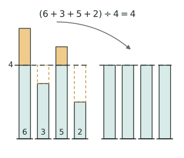

## 讲解

> 左边四根柱子是 6、3、5、2：橙色是高出 $4$ 的部分，橙色虚线框是低于 $4$ 缺的部分，两块正好一样大；把多出来的搬过去（箭头），右边四根就都成了 4，所以平均数是 $16\div4=4$。

**基本关系**：记总数量 $T$、平均数 $a$、总份数 $n$，三式知二求一：

$$\text{平均数}=\text{总数量}\div\text{总份数},\qquad \text{总数量}=\text{平均数}\times\text{总份数},\qquad \text{总份数}=\text{总数量}\div\text{平均数}$$

**移多补少**：几个数增减变化后平均数改变，抓住"总量的变化 ÷ 份数 = 平均数的变化"。份数也变时，先把两个都更新再相除：

$$\text{新平均数}=(\text{原总数量}\pm\text{变化量})\div(\text{原份数}\pm\text{变化数})$$

**平均速度**（最易错）：$\text{平均速度} = \text{总路程} \div \text{总时间}$，**不是**速度的平均数。若去程、返程路程相等，速度分别为 $v_1,v_2$，则往返平均速度为 $\dfrac{2v_1v_2}{v_1+v_2}$；该公式不能直接用于两段路程不相等的情况。如上山 3 km/h、下山 6 km/h 且路程相等，往返平均速度不是 4.5。

## 竞赛真题中的考察

- **考前 60 题 第 17 题**：估算+四舍五入反推整数和（★）
- **考前 60 题 第 18 题**：设平均分列方程（★）
- **2025 秋·走美 第 2 题**：总和变化量除以个数等于平均数变化量（★★）
- **2025 思维能力测评 第 11 题**：加权平均（★★）
- **2025 思维能力测评 第 18 题**：前缀和整除 + 全枚举（★★★★）

> 完整题目与解答见仓库 `exam/answers/` 对应试卷文件；跨卷汇总见 `exam/SUMMARY.md`。

<!-- card:auto -->
## 速查卡

> 裁剪即用：本页对应速查卡「应用题 01背」。下面是本节最紧的一版摘要，公式与结论与正文完全一致，用于做题前扫一遍。全套卡片见 `tools/cards/build/cards.html`。

**基本关系**

$$\text{平均数}=\text{总数量}\div\text{总份数}$$

- 记总量 $T$、平均数 $a$、份数 $n$：$T=an$，$a=T\div n$，$n=T\div a$

**移多补少**

- 总量的变化量 $\div$ 份数 $=$ 平均数的变化量
- 份数也变：先算新的总数量与新的总份数，再相除
- 加权平均：分组平均数按各组份数加权，不能取算术平均

**平均速度**

$$\text{等路程往返平均速度}=\frac{2v_1v_2}{v_1+v_2}$$

- 仅在去程、返程路程相等时使用；路程不等须回到总路程 ÷ 总时间
- 总路程 $\div$ 总时间，不是两段速度的平均数

> ✅ 识别信号：平均分、平均速度、去掉或加入一个数后平均数变化
> ⚠️ 易错：两个平均数取算术平均，只在两份数相同时才成立
<!-- /card:auto -->

## 例题

### 例1：移多补少
**题目**：小明前 4 次测验平均分是 86 分，第 5 次考了 96 分。5 次的平均分是多少？

**覆盖点**：平均数与总数互求, 移多补少

**解析**：第 5 次比原平均分多 $96 - 86 = 10$ 分，平摊到 5 次：$10 \div 5 = 2$ 分。新平均分 $= 86 + 2 = 88$ 分。（验证：$(86 \times 4 + 96) \div 5 = 440 \div 5 = 88$ ✓）

**答案**：88 分

### 例2：平均速度
**题目**：一辆汽车往返甲乙两地，去时每小时行 40 千米，返回时每小时行 60 千米。往返的平均速度是多少？

**覆盖点**：平均速度

**解析**：设单程 120 千米（取 40、60 的公倍数方便计算）。总路程 240 千米，总时间 $= 120 \div 40 + 120 \div 60 = 3 + 2 = 5$ 小时。平均速度 $= 240 \div 5 = 48$ 千米/时，而不是 $(40+60) \div 2 = 50$。

**答案**：48 千米/时

## 变式与自测

> 四道题按「模仿 → 变式 → 综合 → 自测」排。先盖住答案自己做，做完再对；对不上，先查这一问用的是"总数 ÷ 份数"还是"总路程 ÷ 总时间"。

### 变式1：少了一个人的身高（★）

**题目**：某小组 $6$ 名同学的平均身高是 $142$ 厘米，其中前 $5$ 名同学的身高之和是 $715$ 厘米。第 $6$ 名同学的身高是多少厘米？

**覆盖点**：平均数与总数互求

**解析**：题目给了平均数又给了部分之和，说明要把平均数还原成总数再作差。三个量里"总数"是桥。

$$142\times6=852,\qquad 852-715=137 .$$

为什么不能拿 $142$ 直接减 $715\div5$？因为 $715\div5$ 是前 $5$ 人的平均身高，与第 $6$ 人不在同一层量上。

**答案**：$137$ 厘米。

### 变式2：第 5 次要考多少分（★★★）

**题目**：小明前 $4$ 次数学测验的平均分是 $85$ 分。他希望 $5$ 次的平均分达到 $87$ 分，第 $5$ 次至少要考多少分？

**覆盖点**：移多补少

**解析**：平均数从 $85$ 提到 $87$，前 $4$ 次一次都没变，靠的是第 $5$ 次一个人把差额补足——这正是"移多补少"。目标平均分多出 $2$ 分，$5$ 次一共要多 $10$ 分，这 $10$ 分都得由第 $5$ 次出。

$$87+2\times4=95\quad\text{或}\quad 87\times5-85\times4=95 .$$

两种算法都要会：前一种是移多补少的眼光，后一种是最稳的验算。

**答案**：第 $5$ 次至少要考 $95$ 分。

### 变式3：时间差反求路程（★★★★）

**题目**：小明骑车从家到学校，去时每小时行 $15$ 千米，返回时每小时行 $10$ 千米，去时比返回少用 $10$ 分钟。求家到学校的路程，以及往返的平均速度。

**覆盖点**：平均速度

**解析**：这道题串了**「盈亏问题」**的思路——两次结果的差 ÷ 每一次的差 = 份数。这里"两次结果的差"是时间差 $10$ 分钟 $=\frac{1}{6}$ 小时，"每一次的差"是每行 $1$ 千米所需时间之差 $\frac{1}{10}-\frac{1}{15}=\frac{1}{30}$ 小时，相除就得到路程。

$$\frac{1}{6}\div\left(\frac{1}{10}-\frac{1}{15}\right)=\frac{1}{6}\div\frac{1}{30}=5\ (\text{千米}).$$

往返共 $10$ 千米，总时间 $\frac{5}{15}+\frac{5}{10}=\frac{1}{3}+\frac{1}{2}=\frac{5}{6}$ 小时，平均速度 $10\div\frac{5}{6}=12$ 千米/时。它不等于 $\frac{15+10}{2}=12.5$，正好说明"平均速度不是速度的平均"。

**答案**：路程 $5$ 千米，往返平均速度 $12$ 千米/时。

### 自测：往返平均速度不是算术平均（★★★）

**题目**：小明上山每小时行 $2$ 千米，沿原路下山每小时行 $6$ 千米。求他往返的平均速度。

**覆盖点**：平均速度

**解析**：本篇最硬的一条结论就是 **平均速度 $=$ 总路程 $\div$ 总时间**。两段路程相等而时间不等，走慢的那一段占用的时间更长，所以平均速度必然偏向慢的一边，$2$ 与 $6$ 的算术平均 $4$ 一定偏大。

设单程 $6$ 千米（取 $2$、$6$ 的公倍数），总路程 $12$ 千米，总时间 $6\div2+6\div6=3+1=4$ 小时。

$$12\div4=3\ (\text{千米/时}),\quad\text{与公式}\ \frac{2\times2\times6}{2+6}=3\ \text{一致}.$$

回代验算：$3$ 千米/时 $\times4$ 小时 $=12$ 千米 $=$ 往返路程 ✓，且 $3<4<6$，落在两个速度之间，符合常识。

**答案**：$3$ 千米/时。
