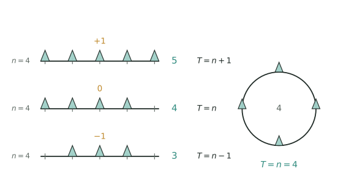

## 讲解

> 每行左边都是 4 个间隔：第一行两端各有一棵，共 5 棵（线上方标 $+1$）；第二行右端留空，4 棵（$0$）；第三行两端都空着，只剩 3 棵（$-1$）。右边圆环首尾重合，4 个间隔正好栽 4 棵。

**核心概念**：间隔（两棵树之间的距离）。关键是弄清"棵数"与"间隔数"的关系。

**三个量的基本关系**（全长、株距、段数三者知二求一）：

$$\text{全长}=\text{株距}\times\text{段数},\qquad \text{段数}=\text{全长}\div\text{株距},\qquad \text{株距}=\text{全长}\div\text{段数}$$

**直线上植树三种情况**（路长 ÷ 间隔长 = 间隔数）：

$$\text{两端都栽：棵数}=\text{间隔数}+1;\qquad \text{只栽一端：棵数}=\text{间隔数};\qquad \text{两端都不栽：棵数}=\text{间隔数}-1$$

按这份次序排下来，棵数随栽法依次减 $1$，画一条短线段数一遍就能定号。

**封闭图形（环形）植树**：首尾重合，不多不少，

$$\text{棵数}=\text{间隔数}=\text{周长}\div\text{株距}$$

**变式**：锯木头（锯成 $n$ 段要锯 $n - 1$ 次）、爬楼梯（上到 $n$ 楼爬 $n - 1$ 层）、敲钟（敲 $n$ 下有 $n - 1$ 个间隔）——都是"间隔数与点数"的关系。

<!-- card:auto -->
## 速查卡

> 裁剪即用：本页对应速查卡「应用题 05正」。下面是本节最紧的一版摘要，公式与结论与正文完全一致，用于做题前扫一遍。全套卡片见 `tools/cards/build/cards.html`。

**基本关系**

$$\text{全长}=\text{株距}\times\text{段数}$$

- 段数 $=$ 全长 $\div$ 株距；株距 $=$ 全长 $\div$ 段数

**三种情形**

- 两端都植：段数 $=$ 棵数 $-1$
- 只植一端：段数 $=$ 棵数
- 两端都不植：段数 $=$ 棵数 $+1$
- 拿不准就画一条短线段数一遍，比背口诀稳

**封闭路线**

$$\text{棵数}=\text{段数}=\text{周长}\div\text{株距}$$

- 首尾同点不多不少；环形花坛、池塘四周都用它
- 变式同构：锯成 $n$ 段锯 $n-1$ 次，上 $n$ 楼爬 $n-1$ 层

> ✅ 识别信号：每隔几米栽一棵、锯木头、爬楼梯、敲钟、池塘四周
> ⚠️ 易错：环形与直线混用；两端都不栽棵数比段数少 $1$
<!-- /card:auto -->

## 例题

### 例1：直线与环形
**题目**：① 在 100 米长的小路一边植树，每隔 5 米栽一棵，两端都栽，共栽多少棵？② 圆形池塘周长 120 米，每隔 6 米栽一棵柳树，共栽多少棵？

**覆盖点**：直线植树三种情况, 环形植树

**解析**：① 间隔数 $= 100 \div 5 = 20$，两端都栽：$20 + 1 = 21$ 棵。② 环形：$120 \div 6 = 20$ 棵。

**答案**：① 21 棵；② 20 棵

### 例2：锯木头变式
**题目**：把一根木头锯成 6 段，每锯一次要 3 分钟，一共要多少分钟？

**覆盖点**：间隔问题变式

**解析**：锯成 6 段要锯 $6 - 1 = 5$ 次（次数 = 段数 − 1），$5 \times 3 = 15$ 分钟。

**答案**：15 分钟

## 变式与自测

> 四道题按「模仿 → 变式 → 综合 → 自测」排。先盖住答案自己做，做完再对；对不上，先看这一题是直线还是环形，再看两端植不植。

### 变式1：走廊插彩旗（★）

**题目**：在一条 $90$ 米长的走廊一侧插彩旗，每隔 $6$ 米插一面，两端都插。需要多少面彩旗？

**覆盖点**：直线植树三种情况

**解析**："两端都插"对应棵数 $=$ 间隔数 $+1$。先除出间隔数，再定号，顺序不能反。

$$90\div6=15,\qquad 15+1=16 .$$

**答案**：需要 $16$ 面彩旗。

### 变式2：花坛的树与花（★★★）

**题目**：一个圆形花坛的周长是 $96$ 米，沿花坛每隔 $8$ 米栽一棵月季。需要多少棵月季？如果每相邻两棵月季之间再放一盆菊花，需要多少盆菊花？

**覆盖点**：环形植树

**解析**：环形首尾重合，棵数与间隔数**相等**，没有 $+1$ 也没有 $-1$，这是它与直线的唯一区别。第二问要注意"两棵之间"正好是"一个间隔"，所以盆数等于间隔数。

$$96\div8=12\ (\text{棵月季}),\qquad 12\ (\text{盆菊花}).$$

若在环形上求"两棵之间"，同样不加减 $1$；这一点可以和锯木头对比记：环形是"首尾粘住"，锯木头是"首尾分开"。

**答案**：月季 $12$ 棵，菊花 $12$ 盆。

### 变式3：从 1 楼到 8 楼（★★★★）

**题目**：小明从 $1$ 楼走到 $4$ 楼用了 $45$ 秒。照这样的速度，他从 $1$ 楼走到 $8$ 楼要用多少秒？

**覆盖点**：间隔问题变式

**解析**：这道题串了**「归一问题」**：$\frac{45}{3}=15$ 秒就是"爬一层楼的时间"，这个单一量不变，剩下的只是乘几层。难点全在"层数"上——从 $1$ 楼到 $4$ 楼只爬了 $4-1=3$ 层，不是 $4$ 层，因为起点那层不用爬。

$$45\div(4-1)=15,\qquad 15\times(8-1)=105 .$$

为什么不是 $45\div4\times8$？那样把 $1$ 楼也算成了一层，单一量就被稀释了。

**答案**：要用 $105$ 秒。

### 自测：公路两旁一共栽几棵（★★★）

**题目**：在一条长 $120$ 米的公路两旁栽树，每隔 $6$ 米栽一棵，两端都栽。一共需要多少棵树？

**覆盖点**：直线植树三种情况

**解析**：本篇的核心结论是"**棵数与间隔数差 $1$**"，两端都栽时棵数比间隔数多 $1$；而"两旁"只是把一边的答案翻一倍，绝不能把间隔数翻倍。

先求间隔数 $120\div6=20$，一边 $20+1=21$ 棵，两旁 $21\times2=42$ 棵。

回代验算：$42\div2=21$ 棵，$21-1=20$ 个间隔，$20\times6=120$ 米，正好是全长 ✓。

**答案**：一共需要 $42$ 棵树。
