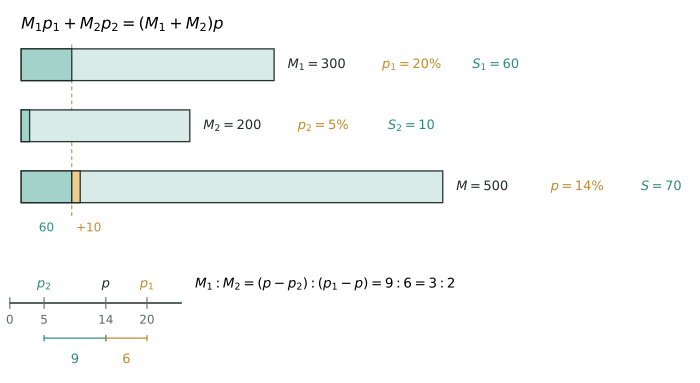

## 讲解



> 上面三条：浅绿是水、深绿和橙色是溶质。第一杯 300 克里有 60 克盐，第二杯 200 克里有 10 克盐，倒进同一杯后溶质正好是拼起来的那 70 克（虚线对齐 60 的刻度），宽度 $300+200=500$ 也对得上。下面把 5%、14%、20% 画在同一条线上，两段长 9 与 6 就是两杯的质量比 $3:2$——长的那段配给浓的一方。

**模型**：溶质（盐、糖、纯酒精）加溶剂（水）得到溶液。浓度 = 溶质 ÷ 溶液 × 100%。设溶液质量为 $M$、浓度为 $p$，则溶质 $S=Mp$，溶剂 $W=M(1-p)$。无论怎样加水、蒸发、加盐，**溶液 $=$ 溶质 $+$ 溶剂**这条加法式永远成立，它与 $S=Mp$、$W=M(1-p)$ 一起构成三个量的换算：

$$\text{溶液}=\text{溶质}+\text{溶剂},\qquad \text{浓度}=\frac{\text{溶质}}{\text{溶液}}\times100\%,\qquad \text{溶质}=\text{溶液}\times\text{浓度}$$

题目给的两个数往往不是同一层的量（如给溶剂求浓度、给浓度求溶质），第一步永远是用这三式把"溶液—浓度—溶质"对齐到同一层。

一切计算的母公式是**溶质账本**：不管怎样混合、倒出、加水，各来源溶质之和等于混合后的溶质。

$$M_1p_1+M_2p_2=(M_1+M_2)p$$

**推导**：加水时溶质不变、溶液变大，浓度 = 溶质/溶液 是"分子不动、分母变大"，所以必然变稀；蒸发水是"分子不动、分母变小"；加盐时分子分母同时变大，靠感觉一定出错，必须设未知数列式。把溶质账本移项，得

$$M_1(p_1-p)=M_2(p-p_2)$$

即

$$\frac{M_1}{M_2}=\frac{p-p_2}{p_1-p}$$

### 十字交叉法

两种溶液浓度分别为 $p_1,p_2$，且 $p_1>p>p_2$ 时，混合后的质量比可直接由上式读出：

$$\boxed{M_1:M_2=(p-p_2):(p_1-p)}$$

写成十字：

```text
p₁        p−p₂
      p
p₂        p₁−p
```

上差 $(p-p_2)$ 对应 $p_1$ 溶液，下差 $(p_1-p)$ 对应 $p_2$ 溶液。

**例**：$20\%$ 盐水 300 克与 $5\%$ 盐水 200 克混合，质量比为 $3:2$。设混合浓度为 $p$，则

$$(p-5):(20-p)=3:2$$

解得 $p=14$。验算：$(300\times20\%+200\times5\%)\div500=14\%$。

十字交叉只适用于**两种**原料，且目标浓度必须夹在两种浓度之间；三种原料先两两合并，或直接用加权平均。加水按 $0\%$、加纯盐按 $100\%$ 处理；蒸发水不要硬套，直接用溶质守恒列方程更稳。

**等量交换模型**：两瓶各倒出 $x$ 克互换，总量与总溶质都不变，故最终公共浓度必等于总溶质÷总溶液；再对其中一瓶写"原剩溶质 + 换入溶质 = 现在溶质"，得到一个一次方程。

**高级变形**：

1. **倒出再补水**：溶液总量始终为 $M$，每次溶质乘以 $(1-\frac{x}{M})$，$n$ 次后 $p_n=p_0(1-\frac{x}{M})^n$。条件是每次"倒出—加满纯水—搅匀"。
2. **补的不是水**：若补入浓度 $q$ 的溶液，乘方失效，要写 $S_{n+1}=(1-\frac{x}{M})S_n+xq$，此时浓度会越来越接近 $q$（极限思想），可用来检验答案是否离谱。
3. **反推与可行性判定**：两种原料浓度一高一低时，配比被目标浓度**唯一确定**；一旦某种原料数量受限，可达浓度范围由"尽量多用高浓度"这一极端决定。看到"至少/至多/能否"，先做极端构造，再用账本验算。

**竞赛视角**：看到"加水、蒸发、加盐""两种溶液混合""倒出再加满""交换等量"，第一反应找不变量（溶质、溶剂、总量、总溶质），第二反应列溶质账本。三类动作要分清：只动分母（加水、蒸发）、只动分子与分母之外的量（加溶质时水不变）、分子分母同步动（倒出溶液）。最容易混的是"浓度翻倍"与"溶质翻倍"：浓度从 10% 到 20% 并不是盐加了一倍，而是盐和溶液同时变化。多次操作先写一次操作的通式再乘方，不要一次次硬算；题目出现"至少/至多/能否"，就把某种原料用到上限做极端构造，再回来验算账本。与百分数应用题的区别在于：百分数的"单位 1"是原量，浓度的"单位 1"是溶液，溶液本身还在变，所以浓度题几乎都要设未知数或反推。

**易错点**：

1. **错误**：把浓度当成"溶质÷水"。**正确**：溶质÷溶液。20 克盐加 180 克水是 10%，不是 11.1%。
2. **错误**：加盐时用"原溶液×新浓度"当现有溶质。**正确**：加盐后溶液也变大了，要么设未知数列方程，要么先用水不变求出新溶液。
3. **错误**：倒出溶液时以为只倒走了盐或只倒走了水。**正确**：倒出的是均匀溶液，盐与水按同一比例同时减少。
4. **错误**：两次稀释把浓度相减，如 20%−5%−5%=10%。**正确**：每次乘 $(1-\frac{x}{M})$，是乘法不是减法。
5. **错误**：两种盐水混合就把浓度取平均。**正确**：只有等质量混合才能算术平均，否则必须按质量加权。
6. **错误**：算出答案不回头检查可取量。**正确**：原料有总量、溶液有饱和上限，答案必须回到题设验证。
7. **错误**：单位混用，克与千克、百分数与小数的换算漏掉。**正确**：全程统一用克，百分数先化小数再入式。


## 竞赛真题中的考察

- **考前 60 题 第 12 题**：铁量守恒列方程（★）
- **考前 60 题 第 30 题**：浓度连乘（每次保留 $\frac35$ 的盐）（★）
- **第 28 届 WMO 第 5 题**：只追踪变化的黄色颜料与总量（★★）
- **第 28 届 WMO 第 12 题**：分步追踪溶液质量与溶质质量（★★）
- **第 30 届 WMO 第 12 题**：抓不变量：只加蓝、红 15 升不变，蓝需 25 升（★★）
- **第 30 届 WMO 第 17 题**：列表法抓溶质守恒；蒸发/加水/加药粉/倒出分别处理（★★★）
- **第 34 届 WMO 第 14 题**：设混合浓度为x，“盐不变”列方程（★★★）
- **2024 IHC C-6 第 17 题**：写出 t 分钟后甲、乙的盐与盐水总量，浓度相等列方程约分解（★★★）
- **2024 IHC D-6 第 5 题**：抓住倒回后甲中只有2kg水反推所取酒精量（★★★）
- **2025 IHC J-6 第 9 题**：分别算溶质与溶液，再相除（设每杯 W）（★★★）
- **2024 IHC 6 培训 第 50 题**：浓度十字/方程（两次混合）（★★★★）
- **第 32 届 WMO 第 9 题**：溶质（酒精）守恒，设倒入量列方程；用两瓶质量相同求丙瓶总量（★★★★★）
- **2024 IHC 6 培训 第 41 题**：比例方程（交换后比例相同）（★★★★★）
- **2024.1 世少赛 第 17 题**：令(mp+60)/(m+500)=(mp+30)/(m+200)，得m(1-10p)=100，代入化简c0=(30-200p)/(300-2000p)=10%（★★★★★）

> 完整题目与解答见仓库 `exam/answers/` 对应试卷文件；跨卷汇总见 `exam/SUMMARY.md`。

<!-- card:auto -->
## 速查卡

> 裁剪即用：本页对应速查卡「应用题 07背」。下面是本节最紧的一版摘要，公式与结论与正文完全一致，用于做题前扫一遍。全套卡片见 `tools/cards/build/cards.html`。

**基本关系**

$$\text{溶液}=\text{溶质}+\text{溶剂}$$

- 浓度 $=$ 溶质 $\div$ 溶液 $\times100\%$；溶质 $=$ 溶液 $\times$ 浓度

**溶质账本**

$$M_1p_1+M_2p_2=(M_1+M_2)p$$

**十字交叉**

$$\frac{M_1}{M_2}=\frac{p-p_2}{p_1-p}$$

- 上差 $(p-p_2)$ 对 $p_1$，下差 $(p_1-p)$ 对 $p_2$，交叉相配
- 只适两种原料，目标浓度须夹在两者之间；加水按 $0\%$ 算
- 倒出加满：每次搅匀后倒出 $x$ 克，再补纯水至原总量 $M$；重复 $n$ 次才用 $p_n=p_0(1-\frac{x}{M})^n$

> ✅ 识别信号：加水蒸发加盐、两溶液混合、倒出加满、交换等量
> ⚠️ 易错：浓度是溶质÷溶液不是÷水；两次稀释不能相减
<!-- /card:auto -->

## 例题

### 例1：先加水再加盐的两步计算（★★★★）

**题目**：一瓶 240 克的盐水，浓度 10%。先倒入 60 克水搅匀，再加入若干克盐，最后测得浓度恰好为 20%。问加入了多少克盐？最后盐水共多少克？

**覆盖点**：溶质守恒与两步增减

**解析**：

第一步，算清原来的账。溶质 $=240\times 10\%=24$ 克，水 $=240-24=216$ 克。

第二步，加水这一步只有分母在变。盐仍是 24 克，溶液变成 $240+60=300$ 克，浓度 $=\frac{24}{300}=8\%$。这一步之所以能直接算，是因为水不带盐，溶质是"不变量"。

第三步，加盐时分子分母同时变，不能再找不变量，只能设未知数。设加盐 $x$ 克，则溶质为 $24+x$，溶液为 $300+x$，列式

$$\frac{24+x}{300+x}=\frac{1}{5}\Longrightarrow 120+5x=300+x\Longrightarrow 4x=180\Longrightarrow x=45$$

验算：盐 $24+45=69$ 克，溶液 $300+45=345$ 克，$69\div 345=0.2$，正好 20%。

**答案**：加入 45 克盐，最后盐水 345 克，浓度 20%。

### 例2：等量交换后两瓶浓度相同（★★★★★）

**题目**：甲瓶有 300 克 20% 的盐水，乙瓶有 200 克 5% 的盐水。从两瓶各倒出相同质量 $x$ 克的盐水，把甲倒出的倒入乙、乙倒出的倒入甲，搅匀后两瓶浓度恰好相同。求 $x$，并求此时的浓度。

**覆盖点**：混合配比与等量交换

**解析**：

第一步，先看整体。交换只是把盐水搬来搬去，总溶液仍是 500 克，总溶质仍是 $300\times 20\%+200\times 5\%=60+10=70$ 克，所以公共浓度必为 $70\div 500=14\%$。这一步不需要知道 $x$，是"总量与总溶质不变"给的免费信息。

第二步，只盯甲瓶。交换后甲瓶仍是 300 克，其中盐 = 原剩部分 + 换入部分：

$$0.2(300-x)+0.05x=0.14\times 300=42$$

$$60-0.2x+0.05x=42\Longrightarrow 0.15x=18\Longrightarrow x=120$$

第三步，验算两瓶都要对。甲：剩 180 克 20% 得 36 克盐，换入 120 克 5% 得 6 克盐，共 42 克，$42\div 300=14\%$；乙：剩 80 克 5% 得 4 克盐，换入 120 克 20% 得 24 克盐，共 28 克，$28\div 200=14\%$。两瓶确实相同。

回头看，十字交叉给出甲、乙质量比 $(14-5):(20-14)=9:6=3:2$，恰好就是 $300:200$，说明交换到"两瓶都等于整体平均"就必然相同，这正是等量交换的本质。

**答案**：$x=120$ 克，公共浓度 14%。

### 例3：三次倒出加水的递推（★★★★★★）

**题目**：甲容器有 600 克 30% 的盐水。(1) 第一次倒出 150 克后加满水；第二次倒出 200 克后加满水；第三次倒出 300 克后加满水。求最终浓度。(2) 若前两次操作不变，第三次最多倒出多少克，才能使最终浓度不低于 10%？

**覆盖点**：倒出补水与逐次递推

**解析**：

第一步，看破结构。每次"倒出—加满水"，溶液都回到 600 克，所以浓度 = 盐 ÷ 600，全程只需跟踪盐。而倒出 $x$ 克时，盐按 $x/600$ 的比例被带走，剩下的盐乘以 $(1-\frac{x}{600})$——这是"同一杯均匀液体"的必然结果。

第二步，逐次算盐。原盐 $600\times 30\%=180$ 克。

- 第 1 次倒出 $\frac{150}{600}=\frac14$：盐 $180\times\frac34=135$ 克，浓度 $135\div 600=22.5\%$；
- 第 2 次倒出 $\frac{200}{600}=\frac13$：盐 $135\times\frac23=90$ 克，浓度 $90\div 600=15\%$；
- 第 3 次倒出 $\frac{300}{600}=\frac12$：盐 $90\times\frac12=45$ 克，浓度 $45\div 600=7.5\%$。

也可以一次乘完：$30\%\times\frac34\times\frac23\times\frac12=30\%\times\frac14=7.5\%$，与逐次结果一致。

第三步，反解上限。第 2 次操作后盐为 90 克，设第三次倒出 $x$ 克，则盐剩 $90\left(1-\frac{x}{600}\right)$，浓度不低于 10% 即盐不少于 60 克：

$$90\left(1-\frac{x}{600}\right)\ge 60\Longrightarrow 1-\frac{x}{600}\ge\frac23\Longrightarrow x\le 200$$

验算：$x=200$ 时盐 $90\times\frac23=60$ 克，浓度恰为 10%，符合"不低于"。

**答案**：(1) 7.5%；(2) 最多倒出 200 克。

### 例4：由两次混合反推浓度并判定可行性（★★★★★★★）

**题目**：甲、乙两瓶盐水浓度未知，甲瓶有 750 克，乙瓶有 900 克。第一次取甲 200 克与乙 300 克混合，测得浓度 14%；第二次取甲 300 克与乙 100 克混合，测得浓度 17.5%。(1) 求甲、乙两瓶的浓度。(2) 此时甲瓶只剩 250 克、乙瓶还剩 500 克，要配出 500 克 16% 的盐水，能否做到？若能则给出取法；若不能，说明理由并求出能配出的最高浓度。

**覆盖点**：浓度反推与极限判定

**解析**：

第一步，把两次混合各写一本账。设甲浓度 $a$、乙浓度 $b$，用小数表示。

第一次：$200a+300b=500\times 0.14=70$；第二次：$300a+100b=400\times 0.175=70$。

第二步，消元。两式右边都是 70，相减得

$$(3a+b)-(2a+3b)=0\Longrightarrow a-2b=0\Longrightarrow a=2b$$

代回 $3a+b=0.7$ 得 $7b=0.7$，$b=10\%$，$a=20\%$。这里能消元，是因为两次取样的溶质总量恰好相等，这是出题人埋的"减法构造"。

第三步，验算。第一次 $200\times 20\%+300\times 10\%=40+30=70$，$70\div 500=14\%$；第二次 $300\times 20\%+100\times 10\%=60+10=70$，$70\div 400=17.5\%$。两次都吻合。

第四步，第二问先按比例算，再用极端判定。十字交叉：$20\%$ 与 $10\%$ 配 $16\%$，质量比 $(16-10):(20-16)=6:4=3:2$，即 500 克中甲要 300 克、乙要 200 克。但甲只剩 250 克，凑不齐。

第五步，判断"能否绕开"。$16\%$ 夹在 $10\%$ 与 $20\%$ 之间，配比被唯一锁定为 $3:2$：甲占得少一点浓度就低于 16%，多一点又高于 16%，没有第二种取法。甲只有 250 克时，按 $3:2$ 只能配出 $250\div\frac35=416\frac23$ 克，不足 500 克。

第六步，求上限。既然凑不出 16%，就让甲尽可能多。500 克中甲最多 250 克，其余用乙，此时盐最多 $250\times 20\%+250\times 10\%=50+25=75$ 克，浓度 $75\div 500=15\%$，确实到不了 16%。这是"极端原理"的标准用法：先把一种原料用到上限，再验证。

**答案**：(1) 甲 20%、乙 10%；(2) 不能配出 16%，最高只能配到 15%，取法为甲 250 克、乙 250 克。

## 变式与自测

> 四道题按「模仿 → 变式 → 综合 → 自测」排。先盖住答案自己做，做完再对；对不上，先把"溶质、溶液、溶剂"三层量的账本对齐，再动笔算。

### 变式1：加 50 克水后（★）

**题目**：$200$ 克浓度 $15\%$ 的糖水中加入 $50$ 克水，搅匀后的浓度是多少？

**覆盖点**：溶质守恒与两步增减

**解析**：加水只动分母——水不带糖，溶质是这一问里唯一不变的东西。先算溶质，再除以新的溶液质量。

$$200\times15\%=30,\qquad 30\div(200+50)=30\div250=12\% .$$

**答案**：$12\%$。

### 变式2：反向配方（★★★）

**题目**：用浓度 $30\%$ 和 $10\%$ 的两种盐水，配制 $250$ 克浓度 $18\%$ 的盐水。两种盐水各需多少克？

**覆盖点**：混合配比与等量交换

**解析**：例 4 是由配方反求浓度，这一问反过来：已知目标浓度求配比，正是十字交叉的用武之地。两条斜差给出质量比，比例一出来，总量按份数一分即可。

$$M_{30\%}:M_{10\%}=(18-10):(30-18)=8:12=2:3 .$$

$250$ 克分 $5$ 份，每份 $50$ 克，故 $30\%$ 取 $2$ 份、$10\%$ 取 $3$ 份。

**答案**：$30\%$ 的盐水 $100$ 克，$10\%$ 的盐水 $150$ 克。

### 变式3：A 是 B 的两倍浓（★★★★）

**题目**：$A$、$B$ 两种盐水，$A$ 的浓度是 $B$ 的 $2$ 倍。取 $A$ 盐水 $200$ 克与 $B$ 盐水 $400$ 克混合，得到浓度 $8\%$ 的盐水。
(1) 求 $A$、$B$ 各自的浓度。
(2) 要把这 $600$ 克 $8\%$ 的盐水稀释成 $6\%$，需加水多少克？

**覆盖点**：浓度反推与极限判定

**解析**：这道题串了**「和倍问题」**："$A$ 的浓度是 $B$ 的 $2$ 倍"就是一份倍数关系，所以把 $B$ 的浓度设成 $1$ 份（记为 $b$），$A$ 就是 $2b$，只剩一个未知数。反推靠的仍是溶质账本。

(1) 溶质 $=200\times2b+400\times b=800b$，而混合后溶质 $=600\times8\%=48$，故 $800b=48$，$b=6\%$，$A$ 为 $12\%$。

(2) 加水溶质不变，仍是 $48$ 克，浓度要降到 $6\%$，溶液应变成 $48\div6\%=800$ 克，所以要加水 $800-600=200$ 克。

**答案**：(1) $A$ 为 $12\%$，$B$ 为 $6\%$；(2) 需加水 $200$ 克。

### 自测：倒出再补水的两连击（★★★）

**题目**：甲容器中有 $200$ 克浓度 $18\%$ 的盐水，乙容器中有 $200$ 克水。先把甲容器的盐水全部倒入乙容器并搅匀；再从中倒出 $100$ 克混合液；最后向乙容器中补入 $100$ 克水。求此时乙容器中盐水的浓度。

**覆盖点**：倒出补水与逐次递推

**解析**：本篇核心结论是"**倒出均匀溶液时，盐和水按同一比例同时减少**"，所以只要盯住盐，溶液量每步都算清就行。

第一次混合：盐 $=200\times18\%=36$ 克，溶液 $=200+200=400$ 克，浓度 $9\%$。
倒出 $100$ 克即倒走 $\frac{1}{4}$，盐剩 $36\times\frac34=27$ 克，溶液剩 $300$ 克。
补入 $100$ 克水：溶液回到 $400$ 克，盐仍是 $27$ 克。

$$27\div400=6.75\% .$$

回代验算：$400\times6.75\%=27$ 克盐；倒出前 $300\times9\%=27$ 克，两次盐量一致，说明补水确实没有带进也没有带走盐 ✓。

**答案**：$6.75\%$。
