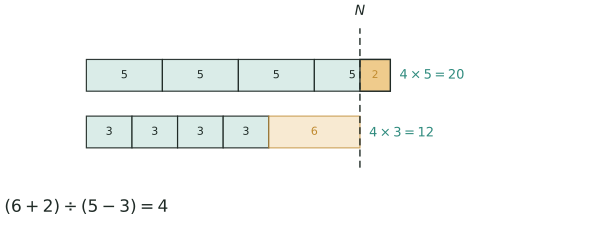

## 讲解

> 上面一行每人分 5，4 人共需 20，比物品多出橙色那 2（亏 2）；下面一行每人分 3，只需 12，离物品还差 6（盈 6）。虚线 $N$ 是物品总数 18，两行右端相差 $2+6=8$，而每人相差 $5-3=2$，所以有 4 人。

**模型**：把一定数量的物品平均分给若干人，两种分法中出现"多（盈）"或"少（亏）"，求人数和物品数。

**基本思路**：两次分配的总差额 ÷ 每人分配的差额 = 份数（人数）。

$$\text{人数（单位数）}=\frac{\text{两次分配的差额}}{\text{两次每人分得之差}}$$

**四种情况的人数公式**：
- 盈亏型（一盈一亏）：人数 $= (\text{盈} + \text{亏}) \div$ 每人差额；
- 盈盈型（两盈）：人数 $= (\text{大盈} - \text{小盈}) \div$ 每人差额；
- 亏亏型（两亏）：人数 $= (\text{大亏} - \text{小亏}) \div$ 每人差额；
- 一盈（亏）一正好：人数 $= \text{盈（亏）} \div$ 每人差额。

一句话记：两次的结果**一加两减**（一盈一亏相加，盈盈、亏亏相减），除数永远是"两次每人分得之差"。

**求物品总数**：人数到手后回代任一种分法——

$$\text{物品数}=\text{每人份数}\times\text{人数}\pm\text{盈（减）或亏（加）}$$

求出人数后，任取一种分法回代求物品总数，**并用另一种分法检验**。

<!-- card:auto -->
## 速查卡

> 裁剪即用：本页对应速查卡「应用题 03正」。下面是本节最紧的一版摘要，公式与结论与正文完全一致，用于做题前扫一遍。全套卡片见 `tools/cards/build/cards.html`。

**人数公式**

$$(\text{盈}+\text{亏})\div\text{两次每人差}=\text{人数}$$

- 盈亏型：$($盈 $+$ 亏$)\div$ 两次分得之差 $=$ 人数
- 盈盈型：$($大盈 $-$ 小盈$)\div$ 两次分得之差 $=$ 人数
- 亏亏型：$($大亏 $-$ 小亏$)\div$ 两次分得之差 $=$ 人数
- 一盈一正好：人数 $=$ 盈 $($或亏$)\div$ 两次分得之差

**物品总数**

- 盈、亏的单位先对齐：同是几个人或同是几间宿舍
- 回代：物品数 $=$ 每人份 $\times$ 人数，盈则加、亏则减
- 必须用另一种分法检验，两种都对才算过关

> ✅ 识别信号：两种分法、多了几少了几个、住不下、剩下几张
> ⚠️ 易错：除数是两次「每人分得之差」，不是两次盈数之差
<!-- /card:auto -->

## 例题

### 例1：一盈一亏
**题目**：老师把一袋糖分给小朋友。每人分 5 块多 12 块，每人分 8 块少 3 块。小朋友有多少人？糖有多少块？

**覆盖点**：一盈一亏

**解析**：两次分配总数相差 $12 + 3 = 15$ 块，每人相差 $8 - 5 = 3$ 块。人数 $= 15 \div 3 = 5$ 人。糖 $= 5 \times 5 + 12 = 37$ 块。检验：$5 \times 8 - 3 = 37$ ✓

**答案**：5 人，37 块糖

### 例2：两亏
**题目**：学校安排宿舍，每间住 6 人则有 8 人没有床位，每间住 9 人则有 2 人没有床位。宿舍有几间？学生有多少人？

**覆盖点**：两盈两亏, 盈亏公式应用

**解析**：两种分法都"亏"（住不下），亏数从 8 变 2，相差 $8 - 2 = 6$ 人，因为每间多住 $9 - 6 = 3$ 人。间数 $= 6 \div 3 = 2$ 间。人数 $= 2 \times 6 + 8 = 20$ 人。检验：$2 \times 9 + 2 = 20$ ✓

**答案**：宿舍 2 间，学生 20 人

## 变式与自测

> 四道题按「模仿 → 变式 → 综合 → 自测」排。先盖住答案自己做，做完再对；对不上，先查"一加两减"有没有用反，除数是"两次每人分得之差"还是"两个盈数之差"。

### 变式1：一盈一亏（★）

**题目**：老师把一些练习本分给同学。每人分 $3$ 本，多出 $15$ 本；每人分 $7$ 本，少 $5$ 本。同学有多少人？练习本有多少本？

**覆盖点**：一盈一亏

**解析**：一盈一亏要**相加**，这是与两盈、两亏唯一的区别所在。差额除以"每人多分了 $7-3=4$ 本"，就得到人数。

$$(15+5)\div(7-3)=20\div4=5\ (\text{人}),\qquad 3\times5+15=30\ (\text{本}).$$

**答案**：同学 $5$ 人，练习本 $30$ 本。

### 变式2：两亏型住宿（★★★）

**题目**：学校安排学生住宿。每间住 $10$ 人，则有 $16$ 人没有床位；每间住 $7$ 人，则有 $40$ 人没有床位。宿舍有多少间？学生有多少人？

**覆盖点**：两盈两亏

**解析**：两次都"住不下"，都属于亏，此时要**相减**：亏得多说明房间更少，两次的差正是"每间多住 $3$ 人"省出来的。方向判别口诀：一盈一亏相加，两盈两亏相减。

$$(40-16)\div(10-7)=24\div3=8\ (\text{间}),\qquad 10\times8+16=96\ (\text{人}).$$

**答案**：宿舍 $8$ 间，学生 $96$ 人。

### 变式3：买两种笔记本（★★★★）

**题目**：小明用 $100$ 元买单价 $12$ 元和 $8$ 元的两种笔记本共 $10$ 本，还剩 $4$ 元。两种笔记本各买了多少本？

**覆盖点**：盈亏公式应用

**解析**：这道题串了**「鸡兔同笼」**：先用"还剩 $4$ 元"这个**盈**把总钱数定成 $100-4=96$ 元，剩下的就是"两种本子、两个总量"的假设法问题。

假设 $10$ 本全买 $12$ 元的，需要 $120$ 元，比 $96$ 元多 $24$ 元；每把一本 $12$ 元换成 $8$ 元，就少花 $4$ 元，所以 $8$ 元的本子有 $24\div4=6$ 本。

$$100-4=96,\quad (12\times10-96)\div(12-8)=6,\quad 10-6=4 .$$

**答案**：$12$ 元的买了 $4$ 本，$8$ 元的买了 $6$ 本。

### 自测：一盈一正好（★★★）

**题目**：老师把一箱苹果分给小朋友。每人分 $6$ 个，正好分完；每人分 $8$ 个，则少 $14$ 个。小朋友有多少人？苹果有多少个？

**覆盖点**：盈亏公式应用

**解析**：本篇核心公式是"两次分配的总差额 $\div$ 两次每人分得之差 $=$ 人数"。这一问有一个状态是"正好"，相当于盈（亏）为 $0$，差额就是 $14$ 本身。

$$14\div(8-6)=7\ (\text{人}),\qquad 6\times7=42\ (\text{个}).$$

回代验算：$7$ 人每人 $6$ 个正好 $42$ 个 ✓；每人 $8$ 个需 $56$ 个，$56-42=14$ 个不够，正好"少 $14$ 个" ✓。

**答案**：小朋友 $7$ 人，苹果 $42$ 个。
