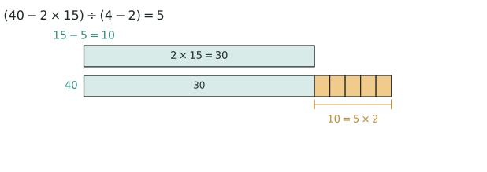

## 讲解

> 上面一条是“全是鸡”算出的脚数 $2\times15=30$；下面一条是实际的 40 只脚，多出来的橙色 5 小段每段 2 只脚，一段就是一只兔换来的。差的 10 只脚除以每只 2 只，得 5 只兔，剩下 $15-5=10$ 只才是鸡。

**模型**：鸡和兔同在一个笼子里，已知**总头数**和**总脚数**，求鸡、兔各几只。鸡 2 只脚，兔 4 只脚。

**假设法**（标准解法）：假设全是鸡：
$$\text{兔} = (\text{总脚数} - 2 \times \text{总头数}) \div (4 - 2)$$
思路：全当鸡算，脚数不够，每把一只兔当成鸡就少算 2 只脚，少的脚数 ÷ 2 = 兔的只数。假设全是兔同理（脚数多了，多的 ÷ 2 = 鸡）。

把上面的式子抽象下来，就是一句走遍变式的通式：**单位数 = 总差 ÷ 单位差**，其中"总差"是假设出来的总量与题目给的真实总量之差，"单位差"是两类对象每个相差多少。所有鸡兔同笼类题目都是先造一个"全是某一类"的世界，再用这一句话换回来。

**抬脚法**（巧解）：让每只鸡抬起 1 只脚、每只兔抬起 2 只脚，总脚数减半，此时鸡的脚数 = 头数，兔还剩 2 只脚，兔数 = 半脚数 − 头数。

**变式**：答对答错计分、大小船载客、晴天雨天运货——凡"两类事物、两个总量"都可套假设法。

## 竞赛真题中的考察

- **2024 IHC 6 培训 第 61 题**：不定方程（整数解）（★★★）

> 完整题目与解答见仓库 `exam/answers/` 对应试卷文件；跨卷汇总见 `exam/SUMMARY.md`。

<!-- card:auto -->
## 速查卡

> 裁剪即用：本页对应速查卡「应用题 03背」。下面是本节最紧的一版摘要，公式与结论与正文完全一致，用于做题前扫一遍。全套卡片见 `tools/cards/build/cards.html`。

**核心公式**

$$\text{单位数}=\text{总差}\div\text{单位差}$$

- 假设全是鸡：$\text{兔}=(\text{总脚}-2\times\text{总头})\div(4-2)$
- 假设全是兔同理：多出的脚数 $\div2$ 就是鸡的只数
- 总差要同类相比：脚比脚、分比分，不能拿脚减头

**单位差怎么定**

- 同向都用得到取减：$|4-2|=2$
- 一得一失取加：答对 $+10$、答错 $-2$，单位差是 $12$
- 抬脚法：脚数减半，兔数 $=$ 半脚数 $-$ 头数
- 三类对象先按配比打包成两类，再一次假设

> ✅ 识别信号：两个总量、两类对象——头数脚数、题数得分、运费赔偿
> ⚠️ 易错：单位差加减不分；答错倒扣时是 $10+2=12$ 不是 $8$
<!-- /card:auto -->

## 例题

### 例1：假设法
**题目**：笼子里有鸡和兔共 35 只，脚共 94 只。鸡和兔各有多少只？

**覆盖点**：假设法

**解析**：假设全是鸡，应有 $2 \times 35 = 70$ 只脚，少了 $94 - 70 = 24$ 只。每只兔少算 2 只脚，兔 $= 24 \div 2 = 12$ 只，鸡 $= 35 - 12 = 23$ 只。检验：$23 \times 2 + 12 \times 4 = 94$ ✓

**答案**：鸡 23 只，兔 12 只

### 例2：变式——答题计分
**题目**：一次竞赛共 10 道题，答对一题得 10 分，答错一题倒扣 2 分。小明得了 76 分，他答对了几道题？

**覆盖点**：鸡兔同笼变式

**解析**：假设全对得 $10 \times 10 = 100$ 分，多了 $100 - 76 = 24$ 分。每错一题不仅少得 10 分还倒扣 2 分，相当于差 $10 + 2 = 12$ 分。答错 $24 \div 12 = 2$ 道，答对 $10 - 2 = 8$ 道。

**答案**：答对 8 道

## 变式与自测

> 四道题按「模仿 → 变式 → 综合 → 自测」排。先盖住答案自己做，做完再对；对不上，先查"单位差"是取减还是取加——一得一失要用加号。

### 变式1：20 只 56 只脚（★）

**题目**：笼子里有鸡和兔共 $20$ 只，脚共 $56$ 只。鸡和兔各有多少只？

**覆盖点**：假设法

**解析**：假设全是鸡，脚数会短少，短少的部分正是兔"藏起来"的那两只脚换来的。总差除以单位差（$4-2=2$）就得到兔数，剩下的自然都是鸡。

$$(56-2\times20)\div(4-2)=16\div2=8\ (\text{兔}),\qquad 20-8=12\ (\text{鸡}).$$

**答案**：鸡 $12$ 只，兔 $8$ 只。

### 变式2：运花瓶的赔偿（★★★）

**题目**：运输队运送 $100$ 个花瓶，完好运到每个可得运费 $3$ 元，损坏一个不但不给运费，还要赔 $5$ 元。运完后运输队共得运费 $260$ 元。损坏了几个花瓶？

**覆盖点**：鸡兔同笼变式

**解析**：这是"一得一失"的典型，单位差必须**相加**：损坏一个，不但那 $3$ 元运费拿不到，还要倒赔 $5$ 元，一来一去相差 $3+5=8$ 元。只写 $5-3=2$ 是本题最常见的错。

假设全部完好，应得 $300$ 元，实际少得 $300-260=40$ 元。

$$40\div(3+5)=5\ (\text{个}).$$

**答案**：损坏了 $5$ 个花瓶。

### 变式3：鸡比兔的 2 倍多 3 只（★★★★）

**题目**：笼子里有鸡和兔，鸡的只数比兔的 $2$ 倍多 $3$ 只，一共 $86$ 只脚。鸡和兔各有多少只？

**覆盖点**：鸡兔同笼变式

**解析**：这道题串了**「和倍问题」**：条件里没有"总头数"，却给了倍数关系，正好用"设 $1$ 份"来补位——把兔看成 $1$ 份，鸡就是 $2$ 份还多 $3$ 只，脚数就能写成只含一个未知数的式子。

$$4x+2(2x+3)=86\ \Longrightarrow\ 8x+6=86\ \Longrightarrow\ x=10 .$$

所以兔 $10$ 只、鸡 $2\times10+3=23$ 只。若把"多 $3$ 只"错记成"少 $3$ 只"，会得到 $8x-6=86$ 即 $x=11.5$，只数不是整数，数据立刻报错——这就是设元后要检查整数性的原因。

**答案**：兔 $10$ 只，鸡 $23$ 只。

### 自测：20 道题的得分（★★★）

**题目**：一次数学竞赛共有 $20$ 道题，答对一题得 $5$ 分，答错一题倒扣 $3$ 分，不答不得分也不扣分。小华每道题都作了答，共得 $68$ 分。他答对了几道题？

**覆盖点**：假设法

**解析**：本篇核心结论是"**单位数 $=$ 总差 $\div$ 单位差**"。答错一题，$5$ 分拿不到还要倒扣 $3$ 分，所以单位差是 $5+3=8$ 分。

假设 $20$ 道全对，应得 $100$ 分，实际少 $100-68=32$ 分：

$$32\div(5+3)=4\ (\text{道错}),\qquad 20-4=16\ (\text{道对}).$$

回代验算：$16\times5-4\times3=80-12=68$ 分 ✓，且 $16+4=20$ 道，与"全部作答"一致。

**答案**：他答对了 $16$ 道题。
